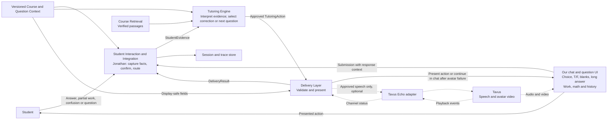

# Tutoring Experience and Delivery Layer

Version: 0.2 proposal for team review  
Research reviewed: 12 October 2026  
Proposed delivery owner: Yining Li  
Primary handoff partner: Jonathan Ma, Student Interaction and Interaction Integration

## 1. Purpose and scope

The Delivery Layer presents an externally selected `TutoringAction` to the student and reports what was presented. The Tutoring Engine remains responsible for interpreting student evidence, choosing support, generating questions and instructional content, grading, and deciding what happens next.

**V1 recommendation:** build the assessment-based experience in our own application using persistent text, rendered mathematics, and the existing student-input components. Specify and prototype Tavus Echo as an optional avatar adapter after the shared handoffs are stable. An avatar is not a V1 release dependency. Speech, video, and richer presentation must use the same approved action as the text interface.

A successful V1 slice is: present a question → capture an attempt → receive an engine-selected hint or explanation → capture a revision → present an engine-selected comprehension check. Every response must link back to the question, action, and delivery that elicited it.

This document defines behavior and proposed contracts, not an implemented integration. Tavus capabilities below are confirmed from public documentation; no authenticated API or live avatar tests were performed. Revision 0.2 incorporates the supplied question-display and interaction/reaction notes: four V1 question formats, engine-selected concept correction and Socratic questioning, and continuity in chat if the avatar fails. Fallback timing remains provisional.

### Existing work and how it informs this specification

The reviewed repository snapshots are pinned so findings remain traceable:

| Source | Observed contribution | V1 consequence |
|---|---|---|
| [Assessment prototype][r-assessment], Jonathan branch at `5cc7c8773909b8b99410ac0a9a084cd58a64b7e5` | Sources/settings/chat UI, rendered math, upload, sketchpad, recorded speech, recognition correction and telemetry. README explicitly leaves quiz generation and grading to future work. | Reuse input and rendering machinery; introduce action/session contracts instead of describing the prototype as an adaptive tutor. |
| [Architecture design][r-architecture] and [October interaction update][r-interaction] at the same revision | Separate evidence, learner state, tutoring decisions, and delivery. Jonathan routes evidence and trace; Yining expresses selected actions. | Preserve these boundaries and return delivery results to Interaction Integration. |
| [Specification plan][r-spec-plan], integration-spec branch at `878081366d3bcb161e4fbc4c68af8e3b89a3d88f` | Versioned contracts, configurable logging, page/line grounding; recommends deferring live avatar interaction. | Follow its nine module sections. Use the requested filename `tutoring-delivery.md` in place of its proposed `delivery.md`; avoid maintaining two competing specifications. |
| [Avatar tryouts][r-avatar], Yining branch at `4b02b3c3644b9d28e5dc9e456a5bfcd998dab291` | Records a Tavus deployment link. It contains no exported configuration, transcript, API traces, or timing results. | Evidence of an existing experiment reference; it does not prove engine-controlled delivery or measured reliability. |
| [Chain-rule procedure][r-chain-prompt] and [flowchart with prompt appendix][r-chain-pdf], same Yining revision | Product-rule confusion, valid expansion, missing inner derivative, retry, and transfer paths. | Reuse the scenarios in §8; the engine selects a branch and delivery presents a single action. |
| [Product workflow ideas][r-workflow] and [progress presentation source][r-presentation] | Teach-back, interactive problem solving, checks, course sources, future avatar sessions, slides, flashcards, infographics, mind maps and tables. | Include teach-back and worked-step interactions; defer separate content-generation studios. |
| [Question display and interaction/reaction notes, IMG_1713][r-display-notes] | Multiple choice, true/false, fill-in-the-blank and long-answer questions; flashcards deferred. Concept correction, identifying the sticking point, and a Socratic question ladder are proposed reactions. | Define question formats separately from tutoring actions; route observable work and student requests to the engine before presenting its selected reaction. |
| [Avatar fallback notes, IMG_1714][r-fallback-notes] | Continue with a chatbot if the avatar does not work; retain what is already available. A backup avatar is an ideal future option. | Continue in our existing chat/work interface with the same session, action, work and history. Defer backup-avatar switching. |

The RTF and PDF chain-rule procedures are variants, not identical transcripts: their branch wording and final transitions differ. Neither constitutes a measured Tavus run. The normative delivery behavior is defined here; the original procedures remain research inputs.

## 2. Responsibilities

### Ownership boundaries

| Layer / proposed owner | Owns | Does not own |
|---|---|---|
| Tutoring Engine / shared engine owners | Learner-state interpretation; action selection; exact instructional content; permitted assistance; expected response; correctness and progression decisions | UI rendering or microphone/upload mechanics |
| Delivery / Yining | Action validation; text/math rendering; response-control presentation; optional narration/avatar dispatch; presentation status; exact content provenance | Diagnosing a misconception, choosing the next question, increasing hint depth, grading, or inferring mastery |
| Student Interaction and Integration / Jonathan | Capture widgets and submission API; recognition; ambiguity confirmation; evidence construction; routing; durable turn and revision links | Changing the mathematical meaning of student work or independently selecting the intervention |
| Course/Question Context / Ovunc | Versioned course/question meaning, response requirements, permitted support and display-safe context | Presentation transport |
| Retrieval / Sean | Verified passages and versioned source locations | Inventing citations or assessing understanding |
| Session persistence / shared, coordinated with Jonathan | Action, submission, delivery and revision history; active session recovery | Treating playback completion as evidence of learning |
| Tavus adapter / Delivery | Translate approved narration into provider messages; correlate events; report channel failures | Run a parallel tutoring policy |

Delivery composes Jonathan's input widgets into the student screen. The widgets emit submissions to his capture service. This resolves the specification plan's phrase “returns the student's next response”: delivery supplies the response context and visible controls; Interaction owns the accepted submission, recognition, and evidence.

### Action preservation rules

1. Render only the selected action's approved student-visible content. Preserve its question, ordering, mathematical meaning, disclosure level, and response requirements.
2. Do not let an avatar or presentation LLM add praise implying correctness, extra hints, answers, examples, questions, or transitions.
3. A student's **Hint** or **Explain** button emits a request to Interaction → Engine. It does not locally choose or generate the requested action.
4. Use deterministic formatting and approved speech text. If content or pronunciation is missing, return a validation/channel issue; do not invent a teaching response.
5. Never include private rubrics, answer keys, diagnosis, or engine rationale in the browser-visible payload or avatar prompt.
6. Content generation may live in an upstream engine-owned content service. A bare instruction such as “give a hint about the chain rule” is insufficient for V1 delivery.
7. Question format, student interaction and tutoring reaction are separate: a multiple-choice card is a presentation format; an answer or “I'm stuck” is input; a concept correction or next Socratic question is an engine-selected action.

## 3. Dependencies

V1 requires an engine that supplies complete approved actions, versioned display fields from Course/Question Context, Jonathan's capture/recognition services, a session store, the existing Markdown/KaTeX renderer, and resolvable source references. Preferences and permitted input methods come from session configuration.

### Changes from the runnable prototype

The current [frontend contracts][r-types] and [API client][r-api] exchange a question with `/api/chat` and receive a `TutorResponse` containing `answer_markdown`, assumptions, citations and a comprehension check. That response is not yet the proposed action contract.

| Existing behavior | Required integration change |
|---|---|
| Render `answer_markdown` and a comprehension check together | Have the engine approve discrete action blocks. A check becomes its own action and response context. |
| Send a question plus recognition metadata to `/api/chat` | Route an identified submission through Interaction and Engine; retain question, attempt and delivery links. |
| Editable research tutoring instructions influence response generation | Apply the selected action's approved content and constraints in the student experience. |
| Reusable recognition and Markdown/math components | Retain those components; add the action presenter and delivery ledger around them. |

Do not relabel every existing chat response as `EXPLAIN` automatically. Its intent and any follow-up question must be selected and approved upstream.

### Proposed student experience

1. **Enter an assessment.** Show the confirmed course, selected section, objective and difficulty supplied by the assessment workflow. Course setup and quiz creation are upstream. Display only verified progress; do not invent a fixed question count for an adaptive session.
2. **Read one active prompt.** Keep its question and equations visible while the student works. Render its supplied format: multiple choice, true/false, fill-in-the-blank, or long answer. Initial assessment questions use `PROBE`; the student sees “Question,” not the internal action name.
3. **Respond or ask for help.** Select an option, enter blank values, or submit typed/recognized work as appropriate. Reuse handwritten image/PDF upload, simplified sketchpad and recorded speech through Jonathan's recognition-and-review flow. “I'm stuck” and “Ask about this step” remain available without requiring a complete answer. Preserve the draft while a request is pending.
4. **Confirm uncertain recognition.** Show the original artifact beside the interpreted text, with “Confirm” and “Edit.” This is recognition UI, not a teaching action or a correction of the student's mathematics.
5. **Receive support.** When the engine returns an action, show it beside the original question and prior attempt. This may ask where the student is stuck, correct a diagnosed concept, or present the next Socratic question. A hint reveals only the approved hint; an explanation contains only its approved steps.
6. **Revise or explain.** A retry opens a new attempt linked to the original. A check asks for reasoning or application. “Continue” acknowledges reading; it never establishes comprehension.
7. **Continue or finish.** Only the engine/session workflow chooses another action, a new question, or the final summary. Delivery renders the supplied summary and unresolved items.

### Question display formats

These formats describe how an action requests a response, not which teaching decision to make. A `PROBE` or `CHECK_UNDERSTANDING` can use any supported format; a `HINT` may elicit a short written explanation. The engine/Question Context supplies the format, options, blanks and reasoning requirement.

| Format | V1 student-facing behavior | Submission and constraints |
|---|---|---|
| Multiple choice (`single_choice`) | Render an engine-authored stem and labeled options, including math. Use a radio group with no preselected answer and an explicit Submit button. | Send the stable `option_id`, not just its display position. Keep labels/order fixed for the attempt. Do not reveal correctness on selection. V1 assumes one choice; multi-select is deferred pending a separate requirement. |
| True/false (`true_false`) | Render the statement and labeled True/False choices, neither selected initially. Include a reasoning field when requested. | Send a boolean and any explanation. A click becomes an answer only on Submit; delivery does not score it. |
| Fill-in-the-blank (`fill_in_blank`) | Embed labeled text/math fields at the approved positions. Provide TeX preview for mathematical entries and keyboard access in reading order. | Send each field's value with its stable `blank_id`; retain empty fields in a partial submission. Validate shape only. Mathematical equivalence, units and correctness belong to the engine. |
| Long answer (`long_answer`) | Show a text/TeX work area and optional upload, sketchpad or recorded-speech controls. Support separate labeled parts where the question requires them. | Preserve the original answer, work and confirmed recognition. No requirement to match a single canonical wording. |
| Flashcards | Deferred | Do not add flip-to-reveal, self-grading or spaced repetition to V1. |

The UI may check whether required fields are populated before a normal Submit. A separate “Submit partial work” or “I'm stuck” path must remain possible. Neither an unanswered field nor an incorrect option alone proves a conceptual misunderstanding.

### Screen proposal

```text
Calculus / Chain rule                 Session progress from engine
------------------------------------------------------------------
Question                           | Tutor support
d/dx (x² + 1)³                     | Hint
Explain your approach.             | Identify the inside function.
                                   | What is its derivative?
Your previous attempt              |
3(x² + 1)²                         | [Optional avatar panel]
                                   | [Stop audio] [Replay]
Your response: long answer         |
[Text / TeX editor and preview]    | Source links, when supplied
[Upload work] [Draw] [Record]       |
[Submit] [Submit partial work]      |
[I'm stuck] [Ask about this step]   |
[Request hint]                     |
------------------------------------------------------------------
Attempt and intervention history / recognition and delivery status
```

The response region changes to option controls, True/False choices or embedded blank fields for the other formats. The question, current work, help controls and history stay in place. On small screens, stack the same regions with the active prompt above the response controls. Avatar video must not cover the mathematics or the submission controls. Provider keys, model tuning, raw telemetry, and editable teaching prompts belong in research/admin settings.

### V1 scope

| Capability | Decision | Requirement or reason |
|---|---|---|
| Persistent prompt, text, rendered inline/display math, ordered worked steps | Required | Students can inspect expressions while solving and after narration. |
| Multiple choice, true/false, fill-in-the-blank and long-answer rendering | Required | Use the selected question format and stable response identifiers. |
| Typed answers, explanation field, TeX preview, explicit submit | Required | Establish a clear answer boundary and retain reasoning. |
| Image/PDF work upload and simplified sketchpad | Include through existing Interaction components | Recognition and confirmation stay with Jonathan. |
| Recorded speech to editable text | Include one simple mode through Interaction | Matches the integration plan; no continuous voice conversation required. |
| Engine-authored hints, explanations, retries, probes and checks | Required | One approved intervention at a time. |
| Concept correction, sticking-point questions and Socratic question ladders | Required interaction patterns | Reuse engine-selected actions; no extra autonomous policy in delivery. |
| Partial-work submission and explicit confusion/concept-question controls | Required | Ask for support without losing the current attempt or fabricating an answer. |
| Attempt history, source links, pending/error states, resume | Required | Make assistance and revisions inspectable. |
| Keyboard operation, clear focus, accessible math representation and readable text at zoom | Required | No learning content available only in audio/video. |
| Plain tables or a supplied static figure when referenced by an action | Basic renderer support where already available | No automatic diagram creation; do not accept an action requiring an unsupported visual. |
| Read-aloud and Tavus avatar | Optional integration spike | Do not gate the core V1 on unverified playback/turn-taking behavior. |
| Avatar failure → existing chat/work interface | Required whenever the optional avatar is enabled | Preserve session and work; backup-avatar/provider switching is deferred. |
| Live voice/video, gaze/emotion-driven adaptation, gestures, synchronized highlighting | Defer | Additional interaction, timing and evaluation work. |
| Generated slides, infographics, mind maps, audio/video overviews, spaced-repetition flashcard product | Defer | Useful later; a simple question card already supports the V1 checking pattern. |

The flashcard idea's binary score is not a delivery rule. Correctness and evidence of understanding remain engine outputs.

## 4. Inputs

All types below are proposed application contracts, not Tavus API schemas. Reconcile them into the shared `interfaces.md` before implementation. Logical operations can initially be in-process functions; this specification does not require new microservices.

### TutoringAction

Producer: Tutoring Engine. Consumer: Delivery, routed by Interaction Integration.

| Field | Required | Meaning |
|---|---|---|
| `schema_version` | Yes | Proposed contract version `0.2`, including question-format and student-interaction fields. |
| `action_id`, `session_id`, `turn_id`, `trace_id` | Yes | Immutable action identity and links to the tutoring turn. |
| `sequence` | Yes | Session-assigned increasing action order. Reject stale dispatches. |
| `course_ref`, `question_ref` | Yes | Stable ID and version; the question reference also binds attempts to the original problem. |
| `based_on_evidence_ids` | Yes, may be empty | Evidence that led to selection; references only, not learner diagnosis to display. |
| `action_type` | Yes | `PROBE`, `HINT`, `EXPLAIN`, `RETRY`, or `CHECK_UNDERSTANDING`. |
| `goal` | Yes | Engine intent for trace and validation; not displayed unless separately included in content. |
| `presentation` | Yes | Title and ordered, approved content blocks, plus language. Every block has a stable ID. |
| `presentation.speech_text` | Conditional | Required for narration. A separately approved spoken equivalent of the visible content. |
| `constraints` | Yes | `content_policy: verbatim`, `answer_disclosure: none/partial/full`, `allowed_controls`; optional hint level and explicit prohibited additions. |
| `response_spec` | Yes | Unique response-context ID; expected kind; question format and field definitions when an answer is requested; allowed input modes; explicit-submit requirement; prior-attempt link when revising. |
| `response_spec.question_format` | For substantive answers | `single_choice`, `true_false`, `fill_in_blank`, or `long_answer`. Omit for acknowledgment-only actions. Independent of `action_type`. |
| `response_spec.require_reasoning` | For substantive answers | Whether an explanation accompanies the selected option, blank values or written answer. |
| `response_spec.fields` | For substantive answers | Stable `field_id`, student-visible label, input kind and required flag for each answer/explanation part; enables multi-part checks. |
| `presentation.options` / `presentation.blanks` | Format-dependent | Choice IDs and approved label blocks, or blank IDs mapped to answer field IDs and explicit locations in approved content blocks. No answer key. |
| `workflow_ref` | Optional | Engine-supplied ladder ID and step ID for traceability. Does not give delivery permission to select or reveal later steps. |
| `sources` | Yes, may be empty | Approved citations with document/version, page, normalized line range, passage ID and viewer link. Include grounding status. |
| `supersedes_action_id` | Optional | Explicitly replaces an older action. Does not erase its delivery history. |

Content blocks in V1: `markdown` (safe prose and lists), `math` (LaTeX plus accessible text), and optional `asset_ref` (approved image with alt text). References to a prior attempt retain its original content; incorrect student expressions must be visibly labeled as student work.

For `single_choice`, each option has `option_id` and approved label blocks; for `true_false`, the standard control submits a boolean. A blank has `blank_id`, `field_id`, `block_id` and a unique placeholder token in that block, so the renderer does not guess where the field belongs. Each answer field declares a supported input kind: `choice`, `boolean`, `text`, `math`, or `work`. Required reasoning must have a designated text/work field. Keep accepted answers, scoring weights, distractor diagnoses and subsequent ladder steps upstream.

The display-safe Question Context supplies the persistent prompt, question version, objective label, permitted input methods, and any required asset references. The full rubric and correct answer remain upstream. Delivery may intersect requested channels with available capabilities, but cannot weaken pedagogical constraints.

### SessionDeliveryContext

Producer: Interaction Integration / session service. Consumer: Delivery.

- Active session and question identities; accepted action sequence; validated context version.
- Supported presentation/input capabilities, locale, accessibility preferences and requested channels.
- Authorized response endpoint/context binding and prior visible attempt references.
- Optional Tavus conversation mapping, held by the adapter; no provider API key in browser configuration.
- Diagnostic logging preference and policy-approved storage references.

### Validation

Validate identity, versions, action type, sequence, required blocks, math syntax, source-reference shape, and response/control compatibility before exposing content. A `RETRY` requires a prior-attempt link. A `PROBE` or `CHECK_UNDERSTANDING` requires a substantive answer mode. An explanation can request an acknowledgment; a later comprehension question requires a separately selected action.

Validate unique field/option/blank IDs, existing block/field references, exactly one occurrence of each blank placeholder, and format-compatible controls. Reject unknown question formats or missing options/fields instead of guessing a layout. Input validation must preserve `false` as a valid True/False response and distinguish an empty blank from a submitted zero.

Reject missing approved content as `INVALID_ACTION`; unknown types or required capabilities as `UNSUPPORTED_ACTION`; outdated sequences as `STALE_ACTION`. Treat duplicate `action_id` with identical content as an idempotent redelivery and return existing status. The same ID with different content is `ACTION_CONFLICT`.

Delivery checks presentation constraints mechanically; it cannot prove a hint is pedagogically sufficient or free of answer leakage by reading its label. The engine must validate content against its policy before approving it. If delivery detects a contradictory disclosure flag or unsafe rendering, it returns an error instead of rewriting the action.

## 5. Functions and expected behavior

### High-level delivery and avatar integration



Solid paths are the required V1 loop. Dotted paths are the optional avatar integration. A student answer always enters Interaction before the engine selects a response.

Question format controls the UI. Student interactions become factual evidence; the engine interprets that evidence and selects a reaction. The same approved action remains on screen when avatar delivery falls back to chat.

### Logical operations

| Operation | Behavior |
|---|---|
| `prepare_action(action, context)` | Validate and construct an immutable, display-safe presentation plan; no content generation. |
| `present_action(plan)` | Render approved blocks, publish response controls and emit delivery events. |
| `deliver_narration(plan)` | Optional: send approved speech to the selected adapter while retaining the same visible content. |
| `interrupt_delivery(delivery_id)` | Stop output when requested or superseded; record partial presentation. |
| `replay_delivery(delivery_id)` | Replay the same approved content on explicit request with a new playback-attempt ID; no new teaching action. |
| `report_delivery(event)` | Return correlated status and presentation provenance to Interaction Integration. |

### Action presentation

| Action | What the student receives | Response and boundary |
|---|---|---|
| `PROBE` | A question or request to explain an approach, with its supplied equation or comparison | Capture the answer/reasoning. Do not show the answer or classify the response. |
| `HINT` | A short bounded cue tied to the active question or supplied student step | Keep the original prompt visible; request only the response specified by the engine. Never expand into a solution. |
| `EXPLAIN` | A supplied concept explanation or worked steps, with approved disclosure level | Present all approved steps in order. Do not append the prototype's automatic comprehension question. |
| `RETRY` | A clear request to revise a specified attempt, optionally identifying the engine-selected issue | Create a revision submission linked to that attempt. Do not count transport retries as learning attempts. |
| `CHECK_UNDERSTANDING` | An engine-authored teach-back, rule-selection or transfer question | Capture its reasoning as new evidence. Playback, acknowledgment and self-reported confidence are not mastery. |

### Student interactions and tutoring reactions

The handwritten notes propose three response patterns. The table separates what can be captured from the teaching decision: “misunderstands the concept” is an engine interpretation, while the submitted reasoning, partial work or explicit confusion report is evidence.

| Observed student interaction | Engine-selected reaction | What delivery presents |
|---|---|---|
| An answer/explanation provides evidence of a conceptual misunderstanding | Diagnose against the question/context; choose concept correction through `EXPLAIN`, or a targeted `PROBE` if the evidence is insufficient. A later `CHECK_UNDERSTANDING` verifies the concept. | The approved explanation addresses the specific concept and preserves the student's original work. No generic “wrong” message or answer reveal is generated locally. |
| The student says they are confused, selects “I'm stuck,” or submits only part of their work | Choose a sticking-point `PROBE`, for example “Which step are you unsure about?” Then choose a bounded hint, explanation or retry based on the response. | Keep partial work visible and editable. Ask the approved clarification without treating the unfinished answer as automatically incorrect. |
| The student asks about a particular concept, step or problem | Choose the next question in a Socratic ladder: clarify the target → elicit the relevant concept → ask for one application step → invite revision → check transfer, as appropriate. | Present only the current approved question, wait for its answer and route that answer back. Further questions and hints require new engine actions. |

The ladder is an interaction pattern, not a fixed script the renderer executes. The engine may skip, repeat, explain or stop according to the evidence and assistance policy. It must avoid an endless questioning loop when the student needs direct explanation. Exact escalation rules and any additional reaction categories remain open for team review, consistent with the notes' “to be decided” list.

Partial work can mean uncertainty, interruption or an intentional intermediate submission. Do not infer confusion merely from an incomplete draft, a pause, a facial expression or an answer length. Capture explicit statements faithfully; ask for clarification when the engine determines that more evidence is needed.

### Text, math, speech and avatar behavior

- **Text:** render approved content after validation; retain it in session history. Do not expose model tokens before approval. Formatting can change wrapping and styling, never wording or meaning.
- **Mathematics:** reuse the prototype's Markdown/`remark-math`/`rehype-katex` path with safe rendering. Preserve exponents, grouping, signs and step order. Supply accessible text/MathML and a raw TeX inspection option. A meaning-critical rendering failure returns `RENDER_FAILED`; do not silently omit the expression.
- **Speech:** use the engine-approved `speech_text`, verbalizing grouping clearly, for example “the quantity x squared plus one, raised to the third power.” Do not synthesize raw LaTeX or read citation URLs. Voice choice and speed are presentation preferences; content and mathematical pronunciation are constrained.
- **Avatar:** speak that same narration. Keep equations and any visual reasoning on our work surface. Record readiness, speaking, completion or interruption. Do not assume expression pointing, word-level synchronization, or mathematical board writing.
- **Student controls:** Stop and Replay affect delivery only. Submit, Submit partial work, Request hint, Explain, “I'm stuck” / “I'm not sure,” and “Ask about this step” enter Interaction as explicit input/request events. When submission occurs during speech, stop current narration; keep its actual exposure status and route the response.
- **Turn control:** one active response context per session. A newer action cancels any older queued narration. Persist submitted work before clearing the editor, and deduplicate repeated Submit requests at the capture boundary.

### Tavus feasibility

**Conclusion:** Tavus is documented to support controlled avatar output. Our preferred design is a custom assessment UI plus Echo; using a third-party tutoring persona by itself does not establish integration with our engine. Public API support is confirmed; end-to-end fitness remains to be tested.

#### Three integration patterns

| Pattern | Where the teaching decisions happen | Fit |
|---|---|---|
| Standalone Tavus tutor / default full pipeline | Tavus conversation model and configured instructions manage the dialogue | Useful for testing presentation and conversational feel. Insufficient evidence that our assessment/evidence/action loop is preserved. |
| Full pipeline with our custom completion endpoint | Our endpoint can invoke our workflow, while Tavus still manages its conversational pipeline and invokes the endpoint | Feasible alternative with a compatibility adapter, final-input gates, state binding and duplicate protection. More integration coupling. |
| Our application plus Echo | Our engine selects and writes actions; Tavus receives only their narration | Recommended avatar spike. Our system also owns input recognition and turn sequencing. |

Embedding is a UI choice, not proof of who controls tutoring. Current hosted embed/widget APIs can send typed interactions and expose lifecycle/protocol events. A plain string passed to `sendMessage` becomes `conversation.respond`; an explicit Echo interaction is needed for supplied narration. Hosted integrations are not categorically uncontrollable. [Tavus host communication][t-host]

#### Confirmed public capabilities

| Capability | Documentation confirms | Implication for us |
|---|---|---|
| Session API | `POST /v2/conversations` returns a conversation ID/URL; supports callback URL and private-room tokens. Current naming uses PAL and Face. [Create conversation][t-create] | Backend owns creation/authentication and maps the provider conversation to our session. Check compatibility with older Persona/Replica experiments. |
| Direct output | `conversation.echo` speaks supplied text or audio. [Echo][t-echo] | Can present an externally generated question, hint, explanation or retry without asking the Tavus LLM to compose it. |
| Echo tradeoff | Echo bypasses much of the pipeline; alternate modes are incompatible with Tavus perception and speech recognition layers. [Pipeline modes][t-modes] | Do not assume Echo also captures/transcribes the student's answer. Retain Jonathan's pipeline. |
| Generated response | `conversation.respond` treats text as a user utterance to answer. [Text Respond][t-respond] | It is not an exact-delivery API for an approved tutoring action. |
| Custom backend | An SSE-streaming `/chat/completions` endpoint with model, base URL and API key is supported. Headers/extra request settings are configurable. [LLM layer][t-llm] | Requires a protocol adapter; our current `/api/chat` JSON response is not a drop-in replacement. |
| Transport and output events | Daily WebRTC app messages send interactions; event ordering/correlation fields are documented. Audio Echo accepts base64 audio with a sample rate and final-chunk marker. [Interaction protocol][t-protocol] | Keep provider transport IDs separate from our action IDs; verify Echo-specific correlation and chunk limits. |
| Interrupt and speaking state | Explicit interrupt is supported. Speaking events include role; stopped events include interruption state/duration. Legacy `replica` duplicates accompany `pal` events. [Interrupt][t-interrupt], [Speaking events][t-speaking] | Stop/replay controls are plausible. Normalize duplicate events and distinguish completion from interruption. |
| Transcript events | Utterance events report speaker and text. [Utterance][t-utterance] | Useful evidence of output when available; do not assume all full-pipeline transcript behavior carries over to Echo. |
| Tool integration | Tools can reach our frontend via app messages or backend via HTTPS, with a result path. Tool app messages have a documented 4 KB limit. [Tool delivery][t-tools] | Workflow hooks exist, but model-invoked tools alone do not enforce our action policy. |
| Presentations | A skill presents processed PDFs up to 50 pages and images; the slide is a screen-video track. [Presentation skill][t-presentation] | This is available presentation functionality, but exact external slide/action control in Echo is unverified and deferred. |
| Interactive cards | Magic Canvas has question, input and display cards; the PAL chooses when to show them, with no per-card trigger API. [Magic Canvas][t-canvas] | It is not the deterministic action-card renderer needed here. Use our own UI for V1. |

Current Magic Canvas documentation also distinguishes API-created sessions with `callback_url` from hosted deployments: hosted embed/widget sessions lack that callback, and card taps are not host protocol events. Do not rely on a hosted card response as our durable assessment submission. [Magic Canvas][t-canvas], [Host communication][t-host]

#### What a custom model endpoint does and does not replace

The endpoint replaces the completion-generation boundary. It need not contain an LLM: Tavus explicitly permits compatible application logic. Therefore it can call our question generator, evidence workflow and Tutoring Engine, then return the selected narration as streamed assistant content. That is an architectural inference enabled by the documented endpoint, not a native `TutoringAction` feature. [Pipeline modes][t-modes], [LLM layer][t-llm]

Our adapter would need to:

1. Bind each authenticated provider request to the correct tutoring session and current response context.
2. Accept only a final, eligible student input; pass it through Interaction's confirmation/evidence path.
3. Invoke the engine once, persist its approved action, and send the structured presentation to our UI.
4. Return only that action's narration in compatible completion chunks.
5. Handle retries, cancellation, session recovery and deferred recognition without committing duplicate learner-state updates.

Custom-endpoint requests are not automatically our `StudentSubmission` or `TutoringAction`. Per-session metadata propagation, final-transcript markers, request cancellation and timeout behavior need a request-capture test. Configure `speculative_inference: false` for this assessment experiment; the documented default can initiate generation before speech ends. Disabling it does not itself establish exactly-once processing. [LLM layer][t-llm]

#### Proposed Echo adapter

Create an Echo-configured PAL and API-managed conversation, join it with the client SDK, wait for actual readiness, then submit approved narration through the documented interaction envelope:

```json
{
  "message_type": "conversation",
  "event_type": "conversation.echo",
  "conversation_id": "provider-conversation-id",
  "properties": {
    "modality": "text",
    "text": "Identify the inside function in the displayed expression. What is its derivative?",
    "done": true
  }
}
```

This example adapts the documented Echo payload. The `text` value comes from the approved action, never from a new avatar teaching prompt. Our adapter retains `action_id → delivery_id → playback_attempt_id → provider conversation/events`; it must not assume arbitrary application IDs are echoed back. [Interaction protocol][t-protocol]

For the spike, permit one utterance in flight and short complete scripts. Disable generative teaching features and verify that joining, idling and submitting answers do not trigger unsolicited speech. When event correlation is ambiguous, report playback as unknown and prevent stale output from being attached to a new action.

#### Input/output methods and remaining gaps

| Desired behavior | Available path | Limitation / test still needed |
|---|---|---|
| Exact approved narration | Echo text; optionally externally synthesized audio | Test added words, pronunciation, truncation, maximum payload and chunk ordering. |
| Spoken student answers | Full pipeline speech recognition, or our recorded-speech path | Echo does not supply the full recognition stack. V1 uses our path and explicit confirmation. |
| Typed answers and mathematical work | Our editor/upload/sketchpad; `respond` exists for full-pipeline chat | Never send our answer to a standalone tutor while the engine is also processing it. |
| Equations beside avatar | Our math renderer | No confirmed native guarantee of faithful LaTeX layout in avatar video. |
| One action, one status | Speaking/utterance events plus local ledger | Echo completion correlation, delivery acknowledgment and reconnect semantics are untested. Event emission does not prove audibility. |
| Rich presentation | Tavus presentations and Canvas are documented | External deterministic control, Echo compatibility and math fidelity are not established. |
| Four assessment formats and Socratic ladders | Our question controls plus one engine-approved action per turn; Echo narrates the action | V1 does not depend on Tavus generating questions, recognizing misconception categories or executing the ladder. |
| No autonomous pedagogy | Echo-configured integration | Verify greeting, idle prompts, interruption recovery and endpoint/configuration behavior in a live session. |

Before selecting an avatar for release, run an authenticated spike on the five example actions in §8, including interruption, duplicate dispatch and reconnect. Capture actual requests/events, compare spoken output with approved scripts, and measure readiness and speech-start latency. No vendor latency claim is adopted as our service target.

## 6. Outputs

### DeliveryResult

Producer: Delivery. Consumers: Interaction Integration and session trace; Engine may consume delivery failures/exposure when choosing its next action.

Required fields:

- `schema_version`, `event_id`, `event_sequence`, `action_id`, `delivery_id`, `session_id`, `turn_id`, `trace_id`.
- `status`: `ACCEPTED`, `PRESENTING`, `PRESENTED`, `PARTIAL`, `FAILED`, `CANCELLED`, or `REJECTED`.
- `channels`: text/math/avatar/speech statuses; requested versus used channels; observed start/end times; error codes where applicable.
- `content_ref`, `content_hash`, and `presented_block_ids`: a versioned record of exact delivered content. The hash is computed over a canonical stored presentation, not vendor transcript formatting.
- `response_context_id` and `input_state`: `CLOSED`, `AWAITING_RESPONSE`, or `SUBMITTED`.
- `occurred_at`, `reason_code` (nullable), and `retryable`.

Optional fields include playback-attempt ID, provider conversation/inference/sequence IDs, interruption reason, duration and transport diagnostics. Do not log tokens or API keys.

Each channel uses `NOT_REQUESTED`, `PENDING`, `PRESENTING`, `PRESENTED`, `INTERRUPTED`, `FAILED`, `CANCELLED`, or `UNKNOWN`. Record `started_at` and `ended_at` when observed; absent times mean unavailable evidence. Stop/Replay controls are shown only when the corresponding channel is enabled.

### Status semantics

`ACCEPTED` means validation passed, not that the student saw anything. `PRESENTING` indicates an active render/playback attempt. `PRESENTED` means the requested presentation was observed complete. `PARTIAL` means some requested content/channel was unavailable, interrupted, or could not be confirmed. Required text/math failure is `FAILED`; invalid input is `REJECTED`; superseded output is `CANCELLED`.

For text-only delivery, successful visible text/math render can reach `PRESENTED` while `input_state` remains `AWAITING_RESPONSE`. With optional avatar requested, text can be available and the avatar still presenting or failed; record both channel states. If text is complete but avatar playback is unconfirmed, report `PARTIAL`. Neither `PRESENTED` nor a vendor stopped-speaking event means “student understood.”

Progress events are append-only and ordered within a delivery. Replaying creates a new playback attempt; it cannot downgrade or overwrite the earlier attempt. A late provider event for a cancelled delivery is recorded as stale and cannot reopen its response controls.

### Student response handoff

Delivery supplies a response binding with `session_id`, `question_ref`, `action_id`, `delivery_id`, `response_context_id`, and, when relevant, `revises_submission_id`. Jonathan's capture service creates `submission_id`, preserves original artifacts/text, records input modality and timestamps, and handles recognition and confirmation.

The accepted submission becomes Student Evidence only through Interaction Integration. Its acknowledgment, not a vendor event, lets the UI show “Submitted.” Duplicate network requests return the same submission receipt. A request for help is labeled as a request, not scored as an answer.

The proposed v0.2 capture handoff adds:

| Field | Meaning |
|---|---|
| `submission_kind` | `answer`, `help_request`, `confusion_report`, `concept_question`, or `acknowledgment`. Determined by the explicit control used; interpretation of free text remains upstream. |
| `completion_status` | `complete`, `partial`, or `not_applicable`. Indicates submitted field completeness or the student's explicit partial-work choice, never correctness. |
| `answer_payload` | For answers: the question format and values keyed by the supplied field IDs. Choice values carry `option_id`; True/False carries a boolean; blank values carry `blank_id` and original text; written work carries text and/or artifact references. Reasoning uses its designated field. |
| `request_text` and `target_ref` | Optional raw request and reference to the existing question, step, block or blank the student asks about. Do not invent a target when none is supplied. |
| `draft_ref` | Optional reference to preserved work accompanying a help/confusion request. Saving a draft does not turn it into a scored attempt. |

Use `answer_payload: {question_format, fields}`, where `fields` is keyed by `field_id`. Each value contains `option_id` for a choice, `value` for a boolean, `blank_id` plus `text` for a blank, or `text`/`artifact_refs` for written work. The field definition determines which value shape is valid. Leave `answer_payload` absent on help-only requests; keep their unfinished values in the referenced draft.

Jonathan's service validates submitted IDs against the active response context. Selecting an option or typing into a blank updates a draft; it does not by itself submit or grade the answer. Capturing a help request must not erase that draft. If the engine selects a follow-up question while the main answer is unfinished, the UI saves the main-question draft, opens the follow-up response context and restores the draft when the engine returns to the main question.

For free text such as “I don't understand the inside function,” capture the exact wording without a fabricated diagnosis. Interaction/Engine may classify its intent with provenance; Delivery must not assign “misconception” or change the selected action itself.

### Avatar fallback to chat

The second note's fallback is the existing chatbot/work interface. “Chatbot” means our same engine-driven session presented through text and math, with all four question formats still available. It does not start a separate third-party tutor or reset the lesson.

Keep approved text/math available regardless of whether an optional avatar was requested. If the avatar is unavailable or fails, continue in chat with the same session, question, action, response context, selected options, blank values, work, draft, prior help and history. Show “Avatar unavailable. You can continue here,” and return a channel failure; do not regenerate the teaching content. If it is slow, offer “Continue in chat” and stop/expire the pending playback so it cannot speak after the student moves on.

Do not automatically replay uncertain speech after reconnect. Restore the current text action and let the student request replay. If the essential text/math cannot render, report failure to the engine and preserve the response draft rather than substitute a different explanation.

Delivery owns this mechanism; Jonathan's session store supplies the preserved state. Product/Delivery must agree later on timeouts, default channel preference and recovery UX with Jonathan. Switching to a backup avatar is a deferred enhancement, reflecting the note's ideal future behavior. It must eventually use the same approved action and history, but V1 requires no second provider or automatic avatar switching.

## 7. Logging and observability

Store the minimum operational ledger even when diagnostic logging is off: current action and immutable content/version, delivery attempts and channel outcomes, active response binding, accepted submissions and revision links. This is necessary to resume safely and account for help already shown.

Optional diagnostics record component/configuration versions, event timing, render errors, provider events, interruption cause, time to visible content, and time to speech. Keep raw provider transcripts separate from approved narration and confirmed student responses. Store controlled artifact references rather than copying student work into every event.

Track **delivered assistance**, not just action selection: distinguish a hint requested, a hint accepted for delivery, and a hint actually displayed. The engine decides how exposure affects assessment. Do not infer attention, effort, confusion or mastery from silence, gaze, playback duration or delivery status.

### V1 acceptance checks

| Check | Passing behavior |
|---|---|
| Five action types | Correct prompt/controls and identical approved content across display and optional narration. |
| Four question formats | Unselected choice/T/F controls; stable option and blank IDs; faithful math/work input; all answers route to the engine for grading. |
| Input shape edge cases | A False answer is accepted; a numeric zero is distinct from an empty blank; unknown IDs are rejected. |
| Interaction versus reaction | A misconception is diagnosed only upstream; partial work and “I'm stuck” remain factual inputs; the renderer never selects the correction. |
| Socratic ladder | Only the current approved step is displayed; each response returns to Interaction/Engine before another teaching action appears. |
| Help during an unfinished answer | Preserve the main draft while answering a targeted follow-up; restore it when the engine returns to the main problem. |
| Bounded hint | No final derivative or additional step appears when the action forbids it. |
| Recognition uncertainty | Original work retained; confirmation precedes evidence; no silent math repair. |
| Retry and check | Revision links to its prior attempt; comprehension answer links to its check action. |
| Duplicate/stale action | One visible action per ID; conflicting payload rejected; stale narration never resumes. |
| Input during playback | Output stops, draft persists, exactly one accepted submission is routed. |
| Rendering or avatar failure | Accurate per-channel result; no claim of successful presentation when it was not observed. |
| Avatar-to-chat continuity | The same question, format, selected values, work, action and response binding survive fallback; no duplicate answer or fresh tutoring session. |
| Citation availability | Supplied source opens at the versioned page/passage, or displays an explicit unavailable state. No invented page numbers. |
| Logging off | Diagnostic events stop; core session and response continuity still work. |
| Accessibility | Core assessment completes with keyboard and text, without audio, camera or avatar. |

These are proposed acceptance checks, not test results. The prototype's evaluation notes identify unsupported page citations and underspecified-request failures; delivery must preserve verified grounding status and cannot fix retrieval by inventing links. [Assessment evaluation][r-evaluation]

## 8. Representative tutoring examples

All five actions reuse the existing chain-rule scenario rather than introduce a new Calculus curriculum. They illustrate presentation after selection; the engine decides whether and when each occurs.

### A. PROBE: distinguish composition from multiplication

Source: Situation A in the [existing teaching prompt][r-chain-prompt].

- **Engine input context:** the student applied the product rule to `(x² + 1)³`.
- **Selected visible action:** “What structure calls for the product rule? Compare the two expressions. Which one is a product of two factors, and which has an outer operation applied to an inner expression?”
- **Math blocks:** `(x^2+1)^3` and `x^2(x+1)`.
- **Response:** typed or recognized explanation; preserve the original attempt.
- **Constraint:** ask about structure; reveal neither derivative.
- **Avatar:** speak the approved comparison while the two labeled expressions stay visible.

Mathematical clarification: expanding a power into repeated multiplication and using the product rule can be valid. The original prompt labels this a “wrong approach”; the engine must distinguish a genuine structural error from a valid longer method. Delivery must not independently mark every product-rule approach wrong.

### B. HINT: missing inner derivative

Source: Situation C. The student wrote `3(x² + 1)²` for the derivative of `(x² + 1)³`.

An illustrative action record:

```json
{
  "schema_version": "0.2",
  "action_id": "act-chain-hint-01",
  "session_id": "session-demo",
  "turn_id": "turn-03",
  "trace_id": "trace-demo",
  "sequence": 3,
  "course_ref": {"id": "calculus-demo", "version": "1"},
  "question_ref": {"id": "chain-rule-01", "version": "1"},
  "based_on_evidence_ids": ["evidence-attempt-01"],
  "action_type": "HINT",
  "goal": "Elicit the inner derivative without supplying it",
  "presentation": {
    "title": "Hint",
    "language": "en",
    "blocks": [
      {"id": "b1", "type": "markdown", "text": "Identify the inside function in the displayed expression. What is its derivative?"},
      {"id": "b2", "type": "math", "latex": "(x^2+1)^3", "accessible_text": "The quantity x squared plus one, cubed."}
    ],
    "speech_text": "Identify the inside function in the displayed expression. What is its derivative?"
  },
  "constraints": {
    "content_policy": "verbatim",
    "answer_disclosure": "none",
    "hint_level": 1,
    "allowed_controls": ["submit", "submit_partial", "report_confusion", "ask_about_step", "request_hint", "stop_audio", "replay"],
    "prohibited_additions": ["inner derivative", "final derivative", "additional hint"]
  },
  "response_spec": {
    "response_context_id": "response-hint-01",
    "expected_kind": "math_with_explanation",
    "question_format": "long_answer",
    "require_reasoning": true,
    "fields": [
      {"field_id": "inner_function", "label": "Inside function", "input_kind": "math", "required": true},
      {"field_id": "inner_derivative", "label": "Its derivative and your reasoning", "input_kind": "work", "required": true}
    ],
    "allowed_input_modes": ["text", "handwriting_upload", "sketchpad", "recorded_speech"],
    "explicit_submit": true
  },
  "sources": []
}
```

The scenario's provenance is this specification's source list; `sources: []` avoids inventing a course-note citation. In a real course, the engine supplies verified grounding references when required.

A corresponding text-only result, with the hash generated at runtime:

```json
{
  "schema_version": "0.2",
  "event_id": "delivery-event-03",
  "event_sequence": 3,
  "action_id": "act-chain-hint-01",
  "delivery_id": "delivery-hint-01",
  "session_id": "session-demo",
  "turn_id": "turn-03",
  "trace_id": "trace-demo",
  "status": "PRESENTED",
  "channels": {
    "text": {"requested": true, "status": "PRESENTED"},
    "math": {"requested": true, "status": "PRESENTED"},
    "avatar": {"requested": false, "status": "NOT_REQUESTED"}
  },
  "content_ref": "presentation:act-chain-hint-01:v1",
  "content_hash": "<sha256-of-canonical-presentation>",
  "presented_block_ids": ["b1", "b2"],
  "response_context_id": "response-hint-01",
  "input_state": "AWAITING_RESPONSE",
  "occurred_at": "2026-10-12T16:00:00Z",
  "reason_code": null,
  "retryable": false
}
```

### C. EXPLAIN: show the relationship without finishing the problem

Source: Situation C / Socratic path and MERGE in the [flowchart appendix][r-chain-pdf].

**Selected content:** “Let the inner function be $g(x)=x^2+1$ and the outer function be $f(u)=u^3$. The chain rule multiplies the outer derivative, evaluated at the inner function, by the inner derivative.”

Display $\frac{d}{dx}f(g(x))=f'(g(x))g'(x)$, followed by the engine-approved comparison to the student's missing factor. Use consistent $f(u)$/$g(x)$ notation instead of carrying forward the research prompt's ambiguous $u=f(x), v=g(x)$ wording.

**Response:** acknowledgment only for this action. If the engine wants the student to identify a derivative next, it sends a separate probe/check. **Constraint:** `answer_disclosure: partial`; do not add the full derivative. **Avatar gap:** the video cannot be assumed to point to a factor; our labeled math blocks supply that reference.

### D. RETRY: finish using the student's corrected inner derivative

Source: MERGE. Interaction has confirmed the student's `u=x²+1` and `u′=2x`.

**Selected content:** “Use your inner derivative to revise your original answer. Show the multiplication before simplifying.” Keep the original `3(x²+1)²` labeled “Your previous attempt,” and show the student's confirmed `2x` as their work.

**Response:** a new submission linked to the previous attempt. The expected final answer, held by the engine, is $6x(x^2+1)^2$. It is not sent as hidden client content.

The original MERGE prompt prints the complete multiplication while asking the student to finish. This specification deliberately withholds that line for a retry unless the engine explicitly authorizes its disclosure.

Illustrative capture receipt created by Interaction:

```json
{
  "schema_version": "0.2",
  "submission_id": "submission-revision-02",
  "session_id": "session-demo",
  "question_ref": {"id": "chain-rule-01", "version": "1"},
  "action_id": "act-chain-retry-01",
  "delivery_id": "delivery-retry-01",
  "response_context_id": "response-retry-01",
  "revises_submission_id": "submission-attempt-01",
  "submission_kind": "answer",
  "completion_status": "complete",
  "input_modality": "text",
  "raw_text": "3(x^2+1)^2 * 2x = 6x(x^2+1)^2",
  "answer_payload": {
    "question_format": "long_answer",
    "fields": {
      "revised_work": {"text": "3(x^2+1)^2 * 2x = 6x(x^2+1)^2"}
    }
  },
  "recognition_status": "NOT_REQUIRED",
  "submitted_at": "2026-10-12T16:02:00Z"
}
```

The corresponding retry action defines a `revised_work` field with `input_kind: work`. This example shows the mathematical-work field only; the engine can request reasoning in a separate action.

### E. CHECK_UNDERSTANDING: transfer the rule

Source: TRANSFER.

**Selected content:** “Before differentiating, identify the rule or rules needed for each expression and explain why.”

1. $\frac{d}{dx}(3x-2)^5$
2. $\frac{d}{dx}[x^2(x+1)^3]$

Render two labeled math blocks with two answer fields; submit them together as one response context. The engine-held criteria are chain rule for the first and product plus chain rules for the second. Do not reveal these criteria in the prompt or speak the derivatives.

Teach-back becomes a response pattern here. The delivery layer does not treat “yes, I understand” as equivalent to the required explanation, grade the response, or decide to move to the harder nested sine example.

### Question-format variants of the same scenario

The engine may select any of these assessment presentations. They demonstrate renderer reuse, not permission for Delivery to transform a question or reveal the answer. Any format change requires an approved action and a new response context.

| Format | Approved student-facing example | Capture |
|---|---|---|
| Multiple choice | “Which rule is the most direct way to differentiate $(x^2+1)^3$?” Options: Chain rule; Product rule; Quotient rule; Sum rule alone. | A stable option ID, plus a short explanation if required. “Most direct” avoids classifying a valid expanded/product approach as mathematically impossible. |
| True/false | “For $y=(x^2+1)^3$, $3(x^2+1)^2$ is the complete derivative with respect to $x$. True or false? Explain.” | Boolean plus reasoning. The statement deliberately quotes the incomplete derivative; no automatic corrective feedback appears on selection. |
| Fill-in-the-blank | “For $y=(x^2+1)^3$, the inside function is [inside-function], and its derivative is [inside-derivative].” | Two blank IDs and the submitted original values. No revealed answer in placeholder text or client metadata. |
| Long answer | “Show how you would differentiate $(x^2+1)^3$ and explain where each factor comes from.” | Text/math or recognized work, with the student's derivation preserved. |

These are new presentation variants adapted from the existing scenario and the supplied format notes. They are not claimed as earlier Tavus experiments.

### Partial work and a specific concept question

The student has written `3(x²+1)²` and selects “I'm stuck.” Capture a `confusion_report` with the student's words and a reference to the saved draft, without marking the work wrong. The engine can select a `PROBE`: “Which part is unclear: identifying the inside function, differentiating it, or combining the derivatives?”

If the student asks “Why do I multiply by the inside derivative?”, the engine may choose a Socratic step about how a change in the inside function affects the outer function, or approve the explanation in Example C. Delivery cannot choose between those strategies. Each step receives a new action and response context linked to the same question; the original work is restored for the retry.

If the avatar fails during that probe, keep the question and its controls in chat, preserve the draft reference and report the channel failure. The student answers the same probe in the same session.

### Uncertain and failed handoffs

- **Uncertain handwriting:** recognition cannot distinguish `3(x²+1)²` from `3(x²+1)³`. Interaction presents both readings with the original image. Delivery continues showing the question; it does not label a missing derivative or request a mathematical retry until the confirmed evidence reaches the engine.
- **Avatar unavailable on the hint:** text/math blocks are visible, avatar is `FAILED`, and overall status is `PARTIAL` with `AVATAR_UNAVAILABLE`. The existing response binding remains valid. No extra hint, regrading or new action is generated.
- **Invalid retry:** no prior-attempt identity is supplied. Delivery returns `REJECTED / INVALID_ACTION` before replacing the active screen. Interaction/Engine repairs the contract.

## 9. Open questions and ownership dependencies

These are proposed coordination items grounded in Jonathan's design, not decisions already agreed with him. No message has been sent and no owner has signed off.

| Owner(s) | Decision to resolve | Concrete completion artifact |
|---|---|---|
| Yining + Jonathan | Confirm response-context IDs, accepted-submission receipt, revision links, event ordering, interaction kinds and preservation of main-question drafts during follow-ups | One shared fixture tracing partial work → confusion/concept question → Socratic probe → retry → check |
| Shared Engine + Yining | Who writes/approves display blocks and speech text; disclosure checks; action vocabulary | Canonical `TutoringAction` in `interfaces.md`, with one valid and one rejected example |
| Jonathan + Engine | When confirmed evidence is sufficient to advance; how delivered assistance is recorded | Defined evidence gate and help-exposure fields, separate from playback status |
| Ovunc + Yining + Jonathan | Display-safe Question Context, four format definitions, stable option/blank/field IDs, expected response fields and input permissions | One render/capture fixture per format, excluding rubrics and answer keys |
| Sean + Yining | Source page/line/passage links and unavailable-citation behavior | A resolvable citation fixture with ingestion version |
| Yining / avatar integrator | Echo readiness, output fidelity, event correlation, interruption and late playback | Authenticated spike report, exact PAL configuration and event logs |
| Yining + Jonathan + product owner | Avatar timeout and reconnect UX; confirm state continuity in chat | Brief fallback policy and a continuity fixture; backup-avatar switching stays deferred |
| Engine owners + Yining | Evidence threshold for concept correction, escalation from Socratic questions to explanation, and additional reaction categories | Reviewed interaction/reaction table; no local automatic teaching rules |

For the Jonathan review, use these questions: Does capture accept the delivery response binding unchanged? Which service allocates session action order? How are option/blank values and help/confusion/concept requests distinguished from answers? Who closes an old response context after submission? How is an unfinished main answer restored after a follow-up or avatar-to-chat transition?

The core V1 is ready to implement after the action/content contract and response handoff are agreed. Avatar release additionally requires the spike evidence; documentation alone does not close those questions.

## References

Repository links are pinned to the reviewed revisions. Tavus links were checked on 12 October 2026; platform behavior and naming may change.

The two local image references are user-supplied design notes incorporated in revision 0.2. They are design inputs, not platform capability evidence or live test results.

[r-display-notes]: /Users/lily/Downloads/IMG_1713.HEIC
[r-fallback-notes]: /Users/lily/Downloads/IMG_1714.HEIC
[r-assessment]: https://github.com/digital-professor-lab/digital-professor/tree/5cc7c8773909b8b99410ac0a9a084cd58a64b7e5/research/assessment-prototype
[r-architecture]: https://github.com/digital-professor-lab/digital-professor/blob/5cc7c8773909b8b99410ac0a9a084cd58a64b7e5/research/student-evidence/system_design.tex
[r-interaction]: https://github.com/digital-professor-lab/digital-professor/blob/5cc7c8773909b8b99410ac0a9a084cd58a64b7e5/research/student-evidence/oct9_update.tex
[r-spec-plan]: https://github.com/digital-professor-lab/digital-professor/blob/878081366d3bcb161e4fbc4c68af8e3b89a3d88f/specs/README.md
[r-avatar]: https://github.com/digital-professor-lab/digital-professor/blob/4b02b3c3644b9d28e5dc9e456a5bfcd998dab291/notebooks/avatar%20tryouts.docx
[r-chain-prompt]: https://github.com/digital-professor-lab/digital-professor/blob/4b02b3c3644b9d28e5dc9e456a5bfcd998dab291/notebooks/prompt%20chain%20rule%20teaching%20procedure.rtf
[r-chain-pdf]: https://github.com/digital-professor-lab/digital-professor/blob/4b02b3c3644b9d28e5dc9e456a5bfcd998dab291/calculus%20example%20chain%20rule.pdf
[r-workflow]: https://github.com/digital-professor-lab/digital-professor/blob/4b02b3c3644b9d28e5dc9e456a5bfcd998dab291/workflow.pdf
[r-presentation]: https://github.com/digital-professor-lab/digital-professor/blob/5cc7c8773909b8b99410ac0a9a084cd58a64b7e5/docs/presentations/digital_professor_progress_report.tex
[r-evaluation]: https://github.com/digital-professor-lab/digital-professor/blob/5cc7c8773909b8b99410ac0a9a084cd58a64b7e5/research/assessment-prototype/evaluation/RESULTS.md
[r-types]: https://github.com/digital-professor-lab/digital-professor/blob/5cc7c8773909b8b99410ac0a9a084cd58a64b7e5/research/assessment-prototype/webapp/frontend/src/types.ts
[r-api]: https://github.com/digital-professor-lab/digital-professor/blob/5cc7c8773909b8b99410ac0a9a084cd58a64b7e5/research/assessment-prototype/webapp/frontend/src/api.ts
[t-create]: https://docs.tavus.io/api-reference/conversations/create-conversation
[t-echo]: https://docs.tavus.io/sections/event-schemas/conversation-echo
[t-respond]: https://docs.tavus.io/sections/event-schemas/conversation-respond
[t-modes]: https://docs.tavus.io/sections/conversational-video-interface/quickstart/pipeline-modes
[t-llm]: https://docs.tavus.io/sections/conversational-video-interface/pal/llm
[t-protocol]: https://docs.tavus.io/sections/conversational-video-interface/interactions-protocols/overview
[t-interrupt]: https://docs.tavus.io/sections/event-schemas/conversation-interrupt
[t-speaking]: https://docs.tavus.io/sections/event-schemas/conversation-started-stopped-speaking
[t-utterance]: https://docs.tavus.io/sections/event-schemas/conversation-utterance
[t-tools]: https://docs.tavus.io/sections/conversational-video-interface/pal/llm-tool-delivery
[t-presentation]: https://docs.tavus.io/sections/conversational-video-interface/skills/presentation
[t-canvas]: https://docs.tavus.io/sections/conversational-video-interface/magic-canvas/overview
[t-host]: https://docs.tavus.io/sections/deployments/host-communication
