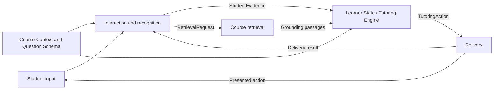

# Digital Professor Specifications

This directory defines how the Digital Professor's components behave independently and together. The specification is the primary deliverable for the current phase. It should establish module boundaries and stable handoffs before implementation work resumes.

The documents here build on the existing chat prototype, Student Evidence design, integration planning, and tutoring-turn workflows. They should refine those ideas into explicit contracts rather than redesign the system from scratch.

## Specification goals

The specification should make five questions easy to answer for every component:

1. What is the component responsible for?
2. What does it depend on and receive?
3. What functions or behaviors does it provide?
4. What does it return, and which component receives it?
5. How does it report uncertainty, corrections, failures, and diagnostic information?

The system should remain course-agnostic at the architectural level. Concrete course examples may be used to check a design, but course-specific assumptions should not become hidden interface requirements.

## Proposed document structure

| Document | Purpose | Primary contributor |
|---|---|---|
| `architecture.md` | Overall component map, ownership boundaries, tutoring-turn workflow, and system-wide dependencies | Shared |
| `interfaces.md` | Canonical shared records, field meanings, versioning, and producer-to-consumer contracts | Shared |
| `student-interaction.md` | V1 input methods, recognition, ambiguity handling, Student Evidence, routing, and interaction logging | Jonathan |
| `course-context.md` | Syllabus and lecture-note ingestion, structured Course Context / Question Schema, and preparation for retrieval | Ovunc |
| `knowledge-retrieval.md` | Indexing, retrieval, passage-level grounding, citations, and retrieval status | Sean |
| `tutoring-engine.md` | Learner State, diagnosis, and selection of a structured Tutoring Action | Shared boundary specification |
| `delivery.md` | Presentation of questions, hints, explanations, and reassessment through supported interfaces | Delivery owner / shared boundary specification |

Additional module files should be added only when a responsibility cannot be stated clearly in one of these documents.

## Current integration status

Ovunc's first Course Context draft has been incorporated into the shared contracts:

| Decision | Current specification |
|---|---|
| Per-question record | `QuestionSchema` replaces the earlier `QuestionContext` name. |
| Ownership | Course Context owns `CourseContext` and the content/build rules for `QuestionSchema`. |
| Course structure | Course → Module → Concept, with linked objectives, sources, and prerequisites. |
| Interaction access | Interaction receives only the display-safe Question Schema fields; solution, approach, rubric, and misconception cues remain restricted to the Tutoring Engine. |
| Learner interpretation | `LearnerState` includes the running open/partial/closed gap comparison against the Question Schema. |
| Course provisioning | A professor/course administrator uploads the syllabus and approved course materials before students can access the course workspace. |
| V1 Course Context input | The syllabus creates the first Course Context. Lecture-note/textbook structural ingestion and passage-level page/line mapping remain integration work. |
| Structural preparation | Uploaded materials are checked for bookmarks, a table of contents, and document-wide heading patterns before section-aware chunking and indexing. |

Two flows must be supported:

1. **Assigned question:** a frozen Question Schema exists before the student answers.
2. **Student-originated question:** Interaction captures and confirms the question first, then requests a runtime Question Schema before creating answer evidence.

The second flow still needs agreement with the Course Context owner because handwritten or spoken questions produce confirmed recognized content rather than text typed directly by the student.

## Required sections for each module

Each module specification should use the following structure:

1. **Purpose and scope**
   - What the module provides.
   - What user or system need it serves.
2. **Responsibilities**
   - Behaviors owned by the module.
   - Explicitly excluded responsibilities.
3. **Dependencies**
   - Services, records, configuration, models, tools, and upstream components required.
4. **Inputs**
   - Record names, required and optional fields, validation rules, and producer.
5. **Functions and expected behavior**
   - Main operations, normal flow, state transitions, and behavior under partial input.
6. **Outputs**
   - Record names, required and optional fields, status values, and downstream consumer.
7. **Expected failures**
   - Known failure conditions, which component detects each one, structured status/error returned, retry or fallback behavior, and whether downstream processing is allowed.
8. **Logging and observability**
   - Events, corrections, provenance, timing, and logging controls.
9. **Examples**
   - At least one normal handoff, one partial/uncertain handoff, and one failed handoff.
10. **Open questions**
   - Unresolved ownership, schema, or behavioral conflicts requiring team agreement.

Each module must state its ownership in testable terms. “Owns” means that the module validates the input, performs the behavior, creates the canonical output/status, and reports its failures. A module may call another service without taking ownership of that service's internal behavior.

## Shared architecture boundaries

The first specification pass should preserve these boundaries:

- The **Interaction module** captures student submissions, coordinates recognition and confirmation, constructs factual Student Evidence, and routes the tutoring turn.
- The **Course Context/Ingestion module** converts course materials and questions into structured context and prepares source content for retrieval.
- The **Retrieval module** returns relevant course passages and precise source locations. It does not determine student understanding or select a teaching action.
- The **Tutoring Engine** interprets Student Evidence as Learner State, identifies gaps, and selects the next Tutoring Action.
- The **Delivery layer** presents the approved action and returns the student's next response to the Interaction module.

Student Evidence must remain distinct from Learner State. Evidence records what the student submitted, confirmed, explained, or revised. Learner State is the Tutoring Engine's interpretation of what that evidence suggests about the student's knowledge.

## Shared interface flow

The shared `interfaces.md` document should eventually define at least:

- `CourseContext`
- `QuestionSchema`
- `StudentSubmission`
- `RecognitionResult`
- `RecognitionCorrection`
- `StudentEvidence`
- `RetrievalRequest`
- `GroundingPassage`
- `LearnerState`
- `TutoringAction`
- `DeliveryResult`
- `InteractionTrace`

Every interface must identify its producer, consumer, required fields, validation behavior, version, and possible failure status.

## Logging requirements

Logging must be designed into the interfaces rather than added after implementation.

- Logging must be configurable and support an explicit on/off setting.
- Disabling diagnostic logging must not disable the minimum state required to continue an active tutoring session.
- Raw model or recognizer output must be stored separately from confirmed or corrected content.
- A correction record must preserve the original value, corrected value, reason or source of the correction, actor, and timestamp.
- The system must distinguish student confirmation, automated normalization, model interpretation, and human review.
- Logs should record component and model versions, input and output identifiers, status, latency, and recoverable failures.
- Sensitive raw artifacts should be referenced by controlled identifiers rather than copied into every log entry.
- The specification must define which records are required for normal operation and which are optional diagnostic telemetry.

## Course-grounding references

Grounding results should return the location of the evidence used, rather than copying or treating an entire source document as the citation.

Each grounding passage should include:

- Course and document identifiers.
- Page number.
- Line number or line range within the normalized page text.
- The exact passage used, or a stable passage identifier that resolves to it.
- A hyperlink that opens the source at the relevant page and visually highlights the used passage when the document viewer supports it.
- Retrieval score or relevance status.
- Ingestion and content version.

The stored page and line reference must resolve against a versioned text representation. If OCR, parsing, or document updates change line numbering, the system must retain the version used by the tutoring turn or regenerate the reference explicitly.

## Student Interaction V1

The detailed decision belongs in `student-interaction.md`. The initial recommendation is:

| Modality | V1 recommendation | Rationale |
|---|---|---|
| Typed text and TeX equations | Include | Lowest implementation effort and clearest baseline for the full tutoring loop. |
| Handwritten image or PDF upload | Include | Important for mathematics and already supported by the research prototype. |
| Direct stylus/sketchpad input | Include in simplified form | Reuse the same handwriting-recognition path after exporting the canvas as an image. |
| Voice | Include one simplified mode | Support recorded speech converted to text; defer continuous real-time conversation. |
| Live video or avatar interaction | Defer | Depends on stable tutoring, delivery, and real-time infrastructure. |

This scope validates the main evidence and handoff contracts without requiring multiple real-time pipelines at once.

## Student Interaction deliverables

`student-interaction.md` must provide:

- V1 student interaction requirements and modality decision.
- A high-level student interaction and evidence workflow.
- Definitions of `StudentSubmission` and `StudentEvidence`.
- Sample records for an initial attempt, confirmed recognition correction, revision, and follow-up response.
- Rules for uncertain handwriting, equations, and speech.
- The point at which student confirmation is required.
- Failure behavior when recognition cannot produce a reliable interpretation.
- Contracts with Course Context / Question Schema, retrieval, the Tutoring Engine, and delivery.
- A clear distinction between factual Student Evidence and interpreted Learner State.
- Logging controls and records for raw recognition, corrections, confirmed content, timing, and status.
- Open interface conflicts that require team discussion.

The Interaction module must never silently repair a student's mathematical work. It may normalize presentation without changing meaning, but any meaning-changing interpretation must be exposed and, when material, confirmed by the student.

## Definition of a usable first specification

The first specification version is ready for team review when:

- Every architecture component has a named responsibility.
- Every handoff has a producer, consumer, input/output record, and failure behavior.
- Shared records use the same names and field meanings across module documents.
- Logging and correction behavior are explicit.
- Grounding references resolve to a page, line location, and highlightable passage.
- Known disagreements are listed as open questions rather than hidden through inconsistent assumptions.
- At least one complete tutoring turn can be traced through the documents without inventing an undefined record or responsibility.

## Immediate work

1. Draft `architecture.md` with the shared component flow and ownership boundaries.
2. Draft `interfaces.md` with record names and minimum required fields.
3. Draft `student-interaction.md` using the requirements and deliverables above.
4. Have Ovunc and Sean add their module specifications and identify the records they produce or consume.
5. Walk through one tutoring turn together and record missing fields, conflicting assumptions, and unclear ownership.
6. Revise the specifications before implementing new system behavior.
