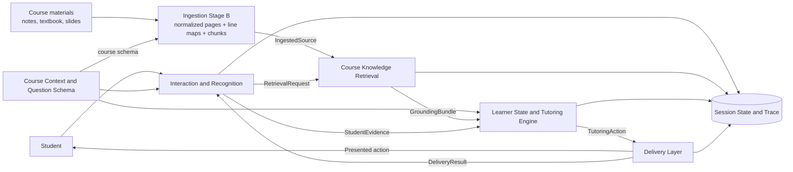

# Digital Professor Architecture

**Status:** Draft V0.1 for team review  
**Scope:** Component responsibilities, dependencies, handoffs, and one complete tutoring loop

## 1. System goal

The Digital Professor is a course-grounded tutoring system that accepts student work through multiple input methods, preserves what the student actually submitted, retrieves relevant course evidence, selects an appropriate tutoring action, and reassesses the student after each response.

The architecture should remain reusable across courses. The initial implementation and validation may use one Calculus course, but no component should assume that all courses use Calculus notation or tutoring strategies.

## 2. Design principles

1. **Preserve student intent.** Recognition may normalize formatting, but it must not silently repair a student's mathematical mistake.
2. **Separate evidence from interpretation.** Student Evidence records observable submissions. Learner State records the Tutoring Engine's interpretation.
3. **Ground course claims.** Course-specific explanations and decisions should resolve to versioned passages with page and line locations.
4. **Use explicit contracts.** Every handoff has a producer, consumer, schema version, status, and failure behavior.
5. **Keep decisions traceable.** A tutoring action should be traceable to Student Evidence, Course Context / Question Schema, Learner State, and grounding passages.
6. **Make diagnostics configurable.** Required session state remains available while optional diagnostic logging can be turned on or off.

## 3. High-level architecture

## 4. Component catalog

| Component | Owns | Receives | Produces | Does not own |
|---|---|---|---|---|
| Course Context and Ingestion | Pre-student provisioning. **Stage A:** syllabus parsing, course structure, and Question Schema construction. **Stage B (post-V1):** structural analysis and document ingestion producing normalized page text, stable line mappings, and versioned chunks | Professor-approved syllabus/materials; bank or confirmed runtime questions; ingestion configuration | `CourseContext`, `QuestionSchema`; Stage B `IngestedSource` records with structural metadata, normalized pages, stable line maps, and versioned chunks | Student diagnosis or tutoring-action selection |
| Course Knowledge Retrieval | Indexing, search, ranking, source-location resolution, grounding status | Versioned chunks and `RetrievalRequest` | `GroundingBundle` containing passage-level citations | Deciding what the student knows or which intervention to use |
| Interaction and Recognition | Input capture, modality routing, recognition, ambiguity confirmation, Student Evidence construction, turn coordination | Student input, `CourseContext`, `QuestionSchema`, `DeliveryResult` | `StudentSubmission`, `StudentEvidence`, `RetrievalRequest`, `InteractionTraceEvent` records | Diagnosing knowledge gaps or choosing pedagogy |
| Learner State and Tutoring Engine | Evidence interpretation, learner-state update, gap identification, action selection | `StudentEvidence`, `QuestionSchema`, `CourseContext`, `GroundingBundle`, prior `LearnerState` | Updated `LearnerState` and `TutoringAction` | Input recognition or user-interface presentation |
| Delivery Layer | Rendering and presenting the approved action through an available channel | `TutoringAction`, channel capabilities, accessibility/preferences | `DeliveryResult` and the next student interaction | Changing the pedagogical action without returning a failure or adaptation request |
| Session State and Trace | Required tutoring continuity, record versions, configurable diagnostics | Events and records from all components | Current session view, audit/diagnostic trace when enabled | Making tutoring decisions |

## 5. Dependency map

| Component | Required dependencies | Optional dependencies |
|---|---|---|
| Course Context and Ingestion | Document parser/OCR, persistent source store, schema validator | LLM-assisted extraction, table/equation parser |
| Course Knowledge Retrieval | Chunk store, search/index service, source-location resolver | Reranker, embedding service, citation validator |
| Interaction and Recognition | Session service, schema validator, text input path | Handwriting recognizer, speech-to-text provider, image preprocessing |
| Learner State and Tutoring Engine | Rules/policy configuration, schema validator, model or decision service | Symbolic math checker, rubric service |
| Delivery Layer | Web/chat renderer, channel capability record | Avatar, speech synthesis, flashcards |
| Session State and Trace | Session database, logging configuration | Analytics/telemetry backend |

Provider-specific tools are implementation choices and should not appear as required interface fields unless a consumer needs that information for behavior or audit.

## 6. When course ingestion runs

Course ingestion and question-time retrieval are separate operations. The normal workflow assumes that a professor or course administrator provisions the course before any student can access it.

### Instructor setup: ingest before student access

The professor/course administrator creates the workspace and uploads the syllabus, lecture notes, textbook material, and other approved sources. The workspace is not marked student-ready until the required provisioning pipeline succeeds:

1. Store the uploaded source and assign a document/content version.
2. Parse or OCR it into normalized page text.
3. Inspect PDF bookmarks, metadata, and opening pages for an explicit table of contents.
4. Scan the full normalized document for repeated headers, numbered sections, page titles, and layout/font changes.
5. Build a structural outline and map sections to syllabus-derived modules/concepts where confidence is sufficient.
6. Create stable page/line mappings.
7. Chunk within detected section boundaries and retain heading ancestry; if structure is unreliable, use page-aware/token chunking and flag the structure as inferred.
8. Validate and flag uncertain or AI-inferred fields for instructor review.
9. Build or update retrieval indexes.
10. Publish the version and enable student access only after required validation, review, and indexing succeed.

The syllabus establishes the Course Context. Lecture notes and textbooks provide the detailed searchable content used to ground question schemas and tutoring. Ingestion is relatively expensive and should not run for every question.

### Question time: select, build, and retrieve

When a question is selected or asked, the system should:

1. Reuse the published Course Context and indexed source versions.
2. Load an existing Question Schema or build one runtime schema for a confirmed student-originated question.
3. Retrieve only the passages relevant to the current question and tutoring decision.

Question time should perform retrieval, not full document ingestion.

### Incremental updates

An instructor may add or replace a document after launch, but the new version remains `processing` and unavailable for grounded claims until ingestion, indexing, and required review complete. The active turn continues against its recorded published version. A later turn may opt into the newly published version; versions must not switch silently inside a turn.

If no published course version exists, the workspace should not be offered to students. If a readiness check fails after access has already been granted, return `course_not_ready` and block course-grounded tutoring until a published version is restored.

## 7. End-to-end tutoring turn

| Stage | Producer → consumer | Input | Output | Expected behavior |
|---|---|---|---|---|
| 1a. Assigned question | Course Context → Interaction and Tutoring Engine | Selected course and bank question | `CourseContext` reference and `QuestionSchema` | Both components use the same frozen schema and course version. |
| 1b. Student-originated question | Student → Interaction → Question Schema builder | Typed or recognized-and-confirmed question | Runtime `QuestionSchema` | Interaction confirms the question first; the builder assigns its ad-hoc `question_id`; subsequent answer evidence uses that ID. |
| 2. Capture submission | Student → Interaction | Text, TeX, uploaded writing, stylus canvas, or recorded voice | `StudentSubmission` | Preserve the original artifact and identify the modality. |
| 3. Recognize content | Interaction → recognizer → Interaction | Original artifact | `RecognitionResult` | Return recognized content, alternatives, and uncertainty without repairing student math. |
| 4. Resolve ambiguity | Interaction ↔ Delivery ↔ Student | Meaning-changing recognition uncertainty | `RecognitionCorrection` or unresolved status | Ask a narrow confirmation question only when the ambiguity could change interpretation. |
| 5. Build evidence | Interaction | Submission, confirmed recognition, explanation, uncertainty, prior links | `StudentEvidence` | Validate identity, provenance, question link, and attempt/revision relationships. |
| 6. Request grounding | Interaction or Tutoring Engine → Retrieval | Question, concepts, student evidence summary, filters | `RetrievalRequest` | Request only the context needed for the current decision. Ownership of this request is an open team decision. |
| 7. Retrieve passages | Retrieval → Tutoring Engine | `RetrievalRequest` | `GroundingBundle` | Return versioned, relevant passages with page/line locations and highlight links. |
| 8. Update learner state | Tutoring Engine | Evidence, context, grounding, prior state | `LearnerState` | State what the evidence supports, what remains unresolved, and confidence. |
| 9. Select action | Tutoring Engine → Delivery | Learner state, question goals, action policy | `TutoringAction` | Choose one structured action such as question, hint, explanation, retry, comprehension check, or transfer problem. |
| 10. Present action | Delivery → Student | `TutoringAction` and channel settings | `DeliveryResult` | Preserve action intent while adapting presentation to the channel. |
| 11. Continue loop | Student → Interaction | Follow-up or revised answer | New `StudentSubmission` | Link the response to the prior attempt and action; do not overwrite history. |

## 8. Routing and coordination

V0.1 proposes that the Interaction module coordinates a tutoring turn because every turn begins and ends with student interaction. Coordination means validating records, invoking the next component, and recording handoff status. It does not mean interpreting Learner State or selecting the Tutoring Action.

A later orchestration service may assume this routing role if coordination becomes too broad for the Interaction module. The record contracts should remain unchanged if ownership moves.

## 9. State and logging

### Required operational state

The following must be retained during an active session even when diagnostic logging is off:

- Session, course, question, and turn identifiers.
- Current `StudentEvidence` and its links to earlier attempts.
- Current `LearnerState`.
- Current or most recent `TutoringAction`.
- Record/schema versions and minimum status required to resume safely.

### Optional diagnostic logging

When enabled, diagnostic logging may also capture:

- Raw recognizer/model responses.
- Candidate alternatives and confidence data.
- Raw-to-corrected recognition changes.
- Retrieval queries, rankings, and rejected passages.
- Component/model versions, token/cost metadata when available, and timing.
- Recoverable errors, retries, and human-review decisions.

The logging configuration must be recorded at session or request level. Turning logging off must stop optional diagnostic persistence, not simply hide it from the interface.

## 10. Grounding and source navigation

Retrieval should not copy an entire source document into the tutoring record. It should return the passage used plus a stable location:

- `document_id` and `content_version`
- PDF/display page number
- normalized page line start and end
- passage or stable `passage_id`
- a `highlight_url` that opens the viewer at the page and highlights the line range
- relevance/status information

Ingestion (Stage B of Course Context and Ingestion) owns the **normalized page text and stable line mappings** — the source of truth for locations — and hands them to retrieval as the proposed `IngestedSource` record (interfaces.md §9), each under a `content_version`. Retrieval indexes, searches, ranks, and resolves locations; whichever component performs the chunking MUST preserve ingestion's page/line mapping. Who owns chunking is an open decision (§12, item 9).

## 11. Failure behavior

| Failure | Responsible component | Expected result |
|---|---|---|
| Uploaded course document is unsupported or unreadable | Course Context/Ingestion | Return `ingestion_failed` with a reason; do not publish or index the failed version. |
| Required syllabus structure cannot be extracted | Course Context/Ingestion | Return `insufficient_input` or a review-required result; do not invent required course structure. |
| A document version is still processing | Course Context/Ingestion / coordinator | Return `course_not_ready` for requests requiring that version; preserve or queue the question according to policy. |
| Re-ingestion creates a new version | Course Context/Ingestion | Keep the previous published version available; publish the new version atomically after validation/indexing. |
| Retrieval index does not match the requested content version | Retrieval | Return `version_mismatch`; do not combine passages from another version silently. |
| Unsupported or unreadable input | Interaction | Preserve the submission, return `recognition_failed`, and ask for a supported retry. |
| Meaning-changing ambiguity remains unresolved | Interaction | Produce partial evidence marked `unconfirmed`; block diagnosis that depends on the ambiguous content. |
| Course/question context is missing | Coordinator | Stop the grounded tutoring path and request context selection or repair. |
| No relevant passage is found | Retrieval | Return `no_support_found` with query and filters; do not invent a citation. |
| Learner State cannot be inferred | Tutoring Engine | Mark evidence insufficient and choose a clarification/comprehension action if policy allows. |
| Delivery channel cannot render the action | Delivery | Return `unsupported_presentation` and request an allowed alternative representation. |
| A component times out | Coordinator | Record timeout, apply configured retry policy, and return a recoverable status to the user. |

## 12. Security and privacy assumptions

- Student artifacts and diagnostic logs may contain educational records and must use controlled identifiers and access.
- Logs must not contain API keys or provider secrets.
- Raw audio/images should follow an explicit retention policy separate from structured evidence.
- Highlight links must enforce the same authorization as their source documents.
- Component specifications must identify data retained beyond the active session.

## 13. Open decisions for team review

1. Does Interaction or the Tutoring Engine produce the final `RetrievalRequest`?
2. What minimum evidence is required before the Tutoring Engine may update mastery-related state?
3. Which recognition uncertainties require confirmation, and can thresholds differ by modality?
4. How are normalized page line numbers generated and kept stable after lecture notes/textbooks are added?
5. What should `highlight_url` target: an internal document viewer, a stored PDF viewer, or a source-system link?
6. Which operational records remain when optional logging is disabled, and for how long?
7. Can Delivery request a presentation adaptation directly, or must all changes return through the Tutoring Engine?
8. Should the runtime Question Schema builder accept confirmed recognized content in addition to text typed directly by the student?
9. Does ingestion (Stage B) or retrieval perform chunking? Ingestion owns normalized pages + stable line maps either way; see the proposed `IngestedSource` record (interfaces.md §9).

## 14. Review checklist

- [x] Ovunc defines Course Context / Question Schema ownership and V1 syllabus behavior in `course-context.md`.
- [ ] Ovunc and Jonathan align runtime Question Schema creation for typed, handwritten, and spoken questions.
- [ ] Ovunc and Sean define source-line mapping before lecture-note/textbook grounding is implemented.
- [ ] Sean verifies retrieval inputs, outputs, status values, and highlight-link feasibility.
- [ ] Jonathan verifies interaction, evidence, ambiguity, and routing behavior.
- [ ] The team assigns the shared Tutoring Engine boundary.
- [ ] One complete turn can be executed using only records defined in `interfaces.md`.
- [ ] Each failure has one clear owner and a structured result.
