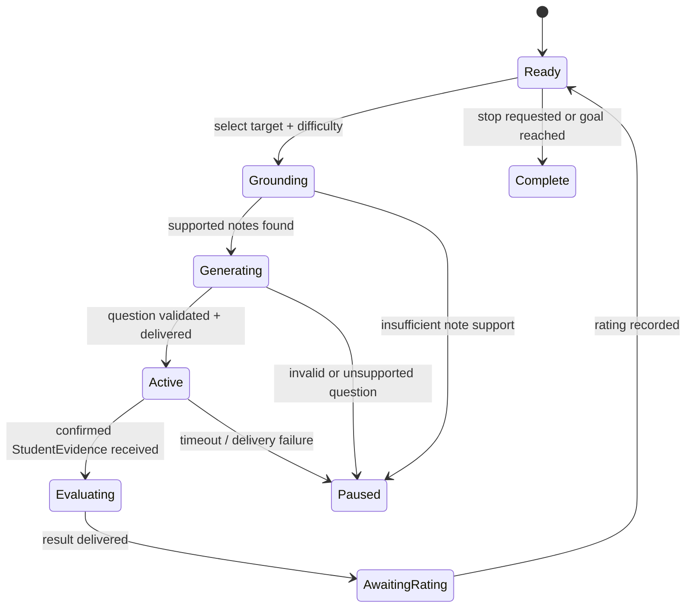
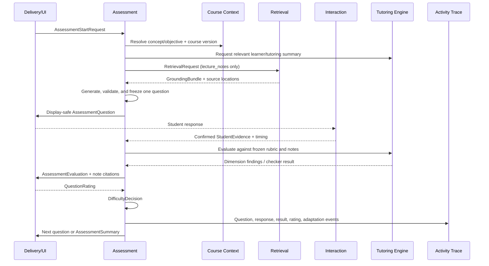

# Assessment Module — V1 Specification

**Status:** Draft V0.1 for team review  
**Primary owner:** Jonathan  
**Related specifications:** [Architecture](architecture.md), [Shared Interfaces](interfaces.md), [Student Interaction](student-interaction.md), [Retrieval](rag-retrieval.md), [Tutoring Engine](tutoring-engine.md)

This document uses **MUST**, **SHOULD**, and **MAY** as normative requirements.
Assessment records defined here are module-owned proposals until promoted into
`interfaces.md`.

## 1. Purpose and scope

The Assessment module runs a course-grounded, adaptive quiz one question at a
time. It selects a target concept, requests supporting evidence from approved
lecture notes, creates a multiple-choice, true/false, or open-ended question,
accepts one student response through Interaction, evaluates what is correct and
incorrect with a non-binary score, and explains why using citations to the
course notes. After each result, the student rates the question **too easy**,
**just right**, or **too hard**. The next question uses that rating together
with response time, response quality, and relevant tutoring history.

The module is built on the existing tutoring loop. It reuses:

- Interaction for typed/handwritten response capture and `StudentEvidence`;
- Retrieval for source selection and stable page/line citations;
- the Tutoring Engine's learner-state interpretation and pedagogical rules;
- Delivery for rendering questions, LaTeX, feedback, and controls; and
- the existing session activity trace for visible history and diagnostics.

### V1 scope

- One active assessment question per session.
- Multiple-choice, true/false, and open-ended questions.
- Typed text and LaTeX responses; confirmed handwriting MAY use the existing
  Interaction pipeline.
- Adaptive difficulty using bounded, explainable signals.
- Non-binary response evaluation with dimension-level feedback.
- Note-only grounding for questions, answers, and explanations.
- Activity-log events for question delivery, response, evaluation, rating, and
  adaptation.

### Deferred work

- Executing or grading student code.
- Plot, graph, and engineering-diagram interpretation.
- Textbook grounding. The record design permits it later, but V1 MUST reject
  textbook and syllabus passages for assessment generation/evaluation.
- Timed exams, grades, gradebook/LMS export, proctoring, and high-stakes use.
- Formal mastery certification or psychometrically calibrated item response
  theory.

## 2. Responsibilities and boundaries

### The Assessment module owns

- Starting, pausing, resuming, and ending an assessment session.
- Selecting the next concept and bounded difficulty target.
- Choosing among enabled question formats.
- Requesting note-only grounding for generation and evaluation.
- Validating that every generated question is answerable from retrieved notes.
- Freezing the question, answer key, rubric, and source set before delivery.
- Ensuring only one question is active at a time.
- Requesting evaluation of confirmed `StudentEvidence` against the frozen
  answer key/rubric and source set.
- Producing a non-binary score and dimension-level findings.
- Requesting and storing the student's perceived-difficulty rating.
- Computing the next difficulty decision and recording its signal breakdown.
- Publishing assessment events to the shared activity trace.

### The Assessment module does not own

- Recognizing handwriting or changing student content (Interaction).
- Deciding which passages are relevant (Retrieval).
- Parsing or indexing course documents (Course Context/Ingestion).
- General tutoring diagnosis or action selection (Tutoring Engine).
- Rendering controls, equations, or avatar behavior (Delivery).
- Treating response time or self-rating alone as proof of understanding.
- Writing grades to an official academic record.

### Boundary with the Tutoring Engine

Assessment orchestrates a question cycle and owns the assessment-specific
rubric result. After evaluation and student rating, it MUST emit an
`AssessmentEngineHandoff` through `record_assessment_result`. The handoff
contains factual evidence and references only: linked tutoring session,
question/evidence/evaluation IDs, concepts, dimension results, timing quality,
student rating, difficulty decision, and grounding references.

The Engine remains the owner of durable `LearnerState`, diagnosis, and the
choice of a targeted hint, retry, explanation, or follow-up question. The
Assessment module MAY identify the lowest-scoring rubric dimension as a
`recommended_focus`, but MUST NOT translate that observation into a tutoring
action. An `AssessmentEvaluation` is evidence that the Engine may incorporate;
it is not itself a mastery label.

## 3. Dependencies

| Dependency | Required capability |
|---|---|
| Course Context | Course, concept, and learning-objective identifiers; approved source inventory. |
| Retrieval | Course-scoped note-only retrieval with stable passage, page, line, version, and highlight references. |
| Interaction | Immutable `StudentSubmission`, confirmed `StudentEvidence`, response timing, attempt links, and handwriting confirmation. |
| Tutoring Engine | Relevant learner/tutoring history and response checking without changing the submitted evidence. |
| Delivery | Render question types, LaTeX, source links, feedback, and difficulty-rating controls. |
| Session/state store | Persist active question, frozen rubric, prior questions, ratings, and adaptation decisions. |
| Activity trace | Append student-visible summaries and optional diagnostic details. |
| Model provider | Structured generation/evaluation output with configured model/version and usage metadata. |

## 4. Inputs

| Input | Producer | Required validation/use |
|---|---|---|
| `AssessmentStartRequest` | Interaction/UI | Course, session, optional concept/objective, question-count goal, allowed formats. |
| Course/concept view | Course Context | IDs and versions MUST resolve to the active course. |
| `GroundingBundle` | Retrieval | Every passage MUST be from the active course and `lecture_notes` in V1. |
| Relevant `LearnerState` summary | Tutoring Engine | Use only evidence tied to the selected concept/objective; preserve confidence/limitations. |
| Tutoring history summary | Tutoring Engine/session trace | Use prior help level, attempts, concepts, and delivered actions; do not ingest private chain-of-thought. |
| `StudentEvidence` | Interaction | MUST be confirmed/valid and linked to the active assessment question and attempt. |
| Response timestamps | Interaction/session coordinator | Use server receipt/delivery timestamps; record interruptions or unknown timing. |
| `QuestionRating` | Student through Delivery/Interaction | Exactly one of `too_easy`, `just_right`, `too_hard`; optional comment. |
| Assessment configuration | System/instructor | Allowed formats, bounds, source policy, target length, timeout behavior, model/version. |

### 4.1 Required timing fields

Response time is measured from confirmed question delivery to response receipt:

```text
response_time_ms = response_received_at - question_presented_at
```

If delivery was not confirmed, the tab was backgrounded, the session was
resumed, or either timestamp is unavailable, timing quality MUST be `unknown`
or `interrupted`. Such timing MUST NOT increase difficulty or lower a score.

### 4.2 Source policy

For V1, an assessment `RetrievalRequest` MUST include:

```json
{
  "allowed_source_types": ["lecture_notes"],
  "excluded_source_types": ["syllabus", "textbook", "other"]
}
```

The Assessment module MUST validate the returned bundle again. A syllabus may
identify course structure or the selected concept, but syllabus text MUST NOT
be used to generate a question, answer key, correctness judgment, or student
explanation. A generated question without sufficient lecture-note support MUST
not be delivered.

## 5. Functions and expected behavior

| Function | Receives | Returns | Expected behavior |
|---|---|---|---|
| `start_assessment` | Start request, course/session refs | `AssessmentSession` | Validate configuration and create a session with no active question. |
| `select_target` | Learner/tutoring history, prior assessment results | Target concept/objective | Prefer unresolved or weakly evidenced concepts; respect requested scope and avoid unsupported targets. |
| `compute_difficulty` | Correctness, response time, rating, history | `DifficultyDecision` | Combine bounded signals, apply guardrails, and record the rationale. |
| `request_note_grounding` | Target and course snapshot | `GroundingBundle` | Request lecture notes only; reject wrong-course, stale, syllabus, or unsupported bundles. |
| `generate_question` | Target, difficulty, note passages, format | Candidate question | Generate one answerable question, answer key, rubric, distractor rationale if applicable, and citations. |
| `validate_question` | Candidate and grounding bundle | Frozen `AssessmentQuestion` or failure | Check format, answerability, uniqueness, source support, leakage, LaTeX, and schema validity. |
| `present_question` | Frozen question | `TutoringAction`/assessment delivery request | Reveal only display-safe fields; keep answer/rubric restricted. |
| `accept_response` | Confirmed `StudentEvidence` | Evaluation request | Enforce active-question/attempt links; never score raw or ambiguous recognition. |
| `evaluate_response` | Evidence, frozen key/rubric, same-version notes | `AssessmentEvaluation` | Identify correct, partial, incorrect, unsupported, and omitted elements and explain why. |
| `present_result` | Evaluation and safe citations | Feedback action | Show score band, findings, explanation, and note citations without exposing hidden model reasoning. |
| `record_question_rating` | Student rating | `QuestionRating` | Store the rating separately from correctness and mark the cycle complete. |
| `record_assessment_result` | Completed evaluation, rating, and difficulty decision | Engine acknowledgement and optional `TutoringAction` | Send factual evidence to the Engine; only the Engine updates learner state or selects a targeted intervention. Log Engine failures without losing the completed assessment cycle. |
| `choose_next_question` | Completed cycle and current state | Next target/format/difficulty or end | Generate only after evaluation and rating, unless rating is explicitly skipped by policy. |
| `end_assessment` | Session state | `AssessmentSummary` | Return completed count and concept-level evidence with limitations; do not claim certified mastery. |

### 5.1 One-question-at-a-time state machine



The system MUST NOT generate or expose question N+1 while question N is
`Active`, `Evaluating`, or `AwaitingRating`.

### 5.2 Question formats

| Format | Required behavior |
|---|---|
| Multiple choice | 2–5 choices; one best answer unless explicitly marked multi-select; plausible note-grounded distractors; no trick wording. |
| True/false | One precise proposition; answer key includes the note-grounded reason and, when false, a corrected statement. |
| Open ended | Expected response mode and dimension rubric are frozen; accept equivalent notation/reasoning where mathematically valid. |

Question and response content SHOULD use `$...$` for inline LaTeX and `$$...$$`
for standalone equations. Delivery MUST render the source text safely while the
canonical record retains the original LaTeX.

### 5.3 Non-binary correctness

`correctness_score` is a bounded value in `[0.0, 1.0]`, supported by explicit
rubric dimensions rather than an unsupported model confidence. Recommended V1
dimensions are:

| Dimension | Meaning | Example weight |
|---|---|---:|
| `concept` | Correct underlying concept or claim | 0.35 |
| `method` | Appropriate approach or reasoning path | 0.25 |
| `execution` | Algebra, arithmetic, logic, or factual execution | 0.25 |
| `communication` | Required explanation, units, notation, or justification | 0.15 |

Weights MUST be frozen with the question and sum to `1.0`. A dimension result
contains `earned` in `[0,1]`, `status` (`correct`, `partial`, `incorrect`,
`omitted`, `not_applicable`), a concise explanation, and supporting source
references. The total is the weighted sum of applicable dimensions. Question
types MAY use different weights, but the rubric cannot change after delivery.

The evaluation MUST distinguish:

- mathematically/conceptually correct content;
- partially correct reasoning;
- a correct result with unsupported or wrong reasoning;
- an incorrect result with useful intermediate work;
- omitted evidence; and
- insufficient evidence to judge.

### 5.4 Difficulty adaptation

V1 difficulty is an ordinal level `1..5`. The next level changes by at most one
step per completed question. The decision uses four bounded signals:

1. **Response quality:** rubric score and which dimensions failed.
2. **Response time:** relative to an item expectation and, when available, the
   student's rolling median for the same format—not a universal speed target.
3. **Student rating:** `too_easy`, `just_right`, or `too_hard`.
4. **Tutoring history:** recent help level, retries, unresolved concept gaps,
   and prior demonstrated evidence for the selected concept.

Recommended starting rule:

- Increase one level only when correctness is at least `0.80`, no critical
  dimension is incorrect, and the combined timing/rating/history signal does
  not indicate excessive difficulty.
- Decrease one level when correctness is below `0.50`, a prerequisite gap is
  active, or the student reports `too_hard` with supporting evidence.
- Otherwise keep the level unchanged.

The student rating can influence the next question but MUST NOT alter the score
of the completed response. Fast responses alone MUST NOT increase difficulty;
slow or interrupted responses alone MUST NOT decrease correctness. Every
decision records the input signals, missing signals, chosen level, and bounded
rationale.

### 5.5 Question generation and validation

Before delivery, the module MUST verify:

1. The target concept and objective belong to the active course/version.
2. At least one supporting lecture-note passage exists.
3. All answer-key claims and required explanation elements resolve to those
   passages.
4. No syllabus or disallowed source passage is present.
5. The prompt is answerable without unseen information.
6. The answer key is unique enough for the selected format.
7. Distractors are plausible but not also correct under the notes.
8. LaTeX is syntactically renderable or safely shown as source text.
9. The question does not reveal its answer through wording, metadata, sources,
   or a prior activity-log event.
10. The question is not a near-duplicate of a recent question unless deliberate
    reinforcement is recorded.

### 5.6 Evaluation and feedback

Evaluation MUST use the frozen question, frozen rubric, confirmed evidence, and
the same source-content versions used when the question was generated. It MUST
return:

- what was correct;
- what was partially correct;
- what was incorrect or missing;
- why, in student-facing language;
- the rubric-derived score and limitations;
- relevant note citations with page/line/highlight links; and
- whether human review or a tutoring handoff is recommended.

The student-facing explanation MUST NOT cite the syllabus. If retrieved notes
cannot support the judgment, return `insufficient_grounding` and do not invent
an explanation or silently switch to general model knowledge.

## 6. Outputs and records

All records use the common envelope and identifiers in `interfaces.md`.
Their machine-readable contracts are:

| Record | JSON Schema |
|---|---|
| `AssessmentSession` | [`schemas/assessment-session.schema.json`](schemas/assessment-session.schema.json) |
| `AssessmentQuestion` | [`schemas/assessment-question.schema.json`](schemas/assessment-question.schema.json) |
| `AssessmentEvaluation` | [`schemas/assessment-evaluation.schema.json`](schemas/assessment-evaluation.schema.json) |
| `QuestionRating` | [`schemas/question-rating.schema.json`](schemas/question-rating.schema.json) |
| `DifficultyDecision` | [`schemas/difficulty-decision.schema.json`](schemas/difficulty-decision.schema.json) |
| `AssessmentSummary` | [`schemas/assessment-summary.schema.json`](schemas/assessment-summary.schema.json) |

Implementation MUST additionally check cross-record and arithmetic invariants
that JSON Schema cannot fully express: record-specific IDs equal `record_id`,
rubric weights sum to `1.0`, choice/rationale IDs resolve, `line_end >=
line_start`, score totals match frozen weights, and next difficulty differs by
at most one level.

### 6.1 `AssessmentSession`

| Field | Required | Description |
|---|---:|---|
| `assessment_session_id`, `course_id`, `session_id`, `user_id` | Yes | Identity and scope. |
| `status` | Yes | `ready`, `active`, `awaiting_rating`, `paused`, `complete`, `failed`. |
| `allowed_question_types` | Yes | V1 subset of `multiple_choice`, `true_false`, `open_ended`. |
| `target_scope` | Yes | Requested concepts/objectives or course-wide scope. |
| `current_difficulty` | Yes | Integer `1..5`. |
| `active_question_id` | No | At most one. |
| `completed_question_ids` | Yes | Ordered IDs. |
| `course_context_version`, `retrieval_snapshot_id` | Yes | Frozen course/index versions. |

### 6.2 `AssessmentQuestion`

| Field | Visibility | Description |
|---|---|---|
| `assessment_question_id`, `assessment_session_id`, `question_id`, `attempt_id` | Shared | Stable links. |
| `concept_ids`, `objective_ids`, `difficulty_level`, `question_type` | Shared | Target and presentation metadata. |
| `prompt_latex`, `choices` | Student-safe | Delivered question content. |
| `answer_key`, `rubric`, `distractor_rationales` | Restricted | Frozen evaluation material; MUST NOT reach student UI before submission. |
| `grounding_passage_ids`, `content_versions` | Shared/restricted view | Exact note support. Student-facing links MAY appear after evaluation. |
| `expected_time_ms` | Restricted/diagnostic | Optional adaptation reference, never a correctness threshold. |
| `status` | Shared | `candidate`, `validated`, `active`, `answered`, `evaluated`, `closed`, `invalid`. |

### 6.3 `AssessmentEvaluation`

| Field | Required | Description |
|---|---:|---|
| `evaluation_id`, `assessment_question_id`, `evidence_id` | Yes | Exact evaluated response. |
| `correctness_score` | Yes | Rubric-derived `[0,1]` score. |
| `dimension_results` | Yes | Earned value, status, explanation, and source refs per dimension. |
| `correct_elements`, `partial_elements`, `incorrect_elements`, `omitted_elements` | Yes | Factual result breakdown. |
| `feedback_latex` | Yes | Student-facing explanation with safe LaTeX. |
| `grounding_refs` | Yes | Note-only passage/page/line/highlight references. |
| `response_time_ms`, `timing_quality` | Yes | Timing observation and quality. |
| `review_status` | Yes | `not_required`, `recommended`, `required`. |
| `limitations` | Yes | Missing evidence, checker limits, or grounding limits. |

### 6.4 `QuestionRating`

| Field | Required | Description |
|---|---:|---|
| `rating_id`, `assessment_question_id`, `evaluation_id` | Yes | Links rating to the completed result. |
| `perceived_difficulty` | Yes | `too_easy`, `just_right`, or `too_hard`. |
| `comment` | No | Optional student explanation. |
| `submitted_at` | Yes | Timestamp. |

### 6.5 `DifficultyDecision`

Contains the prior and next levels, correctness signal, timing signal/quality,
student rating, tutoring-history summary reference, missing signals, bounded
rationale, and policy version. It MUST be reproducible from stored inputs and
MUST NOT contain private model chain-of-thought.

### 6.6 `AssessmentSummary`

Contains question count, format/difficulty history, concept-level evidence,
source versions, and limitations. It MUST say `insufficient_evidence` rather
than infer mastery from too few or unsupported observations.

## 7. Integration and handoffs



### 7.1 Interaction contract

Interaction sends only confirmed `StudentEvidence` tied to the active
assessment question. Raw OCR, unresolved ambiguity, or a response for a stale
question MUST be rejected before evaluation. Assessment returns the next
display action to the coordinator; it does not capture input directly.

### 7.2 Retrieval contract

Assessment supplies active course/version, target concepts, intended operation
(`assessment_generation` or `assessment_evaluation`), and the source allowlist.
Retrieval returns only eligible passages or a structured no-support/failure
status. Assessment validates the source types and versions before use.

### 7.3 Delivery contract

Delivery receives display-safe question or feedback content plus available
response controls. It returns `DeliveryResult` with presentation time/status.
Delivery MUST NOT receive answer keys before the student response is closed and
MUST NOT compute correctness or choose difficulty.

### 7.4 Activity-log contract

The student-visible Activity log SHOULD show:

- question type, concept, difficulty, and delivered prompt;
- preserved response and confirmed transcription when different;
- response-time value only when policy permits showing it;
- correctness score and dimension-level result;
- concise feedback and note citations;
- perceived-difficulty rating; and
- the next difficulty level with a short policy rationale.

Restricted answer keys, distractor rationales, raw model output, and private
diagnostic data MUST not appear before response closure. Diagnostic logging MAY
record model/version, latency, token use, estimated cost, retrieval/query IDs,
and validation failures under the shared logging configuration.

## 8. Expected failures

| Failure | Detection/response | Downstream behavior |
|---|---|---|
| No lecture-note support | Return `insufficient_grounding`. | Do not generate or evaluate; offer another concept or tutoring. |
| Retrieval returns syllabus/textbook in V1 | Return `source_policy_violation`; log passage IDs. | Reject bundle; do not silently filter and continue unless a complete eligible bundle remains and policy permits it. |
| Generated question is ambiguous or has multiple correct answers | Return `question_validation_failed`; retry within budget. | Never deliver invalid candidate. |
| Answer/rubric leakage | Return `content_leakage_detected`. | Block delivery and regenerate within budget. |
| Unconfirmed handwriting ambiguity | Return `confirmation_required`. | Interaction asks student to confirm; no score. |
| Stale/wrong question response | Return `question_link_mismatch`. | Preserve submission; do not evaluate against another question. |
| Missing/interrupted timing | Mark `timing_quality=unknown/interrupted`. | Continue evaluation; exclude timing from adaptation. |
| Unsupported response or insufficient evidence | Return `insufficient_evidence`. | Explain what is needed; do not force binary incorrect. |
| Evaluation lacks source support | Return `insufficient_grounding`. | Do not invent correctness explanation; recommend review/tutoring. |
| Model/checker disagreement | Mark `review_required`; preserve both bounded results. | Do not present high-confidence judgment until resolved by policy/human review. |
| Delivery failure | Keep question/result pending and retry same ID. | Do not advance or start timing until confirmed delivery. |
| Rating omitted or times out | Record `rating_skipped` per policy. | Default to conservative no-change adaptation; do not fabricate rating. |
| Concurrent next-question request | Return `active_question_exists`. | Return existing active question; do not create another. |

## 9. Logging and observability

Minimum operational events:

- `assessment_started`
- `assessment_target_selected`
- `assessment_grounding_received`
- `assessment_question_validated`
- `assessment_question_presented`
- `assessment_response_received`
- `assessment_evaluated`
- `assessment_feedback_presented`
- `assessment_rating_recorded` or `assessment_rating_skipped`
- `assessment_difficulty_decided`
- `assessment_completed`, `assessment_paused`, or `assessment_failed`

Each event MUST include record IDs, session/course/question/attempt links,
producer/version, timestamp, status, and correlation ID. Operational records
needed to resume the quiz remain enabled even when diagnostic logging is off.

Optional diagnostics include retrieval scores, prompt/model versions, raw
structured provider output subject to retention policy, validation attempts,
latency by component, token counts, and estimated cost. Never log API keys,
private chain-of-thought, or unrestricted student artifacts.

## 10. Example cycle

1. The learner has partial tutoring evidence for the chain rule and starts an
   assessment at difficulty 2.
2. Assessment retrieves only chain-rule passages from the lecture notes.
3. It freezes and presents one open-ended question using LaTeX.
4. The student submits a confirmed handwritten response in 95 seconds.
5. Evaluation awards concept `1.0`, method `0.7`, execution `0.5`, and
   communication `0.7`, producing a weighted total of `0.755` and explaining the
   sign error with note citations.
6. The student rates the question `just_right`.
7. The policy retains difficulty 2 because the response is partially correct;
   it selects a reinforcement question targeting execution rather than raising
   difficulty.
8. The Activity log shows the question, confirmed response, dimension result,
   note citations, rating, and short adaptation rationale.

### 10.1 Example record fragments

```json
{
  "record_type": "AssessmentEvaluation",
  "assessment_question_id": "aq-17",
  "evidence_id": "evidence-42",
  "correctness_score": 0.755,
  "dimension_results": [
    {"dimension": "concept", "earned": 1.0, "status": "correct"},
    {"dimension": "method", "earned": 0.7, "status": "partial"},
    {"dimension": "execution", "earned": 0.5, "status": "partial"},
    {"dimension": "communication", "earned": 0.7, "status": "partial"}
  ],
  "response_time_ms": 95000,
  "timing_quality": "valid",
  "grounding_refs": ["passage-notes-p14-l8-l20"],
  "review_status": "not_required",
  "limitations": []
}
```

```json
{
  "record_type": "DifficultyDecision",
  "assessment_question_id": "aq-17",
  "previous_level": 2,
  "next_level": 2,
  "student_rating": "just_right",
  "policy_version": "assessment-difficulty-v1",
  "rationale": "Keep level; reinforce execution after a partially correct response."
}
```

## 11. V1 acceptance scenarios

1. A supported concept produces one note-grounded question with a frozen rubric
   and no syllabus passage.
2. A confirmed response produces a reproducible non-binary score, explains
   right/partial/wrong elements, and cites lecture-note page/line locations.
3. An ambiguous handwritten response remains unscored until confirmation.
4. A `too_hard` rating affects only the next difficulty decision, not the
   completed score.
5. Missing or interrupted timing does not lower correctness or independently
   change difficulty.
6. A wrong-course, syllabus, or stale-version passage blocks generation.
7. Refreshing/reconnecting restores the one active question without generating
   a duplicate.
8. Question, response, result, rating, and adaptation appear in Activity log in
   order without leaking the answer before response closure.
9. A concept without sufficient note support produces a structured failure and
   offers a safe fallback rather than using general model knowledge.

## 12. Open questions

1. Should assessment evaluation be a dedicated Tutoring Engine port or a
   constrained action-card path through the existing port?
2. Which component owns durable cross-question concept performance: Assessment
   session state or `LearnerState`?
3. Is the question rating mandatory, skippable immediately, or skippable only
   after a timeout?
4. Who defines initial difficulty when there is no tutoring history?
5. Which checker types are required for V1 open-ended mathematics, and when is
   human review mandatory?
6. Should source links be revealed immediately after each result or only after
   the learner completes a retry?
7. What minimum number/diversity of observations is required before an
   assessment summary may say more than `insufficient_evidence`?
8. Which assessment records should be promoted into `interfaces.md` before
   implementation begins?

