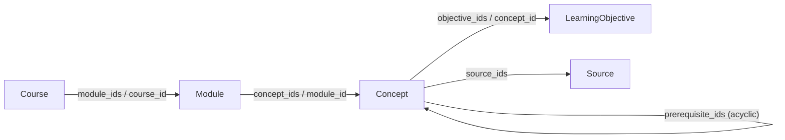
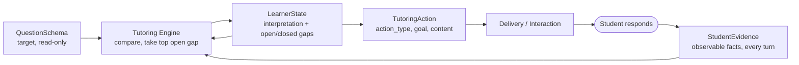

# Course Context — V1 Module Specification

|                                   |                                                                                                                                                                                                                                                                                                                                                                                                  |
| --------------------------------- | ------------------------------------------------------------------------------------------------------------------------------------------------------------------------------------------------------------------------------------------------------------------------------------------------------------------------------------------------------------------------------------------------ |
| **Spec ID**                 | `course-context`                                                                                                                                                                                                                                                                                                                                                                               |
| **Spec version**            | `0.6.0` (draft for team review)                                                                                                                                                                                                                                                                                                                                                                |
| **Date**                    | 2026-10-29                                                                                                                                                                                                                                                                                                                                                                                       |
| **Owner**                   | Course Context module (Ovunc)                                                                                                                                                                                                                                                                                                                                                                    |
| **Shared contract**         | Part of the Digital Professor specs. Shared records (`CourseContext`, `QuestionSchema`, `StudentEvidence`, `LearnerState`, `TutoringAction`, grounding, the common envelope) are canonically defined in [`interfaces.md`](interfaces.md); system roles and the tutoring turn are in [`architecture.md`](architecture.md). This module owns `CourseContext` and `QuestionSchema`. |
| **Data schema versions**    | Exchanged records carry the common envelope of[`interfaces.md`](interfaces.md) §1.1 (`schema_version` = contract version `0.1`). The Course Context file's own data-schema version is `course_context_schema_version`: `1.0` (core) or `1.1` (adds per-record `provenance`, section 1.4).                                                                                          |
| **Question Schema version** | `question_schema_version` `1.0` (section 3)                                                                                                                                                                                                                                                                                                                                                  |
| **Consumers**               | Sean (retrieval), Jonathan (student evidence), Tutoring Engine, Yining (presentation) — see[`interfaces.md`](interfaces.md) for the record contracts                                                                                                                                                                                                                                           |
| **Companion spec**          | `course-context.validation-and-flagging.md` — the Validator and Review Flagger tools used in the pipeline (section 2.1)                                                                                                                                                                                                                                                                       |
| **Companion files**         | `course-context.example-calc1.md` (worked Calculus I example); `templates/` (course-context, question-schema, learner-state, tutoring-action); `examples/calc1.course-context.json`, `examples/calc1.question-schema.xcosx.json`; `diagrams/course-context-io.mmd` (+ `.svg`, `.png`)                                                                                              |

**Status labels.** Sections marked *Normative* are owned by the Course Context module. Sections marked *Proposed (cross-team)* describe records the Course Context module only consumes or helps define; they need agreement from the other owners before they are fixed. Keywords MUST, SHOULD and MAY are used as in RFC 2119.

**Changelog**

| Version | Date       | Change                                                                                                                                                                                                                                                                                                                                                                                                                                                                                                                                                                                                                                                                                                                                                                                          |
| ------- | ---------- | ----------------------------------------------------------------------------------------------------------------------------------------------------------------------------------------------------------------------------------------------------------------------------------------------------------------------------------------------------------------------------------------------------------------------------------------------------------------------------------------------------------------------------------------------------------------------------------------------------------------------------------------------------------------------------------------------------------------------------------------------------------------------------------------------- |
| 0.6.0   | 2026-10-29 | Removed `AssessmentQuestion` from Course Context: Stage A no longer generates questions (saves generation tokens and avoids output-length truncation). Dropped the `AssessmentQuestion` record, `Concept.question_ids`, and their links/rules from §1–2; updated the prompt, template, and the basic validator. The question bank is now an **external/instructor-supplied** artifact: the Question Schema (§3) still has an `origin: bank` path, re-framed to source a bank question's fields from that external bank rather than a Course Context record. |
| 0.5.0   | 2026-10-13 | Aligned to the shared`interfaces.md`/`architecture.md` contract: renamed the per-question record to `QuestionSchema` and `reference_solution`→`reference_answer`; integrated the fields it lacked (`question_type`, `expected_response_modes`, `rubric`, `constraints`); adopted the common envelope and renamed the file's `schema_version`→`course_context_schema_version`; replaced the §4 "Student-State" with the shared `StudentEvidence`/`LearnerState` split and merged "Gap Record" into `LearnerState`; `TutoringAction` uses the shared fields with this module's 12-verb `action_type`; aligned §5 consumers to the interface records; added a Logging/observability section and the README 9-section module view; linked to `interfaces.md`. |
| 0.4.0   | 2026-10-12 | Moved the worked Calculus I example (former §6) and its deviations appendix into a separate informative document,`course-context.example-calc1.md`, expanded there with the end-to-end tutoring trace (Student-State / Gap Record / Tutoring Action) from the design page. §6 is now a pointer; the former Appendix B (Files) becomes Appendix A.                                                                                                                                                                                                                                                                                                                                                                                                                                           |
| 0.3.0   | 2026-10-12 | Re-added the Validate → Flag → Review steps to the pipeline (§2.1), now specified in the companion tool spec`course-context.validation-and-flagging.md` rather than inline. The validation rules and the review-flagging logic live there. §2.5 ties to the Review Flagger's worklist.                                                                                                                                                                                                                                                                                                                                                                                                                                                                                                    |
| 0.2.0   | 2026-10-12 | Removed the Python tooling (validator and provenance annotator) and all rule-based validation content (V/W/Q rules). Dropped`review_status`/`review_notes` and the review-status workflow; schema 1.1 now adds only `provenance` (`source_backed`/`ai_inferred`), which the syllabus-to-JSON prompt emits directly. Section 2.5 kept as an advisory human-check list.                                                                                                                                                                                                                                                                                                                                                                                                                 |
| 0.1.0   | 2026-10-12 | First draft: Course Context requirements, syllabus-to-JSON workflow, Question Schema, shared tutoring concepts, downstream dependencies, Calculus I example, open questions.                                                                                                                                                                                                                                                                                                                                                                                                                                                                                                                                                                                                                    |

---

**Module specification map (per `README.md`).** This document covers the shared module template's required sections: **1 Purpose/scope** (§1), **2 Responsibilities** (§1 — owns `CourseContext` and `QuestionSchema`; does not diagnose students or select tutoring actions), **3 Dependencies** (§2.1 — document parser/OCR, source store, the syllabus-to-JSON prompt, `course-context.validation-and-flagging.md`), **4 Inputs** (§1.5 — one syllabus in V1), **5 Functions and expected behavior** (§2 workflow, §3 QuestionSchema build), **6 Outputs** (`CourseContext`/`QuestionSchema`, interfaces.md §2–3; consumers in §5), **7 Logging/observability** (§6), **8 Examples** (`course-context.example-calc1.md`), **9 Open questions** (§9). Shared records are canonical in [`interfaces.md`](interfaces.md); roles in [`architecture.md`](architecture.md).

---

## 1. Course Context requirements *(Normative)*

Course Context is the structured, linked description of one course that the rest of the Digital Professor reads. It is produced once per course from course materials (section 2), reviewed by a human, and then consumed read-only.

### 1.1 Entity model and links

The chain Course → Module → Concept → LearningObjective / Source is a reading order, not the storage layout. **Concept is the hub.** Objectives and sources all attach to a Concept. Prerequisites are Concept → Concept links, not a separate record type.

**Assessment questions are not part of Course Context.** Stage A does not generate questions. A question bank, when one exists, is supplied separately (instructor-provided or external to this module); the Question Schema (§3) references a bank question by ID but does not store it here.

| Link                                    | Stored as                                         | Reverse stored as                  | Cardinality                                                  |
| --------------------------------------- | ------------------------------------------------- | ---------------------------------- | ------------------------------------------------------------ |
| Course → Module                        | `Course.module_ids` (teaching order)            | `Module.course_id`               | 1..n                                                         |
| Module → Concept                       | `Module.concept_ids`                            | `Concept.module_id`              | 1..n                                                         |
| Concept → Concept (prerequisite)       | `Concept.prerequisite_ids`                      | none                               | 0..n, acyclic                                                |
| Concept → LearningObjective            | `Concept.objective_ids`                         | `LearningObjective.concept_id`   | 1..n                                                         |
| Concept → Source                       | `Concept.source_ids`                            | none                               | 0..n (SHOULD be at least 1)                                  |

Where a link is stored in both directions, the two sides MUST agree.

### 1.2 Field requirements for V1

`MUST` means present and non-empty. `MUST*` means present, and an empty array is allowed (the course is a skeleton for that field). `MAY` means optional.

**Envelope**

| Field                                                                              | Type   | Req    | Notes                                                                                                                             |
| ---------------------------------------------------------------------------------- | ------ | ------ | --------------------------------------------------------------------------------------------------------------------------------- |
| `course_context_schema_version`                                                  | string | MUST   | `1.0` or `1.1` (the Course Context data-schema version; distinct from the envelope `schema_version` in interfaces.md §1.1) |
| `Course`                                                                         | object | MUST   | exactly one                                                                                                                       |
| `Module`, `Concept`, `LearningObjective`, `Source` | arrays | MUST   | at least one`Module` and one `Concept`                                                                                        |
| `assumptions`                                                                    | array  | SHOULD | generator-logged inferences, shape in section 2.4. Consumers MUST NOT fail when it is absent.                                     |

**Course**

| Field                  | Type         | Req         | Notes                                                                                                  |
| ---------------------- | ------------ | ----------- | ------------------------------------------------------------------------------------------------------ |
| `id`                 | string       | MUST        | lowercase slug, e.g.`calc1`                                                                          |
| `title`              | string       | MUST        |                                                                                                        |
| `level`              | string       | MUST        | SHOULD be one of`undergraduate introductory`, `undergraduate advanced`, `master's`, `doctoral` |
| `duration_weeks`     | integer ≥ 1 | MUST        | usually inferred, see 2.3                                                                              |
| `assumed_background` | string       | MUST        | what students know on arrival                                                                          |
| `module_ids`         | string[]     | MUST (≥ 1) | in teaching order                                                                                      |

**Module**

| Field           | Type     | Req         | Notes                                                         |
| --------------- | -------- | ----------- | ------------------------------------------------------------- |
| `id`          | string   | MUST        | `<course>.<NN>-<slug>`, `NN` = teaching order from `01` |
| `course_id`   | string   | MUST        |                                                               |
| `title`       | string   | MUST        |                                                               |
| `goal`        | string   | MUST        | one sentence                                                  |
| `weeks`       | string   | MUST        | `"3"` or `"3-4"`                                          |
| `concept_ids` | string[] | MUST (≥ 1) |                                                               |

**Concept**

| Field                | Type                              | Req   | Notes                                                                                                                             |
| -------------------- | --------------------------------- | ----- | --------------------------------------------------------------------------------------------------------------------------------- |
| `id`               | string                            | MUST  | `<module id>.<slug>`                                                                                                            |
| `module_id`        | string                            | MUST  |                                                                                                                                   |
| `name`             | string                            | MUST  |                                                                                                                                   |
| `summary`          | string                            | MUST  | one or two sentences                                                                                                              |
| `key_definitions`  | string[]                          | MUST* | only the terms that need a precise statement                                                                                      |
| `prerequisite_ids` | string[]                          | MUST* | Concept IDs in the same or an earlier module. Empty when the only prerequisite is assumed background; log that in`assumptions`. |
| `objective_ids`    | string[]                          | MUST* | SHOULD have at least 1                                                                                                            |
| `difficulty_notes` | `{misconception, mitigation}`[] | MUST* | exactly those two keys per entry                                                                                                  |
| `source_ids`       | string[]                          | MUST* | SHOULD have at least 1                                                                                                            |

**LearningObjective**: `id` (MUST), `concept_id` (MUST), `text` (MUST), `bloom_level` (MUST, one of `remember`, `understand`, `apply`, `analyze`, `evaluate`, `create`).

**Source**: `id` (MUST), `type` (MUST, one of `syllabus`, `textbook`, `lecture_notes`, `reading`, `other`), `citation` (MUST), `section` (MUST), `text_chunk` (MUST, non-empty; see 2.3 and open question 2).

**Additive field, schema 1.1** (every record, including `Course`): `provenance` (MUST in 1.1). Definition in 1.4. Core 1.0 fields are unchanged, so a 1.1 file reduces to a valid 1.0 file by deleting this field and setting `course_context_schema_version` back.

**Minimum viable Course Context.** One Course, at least one Module, at least one Concept per Module. Each Concept SHOULD have at least one LearningObjective. Sources and difficulty notes may be empty arrays. The Question Schema builder degrades gracefully on such a skeleton (section 3.3).

### 1.3 IDs and linking

| Entity             | ID pattern                  | Example                                         |
| ------------------ | --------------------------- | ----------------------------------------------- |
| Course             | `<slug>`                  | `calc1`                                       |
| Module             | `<course>.<NN>-<slug>`    | `calc1.06-integral-applications`              |
| Concept            | `<module id>.<slug>`      | `calc1.06-integral-applications.by-parts`     |
| LearningObjective  | `<concept id>.lo<n>`      | `calc1.06-integral-applications.by-parts.lo1` |
| Source             | `<source slug>.<locator>` | `neuhauser.s7-2`                              |

- IDs MUST be lowercase, dot-delimited, and unique within a file. Consumers SHOULD treat them as opaque strings and follow links instead of parsing them. Only the ad hoc question ID (3.3) depends on the pattern.
- `Source.id` is independent of module and concept because one source can back several concepts. It is unique per file only (open question 3).
- A prerequisite link means: a student must already be able to use the listed concept to work on this one. The target MUST be in the same or an earlier module, and the graph MUST be acyclic. In the Calculus I file there are 60 prerequisite links, 26 of them crossing module boundaries.
- Runtime Question Schema IDs (for questions not in the external bank) are defined in 3.3.

### 1.4 Provenance (schema 1.1)

`provenance` says where a record's content came from. The syllabus-to-JSON prompt emits it per record as it generates the file (section 2.2); it is not added by a separate step.

| `provenance`    | Meaning                                                                                                      |
| ----------------- | ------------------------------------------------------------------------------------------------------------ |
| `source_backed` | every non-structural value on the record is stated in, or mechanically copied from, supplied course material |
| `ai_inferred`   | at least one non-structural value was generated by the model beyond what the material states                 |

**Weakest-link rule.** A record's `provenance` is the weakest of its non-structural fields (IDs and link arrays do not count). A Concept whose `name` comes from a syllabus line but whose `summary` was written by the model is `ai_inferred`.

Field-level detail lives in `assumptions[]` (section 2.4): each entry names the record and field the model inferred and why. A record named by an exact-ID `assumptions` entry MUST NOT be `source_backed`.

For the Calculus I file this makes all 32 Source records `source_backed` and every other record `ai_inferred` — under the weakest-link rule, every non-Source record in a syllabus-only file has at least one model-written field.

### 1.5 Source materials and the material lifecycle

Course materials play **two different roles**, and they enter at **two different stages** of this module:

| Role                       | Materials                                                    | Stage                                      | Produces                                                                                                                                                                                  |
| -------------------------- | ------------------------------------------------------------ | ------------------------------------------ | ----------------------------------------------------------------------------------------------------------------------------------------------------------------------------------------- |
| **Structural input** | a **syllabus** (or course breakdown)                  | **A — Structure build** (V1)        | the Course Context skeleton: Course → Module → Concept → objectives, the prerequisite graph, and`Source` records that are *references only* (citation + section, no document text) |
| **Content input**    | lecture notes, textbook, slides, worked examples, past exams | **B — Content ingestion** (post-V1) | the retrievable corpus:**normalized page text**, **stable line mappings**, and **versioned chunks**, linked back to `Source`/`Concept`                              |

#### Stage A — build the structure (all V1 needs)

**V1 input is one syllabus** (PDF or pasted text) and nothing else. Lecture notes and textbooks are **not** used to build the schema.

|                     | Requirement                                                      |
| ------------------- | ---------------------------------------------------------------- |
| MUST contain        | course title; an ordered list of units or topics                 |
| SHOULD contain      | textbook citation; chapter or section references; unit durations |
| Not used in Stage A | lecture notes, textbook text, past exams, problem sets           |

The one-page Calculus I syllabus (AS.110.106, Johns Hopkins) supplied exactly this: the title, the textbook (Neuhauser and Roper, *Calculus for Biology and Medicine*, 4th ed.), six unit headings with durations written as `2-`, `2`, `3-`, `2+`, `2`, `1+` weeks, and 31 section references (Chapter 1, 2.1 to 7.3). Everything else in the Course Context file is model-written from general calculus knowledge.

**What this means (the Stage A output is a skeleton).** A syllabus-only file has plausible content on it. Structure, order and citations are source-backed; summaries, definitions, objectives, prerequisites and difficulty notes are not. That is why the `provenance` field, the `assumptions` log, and the human checks in 2.5 carry most of the trust signal in V1.

#### Stage B — content ingestion (the ingestion layer, post-V1)

A separate stage of this module turns approved documents into content that retrieval can ground on. It does **not** rebuild the structure; it fills in the real material behind the `Source` references.

- **Input:** the **Course Context** (so content is routed/linked to the right `Concept`/`Source`) + **raw approved documents** (lecture notes, textbook, slides) + ingestion config (OCR, chunking policy).
- **Output — the handoff to Sean's retrieval:** per document version — **normalized page text** (one canonical text per page), **stable line mappings** (`page_number` + `line_start`/`line_end` under a `content_version`), and **versioned chunks** tagged with `document_id`/`content_version`/page+line and linked to `Source.id`/`concept_ids`. Proposed as the `IngestedSource` record (interfaces.md §9).
- **Boundary with retrieval (Sean):** ingestion owns the **normalized-text + line-map substrate** — the source of truth for locations — and Sean indexes, searches, ranks, and resolves them into `GroundingPassage`. Whether ingestion or retrieval performs the *chunking* is open (question 13).

**Normalized page text + stable line mappings** mean: each page is parsed into one clean, canonical text (consistent whitespace, headers/footers stripped, hyphenation rejoined) and its lines are numbered, so a citation `(document_id, content_version, page_number, line_start, line_end)` always resolves to the same passage and a `highlight_url` can open and highlight it. The mapping MUST stay stable across re-ingestion, or be regenerated under a new `content_version`. In V1 (Stage A only) no document text exists yet, so `Source.text_chunk` is reference-only and the page/line fields are deferred (open questions 2, 12, 13).

### 1.6 Provisioning and structural analysis

The professor or course administrator supplies the syllabus and approved course materials before students receive access to the course workspace. Students do not normally create the shared course knowledge base.

The syllabus is processed first to establish modules, concepts, objectives, and source references. Lecture notes and textbook materials then receive a structural pass before retrieval chunking:

1. Read bookmarks and document metadata.
2. Inspect opening pages for a table of contents.
3. Scan the full document for numbered headings, repeated headers, page titles, and layout/font changes.
4. Construct an outline and associate sections with Course Context concepts when supported.
5. Normalize page text and assign stable page/line ranges.
6. Chunk within section boundaries while preserving heading ancestry.
7. Fall back to page-aware/token chunking when no reliable structure exists, and mark the outline/chunks as inferred.

The course becomes student-ready only after the required Course Context, structural metadata, page/line mappings, and retrieval index have passed validation and any required instructor review. Later instructor uploads are versioned and remain unavailable to active tutoring turns until their new version is published.

---

## 2. Syllabus-to-JSON workflow *(Normative)*

### 2.1 Pipeline

| # | Step     | Input           | Output                                                               | Who                                                                                                                                               |
| - | -------- | --------------- | -------------------------------------------------------------------- | ------------------------------------------------------------------------------------------------------------------------------------------------- |
| 1 | Intake   | syllabus        | text the generator can read                                          | person running the pipeline                                                                                                                       |
| 2 | Generate | syllabus        | one JSON object, schema 1.1 (core fields +`provenance` per record) | `syllabus-to-json-prompt.md`, single pass, no questions asked                                                                                   |
| 3 | Validate | generated JSON  | pass, or a list of rule violations                                   | Validator (`course-context.validation-and-flagging.md` §3). A file with any error is regenerated, not hand-repaired; capped at a few attempts. |
| 4 | Flag     | validated JSON  | a review worklist                                                    | Review Flagger (`course-context.validation-and-flagging.md` §4); it does not change the file                                                   |
| 5 | Review   | worklist + file | edits, if any                                                        | a human, working the worklist against the fields in 2.5                                                                                           |
| 6 | Publish  | reviewed JSON   | the version consumers read                                           | committed to version control; consumers read it read-only                                                                                         |

Steps 3–5 are specified in the companion tool spec, [`course-context.validation-and-flagging.md`](course-context.validation-and-flagging.md); a file with any validation error is regenerated and re-checked, and only a passing file is flagged and reviewed. A human edit in step 5 SHOULD be re-validated before publishing.

### 2.2 What the current prompt does

`syllabus-to-json-prompt.md` is the non-interactive form of the earlier interactive course-breakdown prompt. It reads the material once, asks nothing, and outputs only one JSON object.

| Prompt phase                            | Fills                                         | Behaviour                                                                                                                                                                                          |
| --------------------------------------- | --------------------------------------------- | -------------------------------------------------------------------------------------------------------------------------------------------------------------------------------------------------- |
| 1. Course-level facts                   | `Course`                                    | infers title, level, duration and assumed background; folds class format into how concepts are written and assessment philosophy into question`type` values (the schema has no field for either) |
| 2. Modules                              | `Module`                                    | one per unit, in teaching order, mapped to weeks                                                                                                                                                   |
| 3. Concepts and objectives              | `Concept`, `LearningObjective`            | one concept per independently right-or-wrong idea; Bloom verbs for technical material, discussion verbs for seminar material                                                                       |
| 4. Prerequisites and difficulty         | `prerequisite_ids`, `difficulty_notes`    | prerequisites point at earlier concepts; hard concepts get`{misconception, mitigation}` pairs                                                                                                    |
| 5. Sources                              | `Source`                                    | one Source per cited section                                                                                                                                                                      |
| 6. Assumptions, provenance and assembly | reverse links,`assumptions`, `provenance` | back-fills every`*_ids` array, logs each inference, sets each record's `provenance` (1.4), and checks that every ID resolves                                                                   |

Its standing rules: output only the JSON; never invent a field other than `assumptions`; never leave a required field null or `"TBD"`.

**Changes this spec needs in the prompt** (not yet made):

| #   | Change                                                                                                                                                                                  | Why                                                                  |
| --- | --------------------------------------------------------------------------------------------------------------------------------------------------------------------------------------- | -------------------------------------------------------------------- |
| P-1 | Emit`provenance` on every record: `source_backed` only when every non-structural value is copied from the syllabus, otherwise `ai_inferred` (1.4, weakest-link rule)              | the prompt now owns provenance; there is no separate annotation step |
| P-2 | If the material has no ordered topic list, output`{"course_context_schema_version": "1.0", "error": {"code": "INSUFFICIENT_INPUT", "detail": "<why>"}}` instead of inventing a course | today the prompt can only invent                                     |
| P-3 | `Source.text_chunk` is the verbatim syllabus line, without a label prefix                                                                                                             | open question 2                                                      |
| P-4 | Document that`assumptions[].id` may end in `.*` and that `field` may be a non-schema topic such as `format (no schema field)`                                                   | the Calculus I file already does both                                |

### 2.3 Source-backed or AI-inferred, for a syllabus-only run

| Content                                                                                                       | Status         | Basis                                                                                                                                                                         |
| ------------------------------------------------------------------------------------------------------------- | -------------- | ----------------------------------------------------------------------------------------------------------------------------------------------------------------------------- |
| `Course.title`                                                                                              | source-backed  | syllabus header (the abbreviation "Bio. & Soc. Sci." is expanded)                                                                                                             |
| `Course.level`, `assumed_background`                                                                      | inferred       | no level or prerequisites are stated                                                                                                                                          |
| `Course.duration_weeks`                                                                                     | inferred       | unit durations sum to about 12; the file says 14                                                                                                                              |
| `Module.title`                                                                                              | source-backed  | unit headings                                                                                                                                                                 |
| `Module.weeks`                                                                                              | partly         | order and counts are stated; the`+` and `-` markers were read as a choice                                                                                                 |
| `Module.goal`                                                                                               | inferred       |                                                                                                                                                                               |
| `Concept.name` and the split into concepts                                                                  | partly         | section titles are stated; splits such as Chapter 1 into two concepts, a separate 3.6 concept, and 4.2 versus 4.3 are inferred and logged                                     |
| `Concept.summary`, `key_definitions`, `LearningObjective.*`, `prerequisite_ids`, `difficulty_notes` | inferred       | general calculus knowledge; no course text was supplied                                                                                                                       |
| `Source.citation`, `Source.section`                                                                       | source-backed  | textbook line and section references                                                                                                                                          |
| `Source.text_chunk`                                                                                         | reference only | the syllabus line that cites the section, not textbook text                                                                                                                   |

Under the weakest-link rule, **every non-Source record in a syllabus-only file is `ai_inferred`.** `provenance` therefore separates Source records from the rest; the `assumptions` log (2.4) is the field-level detail that distinguishes the rest (open question 1).

### 2.4 Representing missing, ambiguous and unsupported information

| Situation                                                                                | The generator MUST                         | Recorded as                                                                              |
| ---------------------------------------------------------------------------------------- | ------------------------------------------ | ---------------------------------------------------------------------------------------- |
| **Missing**: not in the material but reasonably inferable (level, background)      | give one best value, never blank or`TBD` | an`assumptions` entry naming the record and field                                      |
| **Ambiguous**: several readings (`2+ weeks`, `Chapter 1` with no section list) | pick one reading and say which and why     | an`assumptions` entry naming the chosen reading                                        |
| **Unsupported**: cannot be known from a syllabus (real textbook text)              | not fabricate it                           | `text_chunk` holds the verbatim syllabus line; the source is treated as reference-only |
| **Not in the schema**: class format, assessment philosophy                         | fold it into existing fields               | an`assumptions` entry with `field` set to a non-schema topic                         |
| **A blanket policy**: e.g. all difficulty notes come from teaching experience      | state it once                              | a wildcard entry (`id` ends in `.*`)                                                 |
| **Insufficient input**: no ordered topic list                                      | not invent a course                        | the P-2 error object                                                                     |

`assumptions` entry shape: `{ "entity": "Module", "id": "calc1.04-diff-applications", "field": "weeks", "assumption": "Weeks 8-10.", "reason": "The syllabus says '2+ weeks'; three weeks was assumed to cover the plus." }`

Most Calculus I entries name one record; the wildcard entries (`id` ending in `.*`) state a blanket policy once, for example `Concept.difficulty_notes`.

### 2.5 What a human should double-check

V1 has no formal review status; the following is an advisory checklist. Before any student-facing use, a human should double-check these fields, hardest-consequence first. The Review Flagger (`course-context.validation-and-flagging.md` §4) turns this list, plus the `assumptions` log, into a per-file worklist so the reviewer knows which records to look at.

| Priority                                             | Fields                                                                                                                                                                                                                | Why                                                                                                  |
| ---------------------------------------------------- | --------------------------------------------------------------------------------------------------------------------------------------------------------------------------------------------------------------------- | ---------------------------------------------------------------------------------------------------- |
| **Check first**, before any student-facing use | `Concept.prerequisite_ids`                                                                                                                                                                                          | drives the prerequisites in every Question Schema, and so the gap diagnosis                          |
|                                                      | `Concept.difficulty_notes`                                                                                                                                                                                          | become the misconceptions in every Question Schema                                                   |
|                                                      | `Course.assumed_background`                                                                                                                                                                                         | sets what the tutor assumes about every student                                                      |
|                                                      | `Course.duration_weeks`, `Module.weeks` when inferred                                                                                                                                                             | a wrong guess is possible; nothing in V1 logic depends on them                                       |
| **Worth checking**                             | `Concept.summary`, `key_definitions`; `LearningObjective.text`, `bloom_level`; `Module.goal`; `Course.level`; the logged concept splits | wrong but not harmful in the way a wrong solution is                                                 |
| **No check needed**                            | IDs, link arrays, enums, structure                                                                                                                                                                                    | self-consistent by construction: links resolve and ID patterns hold                                  |
| **Spot-check**                                 | `Source.citation`, `Source.section`                                                                                                                                                                               | source-backed, from the syllabus                                                                     |

---

## 3. Question Schema *(Normative for creation and content; delivery contract is Proposed with the Tutoring Engine)*

### 3.1 What it is

A Question Schema is the **target** for one question: what a fully correct solution requires. It is built from Course Context plus the specific question, handed to the Tutoring Engine at the start of a session, and never edited afterwards. The Tutoring Engine is the decision maker: it compares the Question Schema with the `LearnerState` (section 4) and picks the next tutoring action. Everything the engine needs to know about *the question* is in this one record. Which team hosts the builder is open (question 11); this section specifies its inputs, outputs and rules.

The **canonical field list** for this record is in [`interfaces.md`](interfaces.md) §3 (`QuestionSchema`); the record also carries the common envelope (interfaces.md §1.1). This section specifies how each field is *populated* from Course Context.

### 3.2 Template

The canonical field list is [`interfaces.md`](interfaces.md) §3. The table below adds how each field is populated. `int` marks fields integrated from the team's shared record (`question_type`, `expected_response_modes`, `rubric`, `constraints`).

| Field                       | Type                                                                     | Req         | Populated from                                                                                                                                                 | Note                                                                                                          |
| --------------------------- | ------------------------------------------------------------------------ | ----------- | -------------------------------------------------------------------------------------------------------------------------------------------------------------- | ------------------------------------------------------------------------------------------------------------- |
| `question_schema_version` | string                                                                   | MUST        |                                                                                                                                                                | contract version                                                                                              |
| `question_id`             | string                                                                   | MUST        | bank: the external bank question's ID; runtime: ad hoc ID (3.3)                                                                                                       |                                                                                                               |
| `origin`                  | `bank` or `runtime`                                                  | MUST        |                                                                                                                                                                | whether the question was in the bank or built on the fly                                                      |
| `course_id`               | string                                                                   | MUST        | `Course.id`                                                                                                                                                  |                                                                                                               |
| `module_id`               | string                                                                   | MUST        | `Concept.module_id` of the primary concept                                                                                                                   |                                                                                                               |
| `concept_ids`             | string[]                                                                 | MUST (≥ 1) | question's concepts, or the matched concepts; primary first                                                                                                    |                                                                                                               |
| `prompt`                  | string                                                                   | MUST        | bank: the external bank question's prompt; runtime: exactly as the student typed it                                                                                   |                                                                                                               |
| `question_type`           | enum                                                                     | MUST        | builder classifies:`worked_problem`, `conceptual`, `proof`, `open_question`                                                                            | int                                                                                                           |
| `expected_response_modes` | string[]                                                                 | MAY         | builder, from the question's nature (text, equation, steps, diagram, explanation)                                                                              | int                                                                                                           |
| `learning_objectives`     | `{id, text, bloom_level}`[]                                            | MUST        | `LearningObjective` records of `concept_ids`, copied verbatim                                                                                              | ✔                                                                                                            |
| `prerequisite_concepts`   | `{concept_id, name, relevance, provenance, derived_from}`[]            | MUST*       | **direct** `prerequisite_ids` of `concept_ids`; `name` copied; `relevance` written by the builder                                                | ✔                                                                                                            |
| `correct_approach`        | `{technique, justification}`                                           | MUST        | bank: the external bank question's solution plus `Concept.summary`; runtime: solved by the builder                                                                  | ✔                                                                                                            |
| `alternative_approaches`  | `{technique, justification, provenance, derived_from}`[]               | MUST*       | builder                                                                                                                                                        | **+** the task brief asks for "valid approaches" (plural); `correct_approach` stays the canonical one |
| `reference_answer`        | controlled                                                               | MUST        | bank: the external bank question's solution; runtime: builder, machine-checked                                                                                        | access restricted; MUST NOT be shown to the student                                                           |
| `rubric`                  | object/ref                                                               | MAY         | bank: the external bank question's rubric; else grading criteria                                                                                                      | int                                                                                                           |
| `common_misconceptions`   | `{description, cue, mitigation?, provenance, derived_from}`[]          | MUST*       | `description` and `mitigation` copied verbatim from `Concept.difficulty_notes[i]`; `cue` always written by the builder (Course Context stores no cues) |                                                                                                               |
| `source_reference`        | `{concept_ids, source_ids, sibling_question_ids, citation, grounding}` | MUST        | `Concept.source_ids`; `grounding` is `reference_only` or `excerpt`                                                                                     | structured; subsumes the team's`source_refs`                                                                |
| `constraints`             | object                                                                   | MAY         | allowed help, tools, attempts, or disclosure level                                                                                                             | int                                                                                                           |
| `provenance`              | enum (1.4)                                                               | MUST        | weakest link over every element                                                                                                                                |                                                                                                               |
| `built_from`              | `{course_context_schema_version, content_sha256}`                      | MUST        | the exact Course Context file used                                                                                                                             | **+** reproducibility: a session can be replayed against the same data                                  |

`derived_from` is either `runtime` (written by the builder with no Course Context record behind it) or `<record id>#<field path>`, for example `calc1.06-integral-applications.by-parts#difficulty_notes[0]`.

### 3.3 How a Question Schema is created

Input: a course and a question (a bank ID from the external question bank, or free text). Output: a Question Schema, or an error.

1. **Resolve the course** by `course_id`.
2. **Bank lookup.** Ask retrieval (Sean) whether the question is the same problem as a question in the external question bank (if one is provided). The same *pattern* is not a match. A hit gives `origin = bank`; copy the fields from the bank question and skip to step 6.
3. **Concept match.** Ask retrieval for the concept the question tests (primary, plus at most two related). If nothing matches, return `NO_CONCEPT_MATCH`; the builder never guesses a concept.
4. **Assemble from Course Context.** Objectives and misconception text are copied verbatim. Prerequisites are the concept's direct `prerequisite_ids`. Sources come from `Concept.source_ids`. The nearest bank question on the same concept is recorded as a sibling.
5. **Write and check the runtime parts.** The builder writes `correct_approach`, `alternative_approaches`, `reference_answer`, each `cue`, each prerequisite `relevance`, and any misconception that has no Course Context record. It MUST check the final answer independently where that is machine-checkable (for an integral, by differentiating the result). If the check fails, return an error and no schema.
6. **Identify and freeze.** Runtime questions get the ID `<primary concept id>.adhoc-<8 hex>`, where the 8 hex digits are the start of the SHA-1 of the prompt after Unicode NFKC normalisation, lower-casing and removal of all whitespace. Notation is not canonicalised in V1, so `\int x\cos(x) dx` and `∫ x cos(x) dx` get different IDs. Set `provenance` and `built_from`, then freeze the record.

**Degrading on a skeleton Course Context:** with no difficulty notes the misconception list may be empty or contain only runtime items; with no external bank there is no sibling question; with no sources `source_ids` is empty.

### 3.4 How it reaches the Tutoring Engine *(Proposed with the Tutoring Engine owner)*

- **One document per question, delivered once** when a session starts or the student moves to a new question. It is self-contained: the engine does not call back into Course Context mid-session. IDs are kept for traceability only.
- **Read-only.** If tutoring uncovers something the schema lacks, such as a new misconception, it goes into the `LearnerState`, not into the Question Schema.
- **Interface:** `build_question_schema(course_id, question) → QuestionSchema | Error`. Transport (function call, service, file) is not decided.
- **What the engine uses each field for** (the comparison target is `LearnerState`, interfaces.md §10):

| Question Schema field                                      | Engine use                                                                | Appears in`LearnerState` as             |
| ---------------------------------------------------------- | ------------------------------------------------------------------------- | ----------------------------------------- |
| `correct_approach.technique`, `alternative_approaches` | is the student's method a valid one                                       | an`open_gaps` entry on the technique    |
| `prerequisite_concepts[].concept_id`                     | which prior concepts to probe                                             | `open_gaps` entries per prerequisite    |
| `common_misconceptions[].cue`                            | triggers for a`diagnostic_hypotheses` entry; `mitigation` seeds hints | `diagnostic_hypotheses`                 |
| `learning_objectives`                                    | what a transfer or check-understanding question must cover                | an`open_gaps` entry on mastery/transfer |
| `reference_answer`                                       | judging answers, verifying results                                        | not compared                              |
| `provenance`                                             | engine policy on AI-inferred content (open question 6)                    | not compared                              |
| `source_reference`, `prompt`                           | passed on for display                                                     | not compared                              |

- **What the engine does not get:** the rest of the knowledge base, other questions' solutions, other modules.

---

## 4. Shared tutoring records *(Proposed, cross-team)*

The tutoring loop runs on records that are **canonically defined in [`interfaces.md`](interfaces.md)**, not here. The Course Context module owns only the **QuestionSchema** (section 3) and the Course Context data it is built from; the rest is cross-team. This section explains how the QuestionSchema (the target) relates to them.

### 4.1 Records and how they relate

| Record                    | Role                                                                                                                                                                          | Written by                           | Canonical definition          |
| ------------------------- | ----------------------------------------------------------------------------------------------------------------------------------------------------------------------------- | ------------------------------------ | ----------------------------- |
| **QuestionSchema**  | the target for one question                                                                                                                                                   | Course Context builder (this module) | section 3 / interfaces.md §3 |
| **StudentEvidence** | factual, observable record of what the student submitted (no mastery/misconception labels)                                                                                    | Interaction (Jonathan)               | interfaces.md §7             |
| **LearnerState**    | the Tutoring Engine's running interpretation**and** the running gap diff against the target (`open_gaps`, `closed_gaps`, `off_target_context`, `resolved_when`) | Tutoring Engine                      | interfaces.md §10            |
| **TutoringAction**  | the decision for this turn (`action_type` uses this module's 12-verb vocabulary)                                                                                            | Tutoring Engine                      | interfaces.md §11            |

> **Alignment note.** Earlier drafts used a single "Student-State" record plus a separate "Gap Record". Those are replaced by the team's split: observable facts live in **StudentEvidence**; interpretation and the gap diff live in **LearnerState** (the gap fields were merged in, keeping the LearnerState name). Blank templates are in `templates/`: `learner-state.template.json`, `tutoring-action.template.json` (and `question-schema.template.json`).

The Tutoring Engine folds each new StudentEvidence into LearnerState, recomputes the gaps against the QuestionSchema target, and emits one TutoringAction aimed at the top open gap. Only QuestionSchema requirements are scored as gaps; the rest of LearnerState is `off_target_context`. A question is resolved when `open_gaps` is empty.

| QuestionSchema target                                       | Becomes a gap in`LearnerState`                                                                | Gap status                                                   |
| ----------------------------------------------------------- | ----------------------------------------------------------------------------------------------- | ------------------------------------------------------------ |
| `correct_approach.technique` / `alternative_approaches` | technique gap                                                                                   | `open` / `partial` / `closed`                          |
| each`prerequisite_concepts[i]`                            | one prerequisite gap                                                                            | `open` → `partial` (assisted) → `closed`; may reopen |
| each`common_misconceptions[i]`                            | watched via`diagnostic_hypotheses` until its `cue` is seen, then an open gap until resolved | `open` / `closed`                                        |
| mastery/transfer over`learning_objectives`                | a mastery gap (engine policy sets the target level)                                             | `partial` until met                                        |

### 4.2 How gaps change across turns

From the 13-turn trace on the design page (the student first applies u-substitution to ∫x cos x dx):

| Gap                                            | Start          | Turn-by-turn                                                                                                                                     |
| ---------------------------------------------- | -------------- | ------------------------------------------------------------------------------------------------------------------------------------------------ |
| technique (`observed_approach`)              | open           | T1 mismatch (u-substitution), still open; T6 partial (integration by parts proposed tentatively, beside a wrong alternative);**T7 closed** |
| P1 u-substitution mechanics                    | open           | **T3 closed** (student solves the contrast integral alone)                                                                                 |
| P2 structural test for substitution            | open           | T4 partial; T5 confirmed with assistance (given by explanation); still partial at the end ("not yet independent")                                |
| P3 by-parts formula and the choice of u and dv | open           | T8 partial (formula right, choice backwards); T10 confirmed with assistance (needed the T9 hint); still partial at the end                       |
| M1 pattern-matching misconception              | not yet raised | T2 raised (tentative, from the retrieval cue);**T7 closed**                                                                                |
| evidence level (target 5)                      | open (level 0) | T7 level 1; T12 level 4; waiting on the T13 transfer questions                                                                                   |

What this shows:

- **Gaps close in steps.** `open → partial → closed`, and help changes the step: an assisted success is partial, an independent one is closed.
- **A gap can be raised mid-session by a cue.** M1 was in the Question Schema as a watch-for item and became a live gap at T2 when the student's first answer matched its cue.
- **Evidence can surface something the schema never held.** At T9 a narrower misconception appeared (applying parts without checking that the new integral is simpler). It has no Question Schema counterpart, so it stays in `LearnerState` as `off_target_context` and is handled through the P3 gap.
- **Updates can go backwards.** The status vocabulary allows `contradicted`, which reopens a gap. The trace never needed it. A failed transfer question at T13 would reopen P2 or P3.
- **The session is not over at T13.** P2, P3 and the evidence level are still not closed, so `open_gaps` is not empty.
- **The page is inconsistent on one point.** The Gap Record entering Turn 9 lists P2 as closed ("T5, assisted"), while the final table marks P2 "Partial, not yet independent". The mapping above resolves it as partial (open question 8).

### 4.3 Ownership

| Owned by Course Context                                                                                               | Shared, cross-team (canonical in interfaces.md)                                                                                                                            |
| --------------------------------------------------------------------------------------------------------------------- | -------------------------------------------------------------------------------------------------------------------------------------------------------------------------- |
| Course Context schema and review rules; QuestionSchema content and build rules; the 12-verb`action_type` vocabulary | `StudentEvidence`; `LearnerState` (incl. the merged gap fields) and its status vocabulary; `TutoringAction` structure; the decision logic; the target evidence level |

---

## 5. Downstream dependencies *(Normative for what Course Context provides)*

Course Context provides two interface records — `CourseContext` (interfaces.md §2) and `QuestionSchema` (interfaces.md §3) — plus the versioned source pages/chunks retrieval grounds against (section 1.5). Each consumer receives those records; the field names below are the canonical ones in interfaces.md.

| Consumer                                                         | Receives                                                              | Key fields it reads                                                                                                                                                               | Course Context guarantees                                                                                                                                                                                                                  | Open                                                                                                                                                                                                                                                        |
| ---------------------------------------------------------------- | --------------------------------------------------------------------- | --------------------------------------------------------------------------------------------------------------------------------------------------------------------------------- | ------------------------------------------------------------------------------------------------------------------------------------------------------------------------------------------------------------------------------------------ | ----------------------------------------------------------------------------------------------------------------------------------------------------------------------------------------------------------------------------------------------------------- |
| **Sean** (retrieval)                                       | `CourseContext` + `RetrievalRequest`                              | `course_id`, `concept_ids`; `Concept.name/summary/key_definitions`; `Source` `citation`/`section` (+ page/line/`content_version` once ingested)                     | IDs stable/unique; links resolve; scope is a course, narrowing to a module then a concept plus its prerequisites.                                                                                                                          | `Source.text_chunk` is reference-only for syllabus-only files (open question 2); page/line mapping is required for grounding (section 1.5, open question 12). `Source.id` is unique per file, so multi-course stores key on `(course_id, source_id)`. |
| **Jonathan** (interaction / `StudentEvidence`)           | `CourseContext` + `QuestionSchema`                                | `course_id`, `question_id`, `prompt`, `question_type`, `expected_response_modes`, `concept_ids`, `learning_objectives`, `constraints`                             | QuestionSchema`concept_ids`/`learning_objectives` are Course Context IDs, so evidence attaches to findable records. Jonathan does **not** read `correct_approach`/`reference_answer` — those stay with the Tutoring Engine. | which exact fields are guaranteed before the first submission (interfaces.md §17; student-interaction.md open q 2).                                                                                                                                        |
| **Tutoring Engine** (`LearnerState`, `TutoringAction`) | `QuestionSchema` (full)                                             | `learning_objectives`, `prerequisite_concepts`, `correct_approach`, `alternative_approaches`, `common_misconceptions`, `reference_answer`, `rubric`, `provenance` | a self-contained, read-only QuestionSchema per question (3.4).                                                                                                                                                                             | what to do with AI-inferred content (open question 6); transport.                                                                                                                                                                                           |
| **Yining** (delivery / presentation)                       | display-safe`CourseContext`/`QuestionSchema` + `TutoringAction` | `title`, `Module.title`, `Concept.name`; `Source.citation`/`section`; `prompt`; `learning_objectives[].text`; `requires_figure`                                   | a display-safe subset.`reference_answer` and `correct_approach` MUST NOT be rendered to a student.                                                                                                   | math notation (open question 9); how a`requires_figure` question shows without its figure                                                                                                                                                                 |

---

## 6. Logging and observability *(Normative)*

Course Context runs offline (one pass per course), so its observability is about **provenance and reproducibility**, not per-turn session logging (which lives in the runtime components, interfaces.md §13–14).

- **Provenance.** Every record carries `provenance` (`source_backed`/`ai_inferred`, section 1.4); the `assumptions[]` log records each model inference with the record, field, and reason (section 2.4). Together they are the field-level audit of what the model wrote vs. what the syllabus stated.
- **Build reproducibility.** Each QuestionSchema carries `built_from` (`course_context_schema_version`, `content_sha256`) so a tutoring session can be replayed against the exact Course Context bytes used.
- **Review worklist.** The Review Flagger (`course-context.validation-and-flagging.md` §4) emits a per-file review report; it is an operational record, not optional diagnostics.
- **Config.** When invoked in the runtime, this module honors the shared `LoggingConfiguration` (interfaces.md §14): diagnostic items (raw prompt/response, token/cost) are optional; the published Course Context file, its `provenance`, and `assumptions` are required operational records.
- **Correlation.** When emitted as interface records, `CourseContext` and `QuestionSchema` carry the common envelope (interfaces.md §1.1), so builds are traceable by `record_id`/`correlation_id`.

## 7. Worked example: Calculus I *(Informative)*

The full worked Calculus I example — the Course Context file, the Question Schema for ∫ x cos(x) dx, where each field came from, the end-to-end tutoring trace, and the known deviations from this spec — now lives in its own document: [`course-context.example-calc1.md`](course-context.example-calc1.md). It is *informative*: it illustrates this spec on real data but defines nothing new.

---

## 8. Input/output and dependency diagram

Source: [`diagrams/course-context-io.mmd`](diagrams/course-context-io.mmd) (Mermaid; edit the source, then re-render with `mmdc -i course-context-io.mmd -o course-context-io.svg`). A PNG is in the same folder.

Colours: green is the Course Context module (this spec); orange is another team's component; blue is an input or the student; red is the instructor. The Question Schema builder is specified here, but which team hosts it is open (question 11).

| Arrow                                                                    | Contract                                                                               |
| ------------------------------------------------------------------------ | -------------------------------------------------------------------------------------- |
| Syllabus → prompt → validate → flag → Course Context JSON            | 1.5, 2.1,`course-context.validation-and-flagging.md`                                 |
| Instructor review → Course Context JSON                                 | 2.5: a human works the review worklist and edits                                       |
| Course Context JSON → Sean                                              | section 5, first row                                                                   |
| Sean + Course Context JSON + student question → Question Schema builder | 3.3 steps 2 to 4                                                                       |
| Question Schema → Tutoring Engine, Jonathan, Yining                     | 3.4 and section 5                                                                      |
| Jonathan → Tutoring Engine                                              | `StudentEvidence`, section 4                                                         |
| Tutoring Engine → Yining → student                                     | Tutoring Action, section 4                                                             |
| Tutoring Engine ⇢ Instructor review (dotted)                            | runtime-inferred items proposed for the knowledge base (open question 5); manual in V1 |

---

## 9. Unresolved design questions and recommended V1 choices

| #  | Question                                                                                                                                                                                                       | Owner                                     | Recommended V1 choice                                                                                                                                                                                                                                                                                                        |
| -- | -------------------------------------------------------------------------------------------------------------------------------------------------------------------------------------------------------------- | ----------------------------------------- | ---------------------------------------------------------------------------------------------------------------------------------------------------------------------------------------------------------------------------------------------------------------------------------------------------------------------------- |
| 1  | **Provenance is too coarse.** Record-level `provenance` makes every non-Source record `ai_inferred` in a syllabus-only file, so it barely discriminates.                                             | Course Context                            | Keep record-level provenance. Treat the`assumptions[]` log (field-level detail) and the 2.5 human-check list as the trust signal. Revisit per-field provenance when lecture notes arrive.                                                                                                                                  |
| 2  | **`Source.text_chunk` holds no source text** for syllabus-only courses (all 32 are a labelled syllabus line), so a consumer can mistake it for a textbook excerpt.                                     | Course Context, Sean                      | Store the verbatim syllabus line without the label (P-3). Add a`textbook_ref` value for `Source.type` in 1.2 for reference-only records. Until then Sean treats a `Syllabus entry:` or `Syllabus reference:` prefix as reference-only and does not embed it.                                                         |
| 3  | **ID policy.** The trace uses `calc1.module-F…`; the file uses `calc1.06-…`. Regeneration could rename IDs and orphan LearnerState history. `Source.id` is not namespaced by course.             | Course Context, all consumers             | Course Context IDs are canonical; update the trace. Regeneration MUST keep existing IDs (matched by syllabus section) and MUST NOT silently overwrite records a human has edited. Runtime questions use`adhoc-<hash8>`. Multi-course stores key sources on `(course_id, source_id)`.                                     |
| 4  | **Concept granularity.** The tutoring flow tracks finer pieces (P1, P2, P3) than the concepts in Course Context.                                                                                         | Course Context, Tutoring Engine, Jonathan | Keep concept-level IDs in the Question Schema and the LearnerState. Carry the finer piece as`relevance` text. Split concepts only if concept-level tracking proves too coarse.                                                                                                                                             |
| 5  | **Content the tutor needs but Course Context lacks** (M1, a technique-selection objective).                                                                                                              | Course Context, instructor                | The builder adds runtime items marked`derived_from: runtime`. The instructor promotes useful ones into Course Context by hand. An automated queue is V1.1.                                                                                                                                                                 |
| 6  | **Serving AI-inferred content to students.** In a syllabus-only file almost everything is `ai_inferred` and unchecked.                                                                                 | Tutoring Engine, instructor               | A V1 pilot MAY serve`ai_inferred` content. The engine receives `provenance`. The "check first" fields (2.5) are double-checked before any use beyond the pilot.                                                                                                                                                          |
| 7  | **One approach or several.** The template has a single `correct_approach`; the brief says "valid approaches".                                                                                          | Course Context, Tutoring Engine           | Keep`correct_approach` as the canonical one and add optional `alternative_approaches` (3.2). A student method matching either counts as valid.                                                                                                                                                                           |
| 8  | **Status mapping for shared records.** Whether an assisted success is closed or partial (the design page does both).                                                                                     | Tutoring Engine, Jonathan                 | **Resolved:** the gap fields are merged into `LearnerState` (§4.1, interfaces.md §10); map an assisted success to `partial`.                                                                                                                                                                                     |
| 9  | **Math notation.** Course Context stores plain text (`x^2`, `∫`); students and the trace use LaTeX. Bank matching cannot be string equality.                                                        | Yining, Sean                              | V1 stores text as generated and the student's prompt exactly as typed. Yining renders both. Retrieval does the matching. No notation normalisation in V1.                                                                                                                                                                    |
| 10 | **No concept match** for a student's question.                                                                                                                                                           | Sean, Tutoring Engine                     | The builder returns`NO_CONCEPT_MATCH`. The engine falls back to generic elicitation with no target, and the miss is logged for review.                                                                                                                                                                                     |
| 11 | **Who hosts the Question Schema builder.** The design page has the retrieval layer populate the Question Schema; this spec defines the record and the rules.                                             | Course Context, Sean                      | Course Context owns the fields and build rules and provides the builder. Sean's retrieval supplies the lookups (bank match, concept match) and may host the call.                                                                                                                                                            |
| 12 | **Source page/line mapping.** Grounding needs `page_number`/`line_start`/`line_end` per `Source` (interfaces.md §9), but V1 is syllabus-only with no document text.                             | Course Context, Sean                      | Defer page/line to when lecture notes/textbooks are ingested; V1`Source.text_chunk` stays reference-only (§1.5). Define normalized page text + a stable line mapping before retrieval grounds on real passages.                                                                                                           |
| 13 | **The ingestion layer (Stage B) and who chunks.** Content ingestion (lecture notes/textbook → normalized pages + line maps + chunks) is a distinct stage feeding Sean; the chunking owner is unsettled. | Course Context, Sean                      | Ingestion owns normalized page text + stable line mappings (the location source of truth) under a`content_version`, linked to `Source`/`Concept` — proposed `IngestedSource` record (interfaces.md §9). Default: Sean chunks while preserving the maps; revisit if ingestion-side chunking proves better. Post-V1. |

---

## Appendix A. Files

| File                                                                                   | Purpose                                                                                                    |
| -------------------------------------------------------------------------------------- | ---------------------------------------------------------------------------------------------------------- |
| `specs/course-context.md`                                                            | this specification                                                                                         |
| `specs/course-context.example-calc1.md`                                              | worked Calculus I example (Course Context, Question Schema, end-to-end tutoring trace) — moved out of §6 |
| `specs/course-context.validation-and-flagging.md`                                    | spec for the Validator and Review Flagger tools (pipeline steps 3–5)                                      |
| `specs/templates/course-context.template.json`                                       | blank Course Context template, schema 1.1 (all fields, placeholders)                                       |
| `specs/templates/question-schema.template.json`                                      | blank Question Schema template, version 1.0 (all fields, placeholders)                                     |
| `specs/templates/learner-state.template.json`                                        | blank`LearnerState` template (interpretation + merged gap fields; interfaces.md §10)                    |
| `specs/templates/tutoring-action.template.json`                                      | blank`TutoringAction` template (shared fields + 12-verb `action_type`; interfaces.md §11)             |
| `specs/templates/README.md`                                                          | how to use the templates and the placeholder convention                                                    |
| `specs/examples/calc1.course-context.json`                                           | Course Context for Calculus I, schema 1.1                                                                  |
| `specs/examples/calc1.question-schema.xcosx.json`                                    | Question Schema for ∫ x cos(x) dx                                                                         |
| `specs/diagrams/course-context-io.mmd`, `.svg`, `.png`                           | input/output and dependency diagram                                                                        |
| `design-example/syllabus-to-json-prompt.md` and `syllabus_breakdown_template.json` | the prompt and the original schema-1.0 field list; the current full templates are in`specs/templates/`   |
