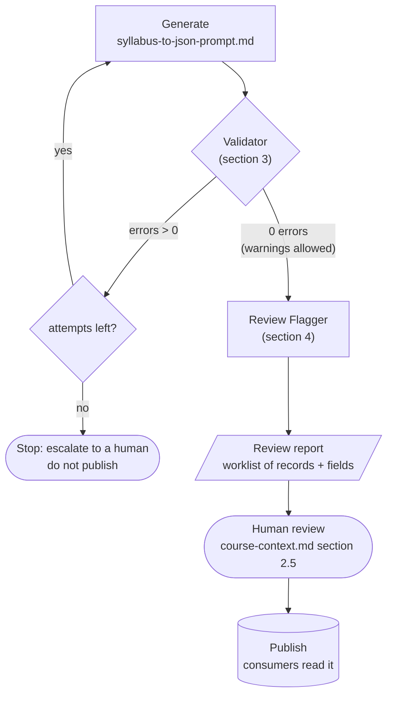

# Validation and Review-Flagging Tools — V1 Specification

| | |
|---|---|
| **Spec ID** | `validation-and-flagging` |
| **Spec version** | `0.1.0` (draft for team review) |
| **Date** | 2026-10-12 |
| **Owner** | Course Context module (Ovunc) |
| **Defines** | two command-line tools: a **Validator** (section 3) and a **Review Flagger** (section 4) |
| **Related spec** | [`course-context.md`](course-context.md) — the data model, field requirements, and human-check list these tools operate on |
| **Status** | this document specifies *what the two tools must do*. It is not an implementation; no code ships with it. |

**Scope.** This spec covers the two tools that sit between generation and publication of a Course Context file (the `syllabus-to-json-prompt.md` output described in `course-context.md` §2). The Validator checks a generated file against conformance rules; the Review Flagger produces a human-review worklist for a file that has already passed validation. Both are pure functions of their input: no network, no model call, deterministic.

**Keywords** MUST, SHOULD and MAY are used as in RFC 2119.

**Changelog**

| Version | Date | Change |
|---|---|---|
| 0.1.0 | 2026-10-12 | First draft: pipeline placement, Validator contract and rules, Review Flagger contract and rules, end-to-end workflow, open questions. |

---

## 1. Purpose

The Course Context file is generated in a single pass from a syllabus (`course-context.md` §2.2). Generation can produce a structurally broken file (a dangling link, a missing field, a prerequisite cycle) or a structurally sound file whose *content* a human still needs to check (an inferred solution, an assumed prerequisite). Two tools separate those two concerns:

| Tool | Question it answers | Blocks publication? |
|---|---|---|
| **Validator** (§3) | Is this file *well-formed* against the schema and link rules? | Yes — a file with any error MUST NOT proceed |
| **Review Flagger** (§4) | Which *content* in this well-formed file should a human look at? | No — it produces a worklist; the human decides |

The Validator is a gate. The Flagger is an assistant to the human review in `course-context.md` §2.5.

---

## 2. Pipeline placement and workflow *(Normative)*

The two tools slot into the `course-context.md` §2.1 pipeline between **Generate** and **Publish**:



**Workflow rules.**

| # | Rule |
|---|---|
| WF-1 | A generated file MUST pass the Validator with **zero errors** before anything else happens to it. Warnings do not block. |
| WF-2 | On one or more errors the file is **discarded and regenerated from scratch** (not hand-patched), then validated again. |
| WF-3 | Regeneration is capped at **N attempts** (default `N = 3`). When attempts are exhausted and errors remain, the run **stops**, does not publish, and surfaces the last error report for human diagnosis. |
| WF-4 | Only a file with zero errors is passed to the Review Flagger. |
| WF-5 | The Flagger produces a **review report** and does **not** modify the validated file. |
| WF-6 | A human works the review report (§2.5 of `course-context.md`), edits the file if needed, and only then publishes. A human edit means the file SHOULD be re-validated (WF-1) before publication. |

**Why regenerate instead of repair (WF-2).** A hand-patched file hides the fact that the generator produced something invalid; regenerating keeps the generator honest and the pipeline reproducible. Feeding the Validator's error report back into the prompt to guide the retry is allowed but not required in V1 (open question 2).

---

## 3. Tool 1 — Validator *(Normative)*

### 3.1 Contract

| | |
|---|---|
| **Planned path** | `specs/tools/validate_course_context.py` |
| **Invocation** | `validate_course_context.py <course-context.json> [--question-schema <qs.json>]` |
| **Input** | one candidate Course Context JSON file (schema 1.0 or 1.1). Optionally a Question Schema file to check as a second mode (§3.4). |
| **Output** | to stdout: one line per finding, `ERROR <rule> <where>: <message>` or `WARN <rule> <where>: <message>`, followed by a one-line summary with error and warning counts and record counts. |
| **Exit code** | `0` when there are zero errors (warnings allowed); `1` when there is at least one error. |
| **Determinism** | pure function of the input bytes. No network, no model, no randomness. The same file always yields the same findings. |
| **Side effects** | none. It never writes to or modifies the input file. |

### 3.2 Error rules

Every rule below is an **error**: a file that violates any of them fails validation (exit `1`) and is regenerated (WF-2). "Record" means any `Course`, `Module`, `Concept`, `LearningObjective`, `Source`, or `AssessmentQuestion` object. Field and ID definitions are in `course-context.md` §1.2 and §1.3.

| Rule | The Validator MUST reject a file where… |
|---|---|
| V-01 | top-level keys are not exactly `course_context_schema_version`, `Course`, the five arrays, and optionally `assumptions`; or `course_context_schema_version` does not look like `1.x` |
| V-02 | a record is missing any required field, or carries an unknown field; or `provenance` appears while `course_context_schema_version` is below `1.1` |
| V-03 | an enum holds a value outside its set (`bloom_level`, `difficulty`, `type`, `Source.type`, `provenance`); `duration_weeks` is not an integer ≥ 1; `weeks` does not match `N` or `N-M`; `requires_figure` is not boolean; a `difficulty_notes` entry is not exactly `{misconception, mitigation}` |
| V-04 | an ID is duplicated, or does not follow the §1.3 pattern; or `Module.id` numbering does not follow `Course.module_ids` order |
| V-05 | any `*_ids` or `*_id` reference points to a record that does not exist |
| V-06 | a forward link and its stored reverse link disagree (`Course.module_ids` ↔ `Module.course_id`; `Module.concept_ids` ↔ `Concept.module_id`; `Concept.objective_ids` ↔ `LearningObjective.concept_id`; `Concept.question_ids` ↔ `AssessmentQuestion.concept_ids`) |
| V-07 | a prerequisite points to a later module, points to itself, or takes part in a cycle |
| V-08 | a question's objective does not belong to any of that question's concepts |
| V-09 | a required field is null, an empty string, an empty array where §1.2 requires ≥ 1, or the literal `"TBD"` |
| V-10 | an `assumptions` entry is not exactly `{entity, id, field, assumption, reason}`, or its `id` does not resolve (a `.*` wildcard that matches no record) |
| V-11 | (schema 1.1) a record is missing `provenance`, or holds a `provenance` outside `{source_backed, ai_inferred}`; or a record named by an exact-ID `assumptions` entry is marked `source_backed` |

### 3.3 Warning rules

Warnings are reported but do **not** block publication. They are passed through to the reviewer.

| Rule | Warn when… |
|---|---|
| W-01 | a Concept has no LearningObjective, or no Source |
| W-02 | a `Source.text_chunk` is a labelled syllabus line (a reference-only source), not a verbatim course excerpt |

### 3.4 Question Schema mode (secondary)

With `--question-schema`, the Validator also checks one Question Schema (`course-context.md` §3.2) against the Course Context file: the exact field set; `course_id` / `concept_ids` / `module_id` consistency; a bank ID resolves or a runtime ID matches the hash rule; objectives and misconception text copied verbatim; `prerequisite_concepts` equals the concept's direct prerequisites; `provenance` valid and a runtime schema never `source_backed`; and `built_from.content_sha256` equals the SHA-256 of the Course Context file bytes. This mode is secondary to the main workflow (§2), which is about the Course Context file. (Open question 3.)

---

## 4. Tool 2 — Review Flagger *(Normative)*

### 4.1 Contract

| | |
|---|---|
| **Planned path** | `specs/tools/flag_for_review.py` |
| **Invocation** | `flag_for_review.py <validated-course-context.json> [-o review-report.json]` |
| **Precondition** | the input file has already passed the Validator (§3) with zero errors. |
| **Input** | one validated Course Context JSON file (schema 1.1, so `provenance` and `assumptions` are present). |
| **Output** | a **review report** (default stdout, or a file with `-o`): a worklist of items for the human reviewer. It does **not** modify the input file (WF-5). |
| **Exit code** | `0` on success. A non-empty worklist is normal, not an error. |
| **Determinism** | pure function of the input. The same file always yields the same report. |

### 4.2 Flagging rules

The Flagger decides *which records and fields a human should look at first*, and *why*. It draws on two signals already in the file — the `assumptions` log and `provenance` — and on the priority list in `course-context.md` §2.5.

| Rule | The Flagger MUST add a review item for… | Priority |
|---|---|---|
| F-01 | every record named by a non-wildcard `assumptions` entry; the item's reason is that entry's `assumption` and `reason` text | from the field (F-02); otherwise *worth checking* |
| F-02 | every **"check first"** field from `course-context.md` §2.5 that sits on an `ai_inferred` record: `AssessmentQuestion.solution`, `rubric`, `common_wrong_answers`; `Concept.prerequisite_ids`, `difficulty_notes`; `Course.assumed_background`; `Course.duration_weeks` and `Module.weeks` when inferred; any `AssessmentQuestion.requires_figure = true` | **check first** |
| F-03 | each **wildcard** `assumptions` entry (`id` ending in `.*`), surfaced once as a global note, not attached to a single record | *global note* |

`source_backed` records with no naming assumption are not flagged.

### 4.3 Review report shape

The report is a list of items plus a short summary. One proposed shape:

```json
{
  "course_id": "calc1",
  "built_from_sha256": "<sha256 of the input file>",
  "summary": { "check_first": 0, "worth_checking": 0, "global_notes": 0 },
  "items": [
    {
      "priority": "check_first | worth_checking",
      "entity": "AssessmentQuestion",
      "id": "calc1.06-integral-applications.by-parts.q1",
      "field": "solution",
      "reason": "AI-inferred solution; the engine treats it as ground truth (course-context.md 2.5)."
    }
  ],
  "global_notes": [
    { "field": "difficulty_notes", "reason": "Wildcard assumption: all difficulty notes come from teaching experience." }
  ]
}
```

The report is a *worklist*, not a status stored on the data. V1 does not write a review flag back into the Course Context file; the published file carries only `provenance` (open question 1).

---

## 5. What these tools do not do

- They do **not** generate or repair content. Regeneration is the generator's job (WF-2); edits are the human's.
- They do **not** set `provenance`. The generator emits it (`course-context.md` §1.4).
- They do **not** decide what is *correct* — only what is *well-formed* (Validator) or *worth a human's attention* (Flagger). Judging whether an inferred solution is right is the reviewer's job.
- They do **not** call a model or the network.

---

## 6. Open questions and recommended V1 choices

| # | Question | Recommended V1 choice |
|---|---|---|
| 1 | **Where does the review flag live** — a field on each record, or a separate report? | A separate review report (§4.3). It keeps the published Course Context file to `provenance`-only (the `course-context.md` decision) and keeps the data clean. Revisit if consumers need an inline flag. |
| 2 | **Does the Validator's error report feed the regeneration retry?** | V1 regenerates from scratch (WF-2). Optionally append the error list to the prompt to guide the retry; measure whether it reduces attempts before committing to it. |
| 3 | **Is Question Schema validation part of this tool or a separate one?** | Keep it as the Validator's secondary `--question-schema` mode (§3.4) for now; split it out only if the Question Schema builder moves to another team (`course-context.md` open question 11). |
| 4 | **Default attempt cap `N`.** | Start at `N = 3`. Raise only if generation proves flaky on real syllabi. |
| 5 | **Report format — JSON, Markdown, or both?** | JSON for machines (§4.3); a human-readable rendering MAY be derived from it. Do not maintain two hand-written formats. |

---

## Appendix A. Example findings (informative)

Validator, on a clean file:

```
WARN  W-02 Source:neuhauser.s7-2: text_chunk is a syllabus line, not a verbatim excerpt
...
calc1.course-context.json: 0 error(s), 32 warning(s)  records={Module:6, Concept:33, LearningObjective:33, Source:32, AssessmentQuestion:66}
```

Validator, on a broken variant (dangling reference), exit `1`:

```
ERROR V-05 Concept:calc1.03-derivatives.chain-rule: prerequisite_ids -> 'calc1.03-derivatives.nope' does not exist as Concept

calc1.broken.json: 1 error(s), 0 warning(s)
```

Flagger summary line (informative):

```
review-report.json written: 11 check_first, 22 worth_checking, 3 global_notes
```
