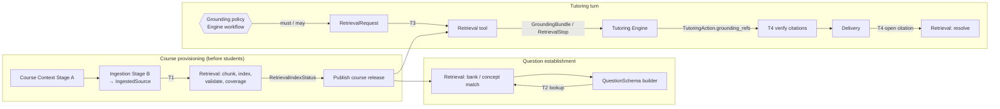
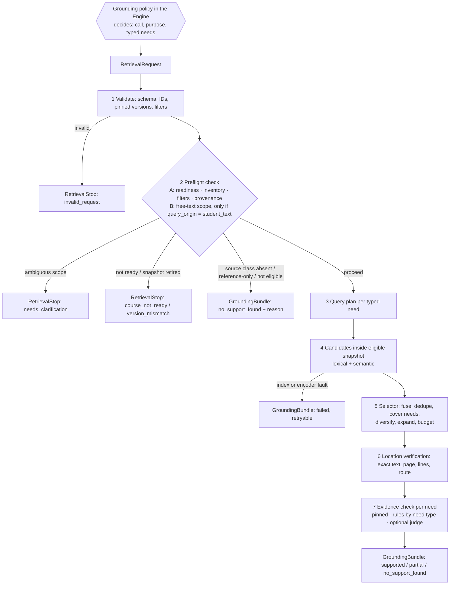

# Course Knowledge Retrieval (Knowledge Base / RAG) — V1 Module Specification

| | |
|---|---|
| **Spec ID** | `rag-retrieval` (team README proposes the filename `knowledge-retrieval.md`; see Q1) |
| **Status** | Working draft toward the team's interface V0.1 freeze; not yet reviewed |
| **Revision** | V1 draft, updated 2026-10-16. Supersedes the local draft of 2026-10-13 and the first upload of 2026-10-16. |
| **Owner** | Course Knowledge Retrieval: Sean (Zixiang Song) |
| **Primary partners** | Ovunc (Course Context and Ingestion), Jonathan (Interaction, routing, shared interfaces), Tutoring Engine owner (TBD), Yining (Delivery) |
| **Shared contracts** | `interfaces.md` V0.1 is canonical for record names and fields. `architecture.md` defines component ownership. `course-context.md` 0.5.0 defines `CourseContext`, `QuestionSchema` and Stage A/B ingestion. All three were reviewed at `integration-spec` commit `088c6ec` (2026-10-15). |
| **Companion files** | Mermaid sources in `diagrams/` (`retrieval-touchpoints.mmd`, `retrieval-turn-flow.mmd`, `identity-and-versions.mmd`); scenario fixtures in `examples/` (`calc1.retrieval.*.json`) |

**Status labels**

- **[Module]**: behavior owned by Retrieval. Other modules may rely on it once V0.1 is frozen.
- **[Proposed]**: a change to a shared record or to another module's behavior. It takes effect only after the affected owners agree; nothing is applied silently.
- **[Open]**: a decision the team still has to make. All of these are listed in §15.

MUST, SHOULD and MAY follow RFC 2119.

---

## 1. Purpose and scope

Course Knowledge Retrieval is the system's **course-evidence tool**. It turns approved course materials into a searchable index. When another component asks, it returns the exact passages that support a specific tutoring need, together with a precise source location and an explicit statement of how well the need is supported.

It answers one question for its callers:

> *Which course text, at which exact location, supports this specific need, and how completely?*

It does **not** decide whether the student is right, what the student knows, what to do next, or **when evidence is needed**. Those are Tutoring Engine decisions. The Engine calls this tool according to the grounding policy in §2.2.

### 1.1 Current inputs (as of 2026-10-16)

| Input | What it actually is | Role in V1 |
|---|---|---|
| **Prototype corpus: six AI course-breakdown LaTeX files** | Ovunc's earlier syllabus-understanding research output (`research/syllabus-understanding/syllabus-breakdown-examples/` on `ovunc/syllabus-understanding`). The files are `Calc1_Syllabus_Claude.tex`, `Calc1_Content_Claude.tex`, `Calc1_Book_Claude.tex`, `Number_Syllabus_Claude.tex`, `Number_Content_Claude.tex` and `Number_Claude_Interactive.tex`. They are model-written course maps, curriculum summaries and textbook-structure outlines. **They are not human-authored lecture notes or textbook text.** The Week 3 prototype indexed them into 130 sections and 221 passages, with real BGE and Qwen3 embeddings, citing LaTeX **source lines**, not pages. All are `unverified`. | **Development corpus only** (§6.6). It is useful for building and testing the pipeline end to end, because it has real structure and stable line maps. It may ground student-facing claims only under an explicit development or pilot policy, always labelled `ai_generated` / `unverified_source`. |
| **Shared Course Context** (`calc1.course-context.json`) | Course Context Stage A output from the one-page JHU AS.110.106 syllabus: 6 modules, 33 concepts, 32 `Source` records (syllabus references only) and 66 AI-written questions. | **Canonical IDs and scope** (`course_id`, `Concept.id`, `Source.id`). The prototype corpus is not yet linked to these IDs; the link is part of the migration (§6.6). |
| **Accepted course materials** (lecture notes, textbooks, worked examples obtained by the team or the enterprise, accepted by a reviewer at document level) | None ingested yet (Stage B is post-V1) | The production target (§6.6 lists the recommended formats) |

### 1.2 What V1 must deliver

1. **A stable tool contract** (`RetrievalRequest` → `GroundingBundle` or `RetrievalStop`) that the Engine and Interaction can integrate against now.
2. **Honest results with today's inputs.**
   - Under the default (production) policy, no approved text exists. A grounding request therefore completes as `no_support_found` with a `reference_only` warning.
   - Under the development policy, the AI-breakdown corpus may answer, but every passage is marked `ai_generated` and carries an `unverified_source` warning. Retrieval never presents either kind of material as textbook text.
3. **The ingestion handoff (`IngestedSource`) and the index lifecycle**, so that approved lecture notes and textbooks can be switched on without changing the turn-time contract.
4. **The lookups the QuestionSchema builder needs** (bank match, concept match) before a `question_id` exists (§7.10).
5. **A grounding policy proposal**: when the Engine must, may, or must not call the tool (§2.2).

### 1.3 Out of scope for V1

- live web search;
- cross-course retrieval for student-facing grounding;
- retrieval over student work or learner history;
- generating course content;
- figures and images as evidence (V1 handles text and equations only);
- languages other than English (§11);
- any judgment of mathematical correctness.

### 1.4 Operating assumption: no instructor, limited human review [Module]

The project has **no course instructor**. Wherever a design would normally rely on an instructor, it relies instead on **human review by team members**, and that capacity is small. Human review is therefore **one method among several, used sparingly**. It is not something the design depends on.

1. **Never a routine blocker.** Normal operation (indexing, retrieval, evidence checks) MUST work with no human in the loop. Unreviewed items get safe defaults: they are excluded, labelled, or treated as uncertain. They never get silently promoted.
2. **Targeted, in priority order:**
   1. one-time **document-level acceptance** at provisioning: is this the right file and edition, and does it belong to this course? This takes minutes per document;
   2. items the automation flags as **low-confidence and high-impact**, such as an outline-to-concept mapping below threshold, or a suspected solution inside notes;
   3. a **small random spot-check** per release, for example 20–30 evidence-check outcomes, to estimate error rates such as false `covered`;
   4. issues raised by users.
3. **Not a data source.** The design does **not** assume that humans will systematically produce labelled training or evaluation sets. Evaluation relies on automatically produced silver labels (rules and model judgments cross-checked against each other). Human spot-checks are used only to estimate how wrong those labels are.
4. **Always recorded.** Every reviewable item carries `review_status ∈ {unreviewed, auto_checked, human_confirmed, human_rejected}`, so that consumers can tell confirmed items from unreviewed ones.

In this document, "reviewer" means a team member acting in this role. Where shared specs say "professor" or "course administrator" (e.g., `architecture.md` §6 provisioning), the same team-member role applies.

---

## 2. How Retrieval is used

### 2.1 Four touchpoints

Retrieval is used at four points. Only one of them, T3, is an on-demand tool call; the others are fixed steps or mandatory checks.

| # | Touchpoint | Kind | Caller | Input → output |
|---|---|---|---|---|
| T1 | **Index build and readiness** | Fixed provisioning step | Course Context and Ingestion / provisioning pipeline | `IngestedSource` + course retrieval policy → `RetrievalIndexStatus` + coverage report |
| T2 | **Course-Context lookups** | Fixed step inside `build_question_schema` | QuestionSchema builder | course + confirmed question text → `CourseContextLookupResult` (bank match / concept match / `NO_CONCEPT_MATCH`) |
| T3 | **Turn-time grounding** | **On-demand tool call, governed by the grounding policy (§2.2)** | Tutoring Engine (recommended; Q2) | `RetrievalRequest` → `GroundingBundle` or `RetrievalStop` |
| T4 | **Citation resolution and verification** | Mandatory check | Engine / coordinator before delivery; Delivery when a citation is opened; session resume | passage reference → resolved passage, or `revoked` / `unavailable` |



There are two reasons for separating the touchpoints. First, the shared `RetrievalRequest` requires a `question_id`, which does not exist yet at T2. Second, a failed index build (T1) should block student access, not surface later in a turn as `no_support_found`.

### 2.2 Grounding policy: when the Engine calls the tool [Proposed, joint with the Engine owner]

T3 is a **tool call**, not a stage that every student message passes through. Retrieving on every message wastes latency, searches with the wrong text, and invites the model to treat "related" as "supported".

The decision to call is made by **workflow rules in the Engine**, not left only to a language model. A model left on its own may skip retrieval and cite from memory; Jonathan's prototype evaluation observed fabricated page citations of this kind. Rules therefore fix what must happen and what must not happen, and the model's discretion applies only to the "may" rows.

**Hard rules [Proposed]**

- **R1. A course-specific claim requires grounding.** If a `TutoringAction` states a course-specific definition, formula, method, convention, example or policy, the Engine MUST have a `GroundingBundle` from the same turn whose passages cover it. Otherwise the action must avoid the claim or state that no course material is available. T4 enforces this rule: every `grounding_refs` entry must come from a bundle of the same session and turn.
- **R2. No retrieval where it adds nothing or causes harm.** This includes:
  - recognition confirmation;
  - requests for missing student work;
  - correctness checking (that is a math or verification tool, not retrieval);
  - encouragement or turn management.
- **R3. Every call states what it is for.** Each call states a `purpose` and typed `evidence_needs` (§6.4), and is built from structured context, not from the full student history.
- **R4. Every bundle status has a planned fallback.** The fallback for each status is decided before the call (table below). With today's default policy, every call returns `no_support_found`, so a missing fallback would block the action.

**Retrieval column for the Engine's actions** (`action_type` from `interfaces.md` §11; the trigger examples follow `System workflow.pdf` §8.3). The Engine owner owns the state → action mapping; Retrieval proposes the retrieval column.

| `action_type` | Typical learner-state trigger | Retrieval | `purpose` | Typical `evidence_needs[].need_type` | Filters / guard | Fallback on `no_support_found` / `failed` |
|---|---|---|---|---|---|---|
| `elicit` | Start of a question; insufficient evidence | Not needed | — | — | — | — |
| `inspect` | Only a final answer given; work missing | Not needed (R2) | — | — | — | — |
| `probe` | Partially correct step | **May** | `definition_lookup` | `definition`, `notation_convention` | concept of the step | Probe without course wording |
| `diagnose` (internal) | Cue matches a misconception | **May** | `diagnosis_support` | `definition`, `theorem_statement` | Engine-facing only | Diagnose from QuestionSchema cues alone |
| `hint` | Local misconception; missing step | **Must if the hint states a course method or formula** (R1) | `hint_support` | `formula_statement`, `method_guidance` | exclude the current question's solution | Socratic hint without a course citation |
| `contrast` | Wrong approach | **Must** | `example_lookup` | `worked_example` (correct technique), `method_guidance` | `document_role ∈ {worked_examples, lecture_notes}`; exclude the same problem | Contrast the two methods without a course example |
| `demonstrate` | Wrong approach; repeated difficulty | **Must** | `example_lookup` | `worked_example` | Exclude the current problem and its bank siblings' solutions | Switch to `contrast`, or an Engine-generated example labelled "not from course materials" if policy allows |
| `explain` | Missing prerequisite; repeated difficulty | **Must** (R1) | `answer_grounding` or `prerequisite_review` | `definition`, `theorem_statement`, `prerequisite_explanation` | concept + prerequisites | Brief general explanation without citation if policy allows; otherwise say that no course material covers this point |
| `retry` | After a hint | Not needed (refers to the prior action) | — | — | — | — |
| `verify` | Checking a result | **Must not** for correctness (R2); **may** use `citation_check` for a course convention | `citation_check` | `notation_convention` | — | Verify with the math tool only |
| `check_understanding` | Evidence sufficient and correct | **May** | `practice_generation` | `worked_example`, `exercise` | `engine_only` solutions never shown | Engine-written check question |
| `transfer` | Mastery near target | **May** | `practice_generation` | `exercise`, `worked_example` | `engine_only` solutions never shown | Engine-written transfer question |

Purposes marked new are [Proposed] additions to the `interfaces.md` §8 enum, which currently lists `answer_grounding`, `diagnosis_support`, `hint_support` and `citation_check`. The additions are `definition_lookup`, `example_lookup`, `prerequisite_review`, `practice_generation`, and `approach_grounding` (the latter used only by the builder, §7.10).

**Who enforces what**

- The Engine's workflow applies the rules (R1–R4).
- T4 rejects citations that do not come from the turn's bundles.
- Retrieval's preflight (§7.4) enforces the safety boundaries, whatever the caller does.

---

## 3. Responsibilities

### 3.1 Retrieval owns [Module]

| Responsibility | Concretely |
|---|---|
| Index lifecycle | Chunking ingested pages (default owner per `course-context.md` Q13); embedding and lexical indexing; index versions; build validation; coverage report; atomic switch to a new index |
| Request validation | Schema checks; ID resolution against the pinned Course Context and QuestionSchema; scope consistency |
| Preflight check | Readiness, version, source-class inventory, filter authorization, provenance policy, and a free-text scope check when the query carries student text (§7.4) |
| Query planning | Queries from typed evidence needs and Course Context terms; notation normalization (§7.5) |
| Eligibility filtering | Course, release, approval, provenance, visibility and scope filters applied **inside** the search (§7.6) |
| Candidate generation and the Selector | Hybrid search, fusion, deduplication, need coverage, diversity, budget, optional reranking (§7.7) |
| Location verification | Exact text, page, lines and `highlight_url` for every passage, checked against the ingested pages (§7.8) |
| Evidence check | A per-need decision on whether the returned passages support each stated need (§7.9) |
| Status and warnings | The canonical `retrieval_status`, machine-readable warnings; component faults are never disguised (§8, §9) |
| Citation resolution and verification (T4) | Re-resolving and validating passage references (§7.12) |
| Diagnostics | Optional `RetrievalReport` (§8.4) |

### 3.2 Retrieval does not own

| Not owned | Owner | Why the boundary matters |
|---|---|---|
| **When to retrieve and for what** | Tutoring Engine, following the grounding policy (§2.2) | Retrieval never infers "needed" or "not needed" from query text |
| Registering, approving and publishing documents; normalized page text; stable line maps | Course Context and Ingestion (Stage B) | `IngestedSource` is the location source of truth; Retrieval never renumbers lines |
| `CourseContext` and `QuestionSchema` content, including AI-inferred fields | Course Context | Read for scope and query terms; never cited as source text |
| Student correctness, mastery, misconceptions, gaps | Tutoring Engine | A high-scoring passage says nothing about the student |
| What to do with `supported` / `partial` / `no_support_found` / `failed` | Tutoring Engine | Retrieval reports support; the Engine decides how to use it |
| Composing and presenting tutoring text | Engine (content), Delivery (presentation) | Delivery shows only passages in `TutoringAction.grounding_refs` |
| Capturing student input; `StudentEvidence` | Interaction | Retrieval receives at most a minimal `evidence_summary` |
| Session state and the trace index | Session State and Trace | Retrieval emits records and trace events only |

### 3.3 What the Tutoring Engine decides with Retrieval's output

The Engine decides:

- which needs to request, following the grounding policy;
- whether `partial` support is enough for the action. A `partial` passage MUST NOT be cited for needs it does not cover;
- the fallback on `no_support_found` or `failed` (§2.2, R4);
- whether to use `ai_generated` / `unverified_source` passages at all, following its policy on AI-inferred content (`course-context.md` Q6);
- which passages to attach to `grounding_refs`.

---

## 4. Dependencies

| Dependency | Required for | V1 status | If missing or failing |
|---|---|---|---|
| `CourseContext` (published, versioned) | T2, T3 scope and query terms | Available (calc1, schema 1.1) | `course_context_unavailable` stop |
| `QuestionSchema` (frozen) | T3 for an established question | Available | `question_context_mismatch` stop |
| `IngestedSource` (normalized pages + line maps) | T1; passage-level grounding | **Not yet**: Stage B is post-V1. The AI-breakdown corpus can be converted into it (§6.6). | `no_support_found` + `reference_only` / `no_ingested_sources` |
| Course retrieval policy | T1, T3 | To be defined at course setup | Strictest defaults (§6.5) |
| Lexical index | T1, T3 | Historical: PostgreSQL full-text (Week 3) | `failed` (`index_unavailable`), retryable |
| Embedding encoder + vector index | T1, T3 semantic channel | Historical: BGE-base, Qwen3-0.6B, pgvector | Lexical-only + `semantic_channel_unavailable` if the policy allows, otherwise `failed` |
| Source viewer / location resolver | `highlight_url`, T4 | **Not yet**; viewer is [Open] Q8 | Passages without a location are excluded (`location_unavailable`) |
| Optional model components (scope check, reranker, evidence judge; e.g., Jev) | Quality only | Historical experiments; external provider | Deterministic path + `*_fallback` / `sufficiency_uncertain` |
| Session and trace service | Pinning, trace events | `interfaces.md` §13–14 | Retrieval still returns its records |

Provider names (models, databases, vendors) never appear as required interface fields. They appear only in diagnostics and index manifests.

---

## 5. Identity, versioning and location model

See `diagrams/identity-and-versions.mmd`.

### 5.1 Identifier chain

| Identifier | Meaning | Assigned by | Stability rule |
|---|---|---|---|
| `course_id` | Course instance (`Course.id`) | Course Context | Every retrieval is scoped to exactly one course |
| `Source.id` | A citation entry in one Course Context file (e.g., `neuhauser.s7-2`) | Course Context | Unique within one file only; Retrieval keys it as `(course_id, Source.id)` |
| `document_id` | One logical uploaded work | Ingestion registrar | Stable across versions |
| `content_version` | One immutable parsed text of a document version | Ingestion | New value whenever page text or line numbering changes |
| `SourceDocumentLink` [Proposed] | `(course_id, Source.id) → (document_id, page/section range)` | Ingestion: auto-mapped with a confidence score; a reviewer checks only low-confidence links | Required before a `Source` can lead to passages; unreviewed low-confidence links are not used |
| `passage_id` | One citable span: `(document_id, content_version, page_number, line_start, line_end)` | Retrieval [Module] | Deterministic (a hash of the five values); stable within a `content_version` |
| `chunk_id` / `chunking_policy_version` | Internal search unit and its policy | Retrieval | May change on re-chunking without changing any `passage_id` |
| `index_version` | Content versions + chunking policy + encoder revisions + lexical configuration | Retrieval | Immutable; old versions stay resolvable for audit |
| `retrieval_snapshot_id` [Proposed] | The published `(document_id, content_version)` set + `index_version` | Retrieval, at publish | Pinned per session; never switched inside a turn |

**Lesson from the prototype.** The Week 3 `passage_id` hashes `document:start:end` with no content version. If the text changes but the line numbers stay the same, an old ID silently points at new text. V1 identity MUST include `content_version`.

### 5.2 Search unit vs citation unit

- **Chunk (search unit).** Sized for the index; may overlap; never returned to callers. The Week 3 baseline caps a passage at about 2,300 characters and an embedding segment at 384 tokens with a 25-word overlap.
- **Passage (citation unit).** An exact, non-overlapping line span on **one page** of a `content_version`. Chunk hits resolve to passages, and deduplication happens at passage level.
- **Single-page rule [Module].** A span that crosses a page is returned as adjacent passages (Q9).
- **Derived text is a search aid, never evidence.** This covers Course Context `Concept` text, prototype concept cards, and any generated summaries or questions added at index time (§6.6). Such text may help find passages; it is never returned as a passage.

### 5.3 Page and line semantics [Proposed clarification of `interfaces.md` §9]

- **`page_number`**: the 1-based **physical page** of the ingested file; the viewer opens this. Jonathan's prototype cited PDF page 4 for content printed on page 5, which is why the two must not be confused.
- **`page_label`** (optional): the printed page label, shown to the student.
- **`line_start` / `line_end`**: inclusive, 1-based lines of the **normalized page text** in `IngestedSource`. Retrieval never computes its own line numbers.
- **LaTeX / Markdown sources.** Source-file lines are not page lines. Compile to PDF and ingest the PDF (§6.6); source lines remain internal provenance (`legacy_locator`).

### 5.4 `highlight_url` [Proposed]

- A **stable application route**, for example `/courses/{course_id}/sources/{document_id}/versions/{content_version}/view?page={page_number}&lines={line_start}-{line_end}`.
- Authorization is enforced **when the link is opened**, so no expiring credentials are stored in records.
- A passage is emitted only after the resolver confirms that the route opens the same document, version, page and lines. Retrieval never guesses a PDF fragment.

---

## 6. Inputs

### 6.1 `CourseContext` [Module usage]

| Field(s) | Use | Trust treatment |
|---|---|---|
| `Course.id`, `course_context_schema_version`, file `content_sha256` | Scope key; version pin; mismatch detection | Structural |
| `Module.*`, `Concept.module_id` | Scope narrowing; section-to-concept filters | Structural |
| `Concept.id`, `name`, `key_definitions`, `summary` | Query expansion; T2 concept-match candidates | Usually `ai_inferred`; search hints only, never evidence |
| `Concept.prerequisite_ids` | Optional scope expansion to direct prerequisites | Usually `ai_inferred`; scope hint only |
| `Concept.source_ids` → `Source.*` | Leads to eligible documents through `SourceDocumentLink`; display citation label | `source_backed` only means *the syllabus names the source*. A `text_chunk` starting with `Syllabus entry:` or `Syllabus reference:` is never embedded or returned (`course-context.md` Q2). |
| External bank question `{id, prompt, concept_ids}` (if a question bank is provided; not part of CourseContext) | T2 bank-match candidates | Kept in a separate lookup index, never in the passage index |
| External bank question answer / `rubric` | Not used | Engine-only; never indexed |

### 6.2 `QuestionSchema` [Module usage]

Retrieval reads only:

- `question_id`, `origin`, `course_id`, `module_id`;
- `concept_ids` (primary first);
- `prompt` (display-safe), `question_type`;
- `source_reference`, `provenance`, `built_from`.

It never reads or indexes `correct_approach`, `alternative_approaches`, `reference_answer`, `rubric` or `common_misconceptions`.

`course_id` and every `concept_id` must resolve in the Course Context named by `built_from`; otherwise the request stops with `question_context_mismatch`.

When `source_reference.grounding = excerpt` and approved `passage_refs` are present (Q7), those **pinned passages** are returned first, re-resolved on their pinned `content_version`.

### 6.3 `IngestedSource` [Response to the `interfaces.md` §9 proposal]

Retrieval **accepts** `IngestedSource` and **accepts chunking ownership** (`course-context.md` Q13 default). It chunks from `pages[]` and preserves the page/line map exactly. Ingestion-supplied `chunks[]`, if present, are hints only.

Proposed additions (minor version):

| Field | Required | Why |
|---|---|---|
| `course_id` | Yes | Cross-course isolation at index time |
| `document_role` | Yes | `lecture_notes`, `textbook`, `slides`, `worked_examples`, `problem_set`, `solutions`, `exam`, `syllabus`, `ai_course_breakdown`, `other`. Drives source-class availability and visibility. |
| `source_provenance` | Yes | `course_material`, `published_text`, `ai_generated`. Distinguishes human-authored course text from AI-written material such as today's breakdown corpus. |
| `approval` (`status`, `approved_by`, `approved_at`, `review_status`) | Yes | Document-level acceptance by a reviewer (§1.4); only accepted versions are indexed under the production policy |
| `pages[].page_label` | No | Printed label (§5.3) |
| `pages[].text_sha256` | Yes | Proves that passage text equals the ingested lines |
| `pages[].lines[]` with optional `bbox` | Optional | Only if highlighting by line geometry |
| `outline[]` (`section_id`, `title`, `level`, start/end page+line, `concept_ids`, `mapping_confidence`, `structure_inferred`) | Yes, possibly empty | Section-aware chunking, concept scoping, context expansion |
| `blocks[]` (`block_type`, page/line range) | Recommended | `block_type ∈ {definition, theorem, proof, example, solution, exercise, remark, figure_caption, other}`. Makes the evidence check and the answer-leak guard workable (§6.6, §7.9). |
| `source_links[]` → `SourceDocumentLink` | Yes, possibly empty | Turns a syllabus `Source` into an eligible page range |
| `extraction_warnings[]` | Yes, possibly empty | Low-confidence pages are excluded or flagged |

T1 validates each document. A failing document → `ingest_rejected`; the others still build (`partial` readiness).

### 6.4 `RetrievalRequest` (canonical, `interfaces.md` §8)

**Producer:** Tutoring Engine (recommended, Q2). **Consumer:** Retrieval.

**Canonical fields.** The common envelope plus `retrieval_request_id`, `course_id`, `question_id`, `turn_id`, `query` and `purpose`. Optional: `concept_ids`, `document_filters`, `evidence_summary`, `top_k`.

**Proposed optional additions** (minor version):

| Field | Type | Why |
|---|---|---|
| `evidence_needs[]` | `[{need_id, need_type, description, concept_ids?}]` | Support can only be judged relative to stated needs. The `need_type` vocabulary is `formula_statement`, `definition`, `theorem_statement`, `worked_example`, `exercise`, `method_guidance`, `prerequisite_explanation`, `notation_convention` and `course_policy`; it tells the evidence check what to look for (§7.9). |
| `query_origin` | `structured` / `student_text` | `structured`: built by the Engine from QuestionSchema / Course Context. `student_text`: contains the student's own words, which triggers the free-text scope check (§7.4 B). |
| `course_context_ref` | `{course_context_schema_version, content_sha256}` | Same Course Context as the caller (copied from `built_from`) |
| `retrieval_snapshot_id` | string | Pins the release; resumed sessions reuse it |
| `scope` | `{module_ids?, include_prerequisites?}` | Explicit narrowing |
| `exclude` | `{question_ids?, same_problem_as_current?: bool}` | Answer-leak guard for `example_lookup` / `practice_generation` |
| `query_language` | BCP-47, default `en` | V1 is English-only (§7.5) |
| `max_passage_chars` | int | Consumer budget |

**Validation [Module]**

1. A schema-valid envelope; a non-empty `query` of at most 2,000 characters; `top_k` from 1 to 10 (default 4); at most 4 needs.
2. A published release must exist for the course, otherwise the request stops with `course_not_ready`.
3. `question_id` must resolve within the same course; `concept_ids` must belong to the question, its direct prerequisites, or be marked exploratory.
4. `document_filters` may only narrow the eligible set (`filter_not_permitted`).
5. `evidence_summary` is at most 500 characters and contains no identifiers and no full history (`evidence_summary_too_broad`).
6. **Restricted-field rule.** Interaction-built requests use display-safe fields only. Engine-built requests may phrase needs using restricted knowledge, and the resulting passages are Engine-facing until attached to an action.
7. An invalid request returns `RetrievalStop` with `invalid_request`, never `no_support_found`.

### 6.5 Course retrieval policy [Proposed]

A versioned per-course configuration, set at provisioning. It replaces the prototype's hard-coded `calc2`, second-semester and line-range rules.

| Setting | Example | Default |
|---|---|---|
| `allowed_source_classes` | `[lecture_notes, textbook, worked_examples]` | Roles present in the release |
| `allow_unverified_sources` | `none` / `development` / `pilot` | `none`: `ai_generated` or unapproved documents are not eligible |
| `excluded_scopes` | Out-of-course outline ranges (e.g., Calculus II chapters) | None; cross-course is always excluded |
| `visibility` by `document_role` and `block_type` | `solutions`, `exam`, `solution` blocks → `engine_only` | Same as the example |
| `authority_order` | `lecture_notes > worked_examples > textbook > ai_course_breakdown` | Equal, except `ai_course_breakdown` is always last |
| `free_text_scope_rules` | Named-course, semester and source-class patterns | Generic rules only |
| `model_scope_check`, `reranker`, `evidence_judge` | `off` / `shadow` / `on` | `off` |
| `external_processing_allowed` | `false` | `false`: no student text goes to an external model provider |
| `policy_version` | `calc1-retrieval-policy@1` | Required; recorded in every report |

### 6.6 Current corpus, and recommended inputs for ingestion [Proposed, with Ovunc]

#### 6.6.1 How the current corpus is used in V1

The six AI course-breakdown LaTeX files (§1.1) stay valuable, but in a precise role:

1. **Development and integration corpus.** They are registered as `document_role = ai_course_breakdown` and `source_provenance = ai_generated`, with approval `unverified`. They are eligible only when `allow_unverified_sources ∈ {development, pilot}`. Every returned passage carries `unverified_source`, and its `source_label` says "AI-prepared course map (unverified)" (example `h`).
2. **First end-to-end test of Stage B.** Each `.tex` file is compiled to PDF. PDF text plus SyncTeX (the LaTeX source-to-PDF position map) gives page/line maps, and the LaTeX environments give `outline[]` and `blocks[]`. This produces real `IngestedSource` records and exercises page/line citations and `highlight_url` before any accepted course material arrives.
3. **ID alignment.** Breakdown sections are mapped to the shared Course Context concept IDs through `outline[].concept_ids`. For `calc1`, the six module boxes match the six Course Context modules, so the mapping is mostly mechanical; it still needs a review pass.
4. **Never presented as textbook text.** The Engine decides, by policy, whether to use these passages at all (`course-context.md` Q6).

#### 6.6.2 Recommended formats for production materials

The aim is to give retrieval the **original document** (the citation target) **plus as much reliable structure as possible**. Ranked by efficiency and fidelity for a math course:

| Rank | Material form | Why | Processing needed |
|---|---|---|---|
| 1 | **LaTeX source + its compiled PDF** (lecture notes are often written in LaTeX) | Exact mathematics; structure and block types come for free from environments (`theorem`, `definition`, `example`, `proof`, `exercise`); SyncTeX maps source to PDF pages and lines, so citations are exact | Compile and map; light normalization |
| 2 | **Born-digital PDF with a text layer and bookmarks / TOC** (publisher textbook, exported notes) | Pages are exact; the outline comes from bookmarks (Jonathan's prototype already reads them with PyMuPDF) | Math-aware text extraction (formulas are often garbled in a plain text layer); header/footer removal; block typing by rules or a model, then review |
| 3 | **EPUB / HTML with MathML** (publisher e-book) | Clean structure and math | Page mapping may be missing (needs a page list); licensing check |
| 4 | **Slides (PDF export)** | Each slide is one page; good for definitions and examples | Sparse text; often needs the speaker notes |
| 5 | **Scanned PDF / photos** | Accept only when nothing else exists | OCR + math OCR; lowest fidelity; mandatory review of low-confidence pages |

#### 6.6.3 Why not send a ready-made JSON of the textbook?

A JSON export of the textbook, whether hand-made or AI-made, is **not** the recommended primary input:

- it loses the page fidelity that citations need;
- it pre-decides chunking;
- if a model produced it, it becomes `ai_generated` and is no longer source text.

**JSON is the output of ingestion (`IngestedSource`), not the input.** The upload should be the original files plus a small manifest. In this example the manifest is JSON, but any equivalent is fine:

```json
{
  "course_id": "calc1",
  "document_role": "lecture_notes",
  "title": "Calculus I Lecture Notes, Fall 2026",
  "edition_or_version": "2026-11-01",
  "files": ["calc1-notes.tex", "calc1-notes.pdf"],
  "covers_sources": [{"source_id": "neuhauser.s7-2", "pages": "41-48"}],
  "in_scope_ranges": "all",
  "contains_solutions": false,
  "rights": "course members only",
  "accepted_by": "reviewer (team member)",
  "review_status": "human_confirmed"
}
```

#### 6.6.4 Granularity and separation

- **Textbooks.** Send the syllabus chapters, or the whole book with in-scope ranges marked; out-of-scope ranges become `excluded_scopes`. Both work. Whole books add noise and rights questions.
- **Solutions, answer keys and exams with answers.** These are **separate documents**, so that they can be marked `engine_only` as a whole. Solutions embedded in notes are caught by `solution` blocks.
- **Lecture notes.** Per lecture or per chapter is ideal; one large file is fine if it has bookmarks.

#### 6.6.5 Further processing ("re-processing") after upload

Yes, further processing is needed. Raw text alone is not enough for reliable evidence checks:

| Step | Owner | Purpose |
|---|---|---|
| Normalize page text (headers/footers, hyphenation, math kept as LaTeX inline) | Ingestion | Stable lines; exact passage text |
| Structure: outline + `blocks[]` with `block_type` | Ingestion (rules from LaTeX or PDF; model-assisted for plain PDFs, then review) | Need types map onto block types (`worked_example` → `example`); solution blocks become `engine_only` |
| Section → concept mapping | Ingestion with Course Context; automatic with confidence; reviewer checks low-confidence items only | Concept scoping; coverage report |
| Chunking, embedding, lexical index | Retrieval | Search |
| Optional index-time enrichment (contextual headers such as "Ch. 7.2 › Integration by parts", generated paraphrases or questions) | Retrieval | Better recall. Treated as derived search aids only; never returned as evidence (§5.2). |
| Document-level acceptance (right file, edition, course); mapping spot-check | Reviewer (team member), at provisioning, minutes per document | Production eligibility (§1.4) |

---

## 7. Functions and expected behavior

### 7.1 Turn-time flow (T3) [Module]

See `diagrams/retrieval-turn-flow.mmd`.



### 7.2 Three separate judgments [Module]

| Judgment | Question | Decided at | Does **not** imply |
|---|---|---|---|
| Can this request be served? | Ready, permitted, in scope, and does the requested source class exist? | Preflight (step 2, before search) | That any passage covers the need |
| Candidates found | Did search return plausible text? | Steps 4–5 | That the text supports the need |
| Evidence sufficient | Do verified passages directly support **each stated need**? | Evidence check (step 7, after search) | That the student is right, or that the Engine must use it |

Similarity, fusion and reranker scores are ranking signals. They are neither probabilities of truth nor sufficiency findings.

### 7.3 Validation [Module]

Validation follows §6.4. Failures are caller errors and return `RetrievalStop` with `validation_errors`. They are not retried automatically.

### 7.4 Preflight check (formerly "Gatekeeper") [Module]

The preflight runs **before** search and inspects the **request and the library's inventory**, never search results. Because the Engine's grounding policy already decides *whether* to call, the preflight does **not** judge necessity. It only checks whether this request **can be served safely**, which no caller can guarantee for the tool.

**A. Mandatory preconditions** (every request; deterministic; cheap):

| Check | Outcome when it fails |
|---|---|
| Course has a published release; pinned snapshot still exists | `RetrievalStop`: `course_not_ready` / `version_mismatch` |
| Filters only narrow the eligible set; restricted documents are not requested for student-facing purposes | `RetrievalStop`: `invalid_request` (`filter_not_permitted`) |
| Requested source class exists in the release. This is checked from `evidence_needs[].need_type`, `document_filters` and the policy: for example, `worked_example` needed but no `worked_examples` / `lecture_notes` documents ingested | `GroundingBundle`: `no_support_found` + `source_class_unavailable` (a healthy answer, not a block) |
| Eligible documents exist under the provenance policy. If only syllabus references exist, or only `ai_generated` documents exist while `allow_unverified_sources = none` | `no_support_found` + `reference_only` / `no_eligible_sources` |
| Purpose is a valid enum value for this caller (e.g., `approach_grounding` only from the builder) | `RetrievalStop`: `invalid_request` |

**B. Free-text scope check** (only when `query_origin = student_text`):

The Engine's own structured queries cannot drift out of scope. Student words can: "what does the second semester cover?", "use Calculus II", a request for the lecturer's exact words, or an attempt at instruction injection. Rules come from `free_text_scope_rules` in the policy, which carries the prototype regexes forward as policy data:

| Detected | Outcome |
|---|---|
| Course, module or semester different from `course_id`, or mixed scopes | `RetrievalStop`: `needs_clarification` + `clarification_prompt_hint` |
| An explicitly excluded scope (e.g., Calculus II material) | `no_support_found` + `excluded_scope` |
| A source class the course cannot have (lecture transcript, a student's grade record) | `no_support_found` + `source_class_unavailable` |
| Instructions inside the text ("ignore the course filter") | No effect; treated as data |

An optional **model scope check** (the Week 5 Jev gate design) MAY run here, `shadow` mode first, and only for `student_text`. It may only make the outcome **stricter** (clarify or stop), never grant what the rules deny. On timeout (800 ms) or error, the rules alone decide and the report records `gate_fallback`. Student text goes to an external model only if `external_processing_allowed = true`.

**C. Not done by the preflight:**

- **Necessity** belongs to the grounding policy (§2.2).
- **Answerability**: whether the corpus covers the need is only known after search, by the evidence check (§7.9). The preflight can only conclude "no" without searching when the inventory makes it certain: a missing source class, reference-only material, or nothing eligible.

Every stop carries `reason_code`, the matched rule and `policy_version`, so that false rejections can be reviewed. The coordinator may re-issue a corrected request.

### 7.5 Query planning [Module]

1. **Needs.** Use the typed `evidence_needs[]`. Without them, derive needs only from explicit structure ("compare A and B", "X and how Y", the Week 3 `query_facets`) and mark them `needs_derived` with `need_type = other`.
2. **Query text per need.** Combine the need description, Course Context concept names and definitions (hints only), the display-safe prompt, and the minimal `evidence_summary`. The `need_type` adds block-type preferences (e.g., `worked_example` → `example` blocks).
3. **Notation normalization** (lexical channel; `course-context.md` Q9): `∫`↔`\int`, `²`↔`^2`, `\cos`↔`cos`, spacing. The original query is kept in the report.
4. **Language.** English in V1. Any other language → `no_support_found` + `query_language_unsupported`, unless policy enables translation (Q14).
5. **Bounds.** At most 4 needs and 8 query variants; beyond that, `budget_truncated`.

### 7.6 Candidate generation and eligibility filtering [Module]

- **The eligible set is computed before ranking**: pinned snapshot, same `course_id`, approval and provenance allowed by policy, visibility allowed for the purpose, not excluded, optionally restricted to concept-linked outline ranges, and minus the `exclude` list. Nothing outside the eligible set enters fusion.
- **Channels.** Lexical (exact phrase + broad terms) plus one or more semantic channels, fused with RRF (k = 60), as in the Week 3 baseline. The contract fixes no model.
- **Filtered vector search.** At course scale, use exact search inside the eligible set, or verify recall if an approximate index is used. Isolation and recall are tested separately.
- **Quality flags.** Pages or lines with `blocking` ingestion warnings are excluded; lower-severity issues pass with `source_quality_warning`.
- **Encoder lifecycle.** The query encoder revision MUST match `index_version` (`index_encoder_mismatch`). The encoder is long-lived; the prototype reloads both models on every call (about 1.3–2 s).

### 7.7 Selector [Module]

1. Resolve chunk hits to passages and deduplicate overlapping spans.
2. Fuse channel ranks (RRF), then apply the policy's authority order. `ai_course_breakdown` always ranks after human-authored course or published material.
3. **Cover needs first.** Reserve the best passage per need, preferring the need's block types, then fill by overall rank.
4. **Soft diversity** per document. It never drops a need's only coverage; a hard per-file cap cost 40/46 vs 44/46 in Week 3.
5. **Context expansion.** Add the neighbouring passage that carries a definition or condition the selected passage depends on (`role: context`).
6. **Budget.** At most `top_k` primary passages and `max_passage_chars`; report cuts (`budget_truncated`).
7. **Deterministic ties.** Ties break by `(document_id, page_number, line_start)`. The same request, snapshot and policy give the same baseline bundle.

**Optional reranker** (the Week 5 Jev design, default `off`):

- **Order.** It scores up to 20 candidates per whole question and per need; final order = 0.5 normalized fusion + 0.5 reranker, after per-need reservation. The reranker's top 4 are kept and the rest is filled from the baseline.
- **Failure.** Timeout or error → baseline + `selector_fallback`.
- **Enabling.** Turn it `on` only after evaluation on new-topic questions (silver labels plus a small human spot-check, §1.4).
- **Scores.** `relevance_score` is exposed only when calibrated (`scoring_version`); otherwise it is null.

### 7.8 Location verification [Module]

Step 6 is **purely algorithmic**. For each selected passage it checks all of the following:

1. The document version is in the snapshot and still allowed.
2. `passage_text` equals the normalized lines `line_start..line_end` of `page_number`, checked against `pages[].text_sha256`.
3. The highlight route resolves.

A failing passage is dropped with `location_unavailable`, `text_mismatch` or `stale_version`, and coverage is recomputed.

### 7.9 Evidence check (sufficiency) [Module]

Step 7 decides, **for each stated need**, whether the verified passages support it: `covered`, `partially_covered` or `not_covered`. It is the module's core quality step. Four layers are tried, **from most to least trustworthy**:

| Layer | Who judges | How | Can it mark a need `covered`? |
|---|---|---|---|
| 1. **Human-confirmed pinned passages** (sparse) | A reviewer, in advance | The frozen QuestionSchema carries `passage_refs` with `review_status = human_confirmed` for this need (Q7). Rare by design (§1.4); the check never depends on this layer existing. | Yes |
| 2. **Rules by need type** | Algorithm | See the table below | Yes, for need types with a reliable rule; otherwise at most `partially_covered` |
| 3. **Model evidence judge** (optional) | Model | The judge rates whether the passage *directly* states the needed content (the Week 5 Jev `answers_question` / `relation` design: direct / partial / related / unrelated) | Yes, if confidence ≥ the policy threshold and the judge's false-`covered` rate, estimated by spot-check, is within policy; otherwise `partially_covered` |
| 4. **None applicable** | — | — | No: `partially_covered` + `sufficiency_uncertain` |

**Rules by need type** (layer 2). This is why typed needs and `blocks[]` matter:

| `need_type` | Deterministic rule | Rule reliability |
|---|---|---|
| `formula_statement` | The normalized formula (or an algebraically identical normalized form) occurs in the passage | High → may mark `covered` |
| `definition` | A `definition` block, or a defining pattern ("X is defined as", "we say X is"), for the target term | Medium–high |
| `theorem_statement` | A `theorem` block naming the target, or the theorem name plus its statement | Medium–high |
| `worked_example` | An `example` block in which the target technique or concept occurs; not the current problem | Medium. Correct type and topic, but the rule cannot tell whether it illustrates the right point. |
| `exercise` | An `exercise` block on the concept; solutions `engine_only` | Medium |
| `notation_convention` | The symbol plus a defining pattern | Medium |
| `method_guidance`, `prerequisite_explanation` | Keyword presence only | **Low**: needs layer 1 or 3, otherwise `partially_covered` |

**Bundle status**

| Condition | `retrieval_status` |
|---|---|
| Every need `covered`, every passage verified | `supported` |
| At least one verified passage, and at least one need not `covered` | `partial` (with `uncovered_needs`) |
| Healthy completion and no verified passage for any need (incl. preflight "certain no" cases) | `no_support_found` |
| Index, encoder, Selector baseline or resolver fault | `failed` |

**Trust is reported separately from coverage.** Coverage says whether the text states the needed content. Provenance says whether the text is approved course material. An `ai_generated` passage can cover a need, so the bundle may be `supported` or `partial`, but it always carries `unverified_source`, and the Engine applies its own policy.

Conflicting verified passages → `source_conflict` with both IDs. V1 does not resolve the conflict, and automated detection is optional.

With little human review available, layers 2 and 3 carry most of the work. How well this step works is estimated from silver labels plus a small human spot-check per release (§1.4), with the main metric being **false `covered`** (§10).

### 7.10 Course-Context lookups for the QuestionSchema builder (T2) [Proposed]

`course-context.md` §3.3 asks Retrieval for two lookups before a `question_id` exists:

- **Bank match.** Is the confirmed question the *same problem* as a question in the external question bank (if one is provided)? The same pattern is not a match. The result is `match`, `no_match` or `ambiguous` (top two within a margin), with candidates and a reason. The method is notation-normalized exact match plus high-threshold similarity. A guessed match is never returned.
- **Concept match.** The primary concept plus at most two related concepts, or `NO_CONCEPT_MATCH` below the threshold. Candidates come only from the Course Context concept list.

Both lookups search a **separate Course-Context index** built from the published Course Context version. They never return source passages and are never evidence. They use their own records, `CourseContextLookupRequest` / `CourseContextLookupResult` (example `f`), rather than a staged `RetrievalRequest` (Q5).

**When do lecture notes and textbooks come in?** This answers Ovunc's open point [Proposed]:

1. They are ingested **once, at provisioning** (Stage B → T1), not during each QuestionSchema build.
2. At QuestionSchema build, the builder MAY call T3 with `purpose = approach_grounding` for passages supporting `correct_approach` and misconception mitigations. They are frozen as `source_reference.passage_refs` with `grounding = excerpt` (Q7), each carrying its `review_status`. A reviewer MAY confirm some of them, but this is optional; unreviewed refs act as evidence through layers 2 and 3 only, not layer 1.
3. At turn time those pinned passages are layer-1 evidence (§7.9). Retrieval fills the remaining needs.

### 7.11 Provisioning: index build, readiness and updates (T1) [Module + Proposed]

1. **Build** a new `index_version`: chunks, embeddings, lexical index, and the Course-Context lookup index.
2. **Validate**: counts, chunk-to-passage mapping, encoder revision and dimensions, no duplicate or empty chunks, a smoke query set, and a cross-course isolation test.
3. **Coverage report**: indexed passages and blocks per Course Context concept; `concept_without_source` list for the Review Flagger and, if time allows, a reviewer.
4. **Readiness**: `ready`, `partial` (needs one reviewer's acknowledgement) or `failed` (blocks access, `course_not_ready`).
5. **Publish atomically**: a new `retrieval_snapshot_id`. Active turns keep theirs; a session switches only at a turn boundary with an explicit opt-in.
6. **Withdrawal**: revoked document versions disappear from new bundles immediately. T4 returns `revoked` for old references.
7. **History**: old indexes are kept while pinned or per the retention policy, and are never mutated. The prototype's truncate-and-reload importer must be replaced.

### 7.12 Citation resolution and session continuity (T4) [Module]

- `resolve_passage(document_id, content_version, passage_id)` → text and location, or `revoked` / `unavailable`.
- `verify_grounding_refs(action, bundle_ids)` checks that each `grounding_refs` entry:
  - comes from a bundle of the same session and turn;
  - comes from a bundle whose status is `supported` or `partial`;
  - covers a need that bundle reports as covered.

  This enforces rule R1, and it is the citation check Jonathan's evaluation recommended.
- **Resume.** A resumed session reuses its snapshot. If the snapshot's index has been retired → `version_mismatch`. Cited passages stay resolvable from stored text unless revoked.

---

## 8. Outputs

### 8.1 `GroundingBundle` / `GroundingPassage` (canonical, `interfaces.md` §9)

**Producer:** Retrieval. **Consumer:** Tutoring Engine. Delivery receives passages only through `TutoringAction.grounding_refs`.

**Envelope `status` vs `retrieval_status`** [Proposed]: the envelope reports **processing** (`completed` / `failed`); `retrieval_status` reports the **result**.

**Canonical required fields:**

- bundle: `grounding_bundle_id`, `retrieval_request_id`, `retrieval_status`, `passages[]`, `warnings[]`; optional `query_interpretation`;
- each passage: `passage_id`, `document_id`, `content_version`, `page_number`, `line_start`, `line_end`, `passage_text`, `highlight_url`, `retrieval_rank`; optional `relevance_score`.

**Proposed optional additions:**

| Field | On | Purpose |
|---|---|---|
| `retrieval_snapshot_id` | bundle | Reproducibility, resume |
| `need_coverage[]` = `{need_id, coverage, passage_ids, method}` | bundle | Which need is covered, and by which layer (§7.9) |
| `uncovered_needs[]` | bundle | Required when `partial` |
| `page_label` | passage | Printed page label |
| `role` (`primary` / `context`) | passage | Context expansion |
| `visibility` (`student_visible` / `engine_only`) | passage | Answer-leak guard |
| `document_role`, `block_type` | passage | Engine policy; display |
| `source_provenance` (`course_material` / `published_text` / `ai_generated`), `review_status` | passage | Trust, separate from coverage |
| `source_label` | passage | Human citation text |
| `legacy_locator` | passage | Source-file lines for converted LaTeX (audit only) |
| `scoring_version` | bundle | Required if `relevance_score` is non-null |

**Invariants [Module]** (contract tests, §14):

1. `supported` ⇒ passages non-empty and every need `covered`.
2. `partial` ⇒ passages non-empty and `uncovered_needs` non-empty.
3. `no_support_found` / `failed` ⇒ passages empty.
4. Every passage passed §7.8 and belongs to the bundle's course and snapshot.
5. `retrieval_rank` is 1..n with no gaps.
6. No passage text comes from Course Context, QuestionSchema, a `Source.text_chunk`, or index-time derived text.
7. Every `ai_generated` passage has an `unverified_source` warning.
8. A component fault is never `no_support_found`.

### 8.2 "RetrievedEvidence" (ticket term) → `GroundingBundle`

RetrievedEvidence is the evidence payload of `GroundingBundle`: passages, references, status and need coverage. V1 does not add a separate record (Q3).

The Week 4 report 1.1 maps as follows, never mechanically:

| Week 4 report | V1 equivalent |
|---|---|
| `found` | `partial` + `sufficiency_uncertain` until the evidence check has run |
| `not_found` (healthy search) | `no_support_found` |
| `not_found` (scope or source class) | `no_support_found` with a reason, or `RetrievalStop` |
| `needs_clarification` | `RetrievalStop` |

### 8.3 `RetrievalStop` [Proposed new shared record]

| Field | Required | Meaning |
|---|---|---|
| envelope | Yes | `record_type = RetrievalStop`, `status = completed` |
| `retrieval_request_id` | Yes | The stopped request |
| `stop_reason` | Yes | `invalid_request`, `needs_clarification`, `course_not_ready`, `version_mismatch` |
| `reason_code` | Yes | Specific code (§9.2) |
| `validation_errors[]` | If invalid | Field / code / message |
| `clarification_prompt_hint` | If clarification | Neutral hint; Interaction/Delivery own the wording |
| `retryable` | Yes | Whether the same request may succeed later |
| `policy_version` | Yes | For review of false rejections |

The earlier draft had a `retrieval_not_needed` stop. It is removed, because necessity now belongs to the grounding policy (§2.2). The alternative to a separate record, extending `retrieval_status`, is listed as Q4.

### 8.4 `RetrievalReport` (internal diagnostics) [Proposed]

It is persisted only when diagnostic logging is enabled, and never sent to Delivery. It contains:

- the envelope and the IDs of the request, bundle or stop;
- `preflight` (checks run, outcome, deciding layer `rules` / `model` / `fallback`, `policy_version`);
- `snapshot` (snapshot, `index_version`, `course_context_ref`);
- `query_plan` (typed needs, variants, normalization);
- `channels` (counts);
- `selector` (mode, reranker status, selected IDs, omitted counts by reason);
- `resolution` (drops with reasons);
- `evidence_check` (per need: coverage, layer, rule or judge detail);
- `final_status`, `component_errors[]`, `timings_ms` per stage, `usage`.

Student text is stored as a hash unless the policy allows text. No secrets and no full documents are ever stored.

### 8.5 Other outputs

| Output | Consumer | Touchpoint |
|---|---|---|
| `RetrievalIndexStatus` (`index_version`, candidate snapshot, `state`, per-document results, `coverage`, `warnings`) [Proposed] | Provisioning / publish; reviewer | T1 |
| `CourseContextLookupResult` (`lookup_type`, `result`, candidates, scores, matched terms) [Proposed] | QuestionSchema builder | T2 |
| Resolved passage / `revoked` / `unavailable`; `verify_grounding_refs` result | Engine / coordinator, Delivery | T4 |
| `InteractionTraceEvent` (`event_type = retrieval`) | Session State and Trace | T3, T4 |

### 8.6 Who consumes what

| Record | Engine | Interaction / coordinator | Delivery | Trace (operational) | Evaluation |
|---|---|---|---|---|---|
| `GroundingBundle` | **Yes** | Reference + status (routing, retry) | Only `grounding_refs` passages, via the action | IDs, status, snapshot, selected passage IDs | Yes |
| `RetrievalStop` | If it is the requester | Clarification, retry, readiness | Clarification wording via Interaction | Yes | Yes |
| `RetrievalReport` | No | No | No | No | **Yes** |
| `CourseContextLookupResult` | No | Ambiguity prompts only | No | Yes | Yes |
| `RetrievalIndexStatus` | No | Readiness only | No | Yes | Yes |

---

## 9. Expected failures

### 9.1 Failure matrix

| Condition | Detected by | Result | Retryable | Downstream may continue? |
|---|---|---|---|---|
| Malformed request, unknown IDs, forbidden filter | Validation / preflight A | `RetrievalStop` `invalid_request` | No | Yes, without grounding |
| QuestionSchema ↔ Course Context mismatch | Validation | `RetrievalStop` (`question_context_mismatch`) | No | Yes, without grounding |
| Ambiguous or mixed scope in student text | Preflight B | `RetrievalStop` `needs_clarification` | After clarification | Clarify first |
| No published release / index not ready | Preflight A | `RetrievalStop` `course_not_ready` | Later | Course-grounded tutoring blocked |
| Pinned snapshot retired | Preflight A | `RetrievalStop` `version_mismatch` | After explicit opt-in | Yes, without new grounding |
| Requested source class absent | Preflight A/B | `no_support_found` + `source_class_unavailable` | No | Yes |
| Only syllabus references, or only `ai_generated` material under policy `none` | Preflight A | `no_support_found` + `reference_only` / `no_eligible_sources` | No | Yes |
| Model scope check timeout or error | Preflight B | Rules only + `gate_fallback` | n/a | Yes |
| Index or encoder unavailable | Step 4 | `failed` (+ degraded lexical-only if the policy allows) | Yes | Yes, without grounding |
| Encoder revision ≠ index revision | Step 4 | `failed` + `index_encoder_mismatch` | No | Yes, without grounding |
| Reranker / evidence judge timeout or error | Steps 5, 7 | Baseline + `selector_fallback` / `sufficiency_uncertain` | n/a | Yes |
| Resolver down | Step 6 | `failed` + `resolver_unavailable` | Yes | Yes, without grounding |
| Passage text ≠ ingested lines; route unresolvable | Step 6 | Passage dropped + warning; status recomputed | n/a | Yes |
| Healthy search, nothing verified | Step 7 | `no_support_found` | No | Yes |
| Some needs uncovered or uncertain | Step 7 | `partial` + `uncovered_needs` | No | Yes, within coverage |
| Overall deadline exceeded | Retrieval / coordinator | `failed` + `timeout` | Yes | Yes, without grounding |
| Cited document later revoked | T4 | `revoked` | No | Delivery shows "source unavailable" |
| Action cites a passage not from the turn's bundles | T4 | `verify_grounding_refs` rejects | No | Engine must revise the action |

### 9.2 Code catalog

- **Request:** `invalid_request`, `unknown_course`, `unknown_question`, `unknown_concept`, `question_context_mismatch`, `filter_not_permitted`, `evidence_summary_too_broad`.
- **Scope and readiness:** `mixed_scope`, `ambiguous_scope`, `course_filter_conflict`, `excluded_scope`, `source_class_unavailable`, `course_not_ready`, `version_mismatch`.
- **Sources:** `reference_only`, `no_ingested_sources`, `no_eligible_sources`, `unverified_source`, `unapproved_source`, `stale_version`, `revoked_source`, `source_quality_warning`, `location_unavailable`, `text_mismatch`, `source_conflict`.
- **Components:** `index_unavailable`, `encoder_unavailable`, `index_encoder_mismatch`, `resolver_unavailable`, `timeout`, `gate_fallback`, `selector_fallback`, `semantic_channel_unavailable`.
- **Quality and budget:** `sufficiency_uncertain`, `needs_derived`, `budget_truncated`, `query_language_unsupported`.
- **Citation check:** `citation_not_from_turn_bundle`, `citation_need_not_covered`.

Each warning is `{code, message, retryable?, need_id?, passage_id?, source_id?}`.

---

## 10. Logging and observability

**Operational records** are always kept: request and bundle/stop IDs, `correlation_id`, course/question/turn/session IDs, `retrieval_snapshot_id`, status or stop reason, selected passage IDs with document version, and the warnings needed to continue safely.

**Diagnostic records** are kept only when enabled: the `RetrievalReport`, timings, candidates, model signals and cost. Turning diagnostics off stops persistence, not just display.

**Privacy.**

- Student text appears only in `query` (when `query_origin = student_text`) and in `evidence_summary`. Both are minimized and hashed unless the policy allows text. They are sent to an external model only if approved.
- The Week 5 Jev experiments sent raw synthetic questions to a third-party API; that is acceptable for test data only.
- Copyrighted text is served only to authorized course members through the viewer route.

**Metrics** are reported separately, not merged into one score:

- preflight false-rejection and false-allow rates (free text);
- recall@k of required evidence;
- per-need-type coverage precision. The headline metric is **false `covered`**;
- `no_support_found` precision;
- location accuracy;
- fallback rates;
- latency p50/p95 per stage;
- cost per call;
- how often the grounding policy fired, by action type.

Historical figures keep their scope. Week 3 46/46 is post-hoc coverage on a fixed silver-label set built from the AI-breakdown corpus. The Week 5 gate (41/42; 0/88 false blocks) and rerank (top-3 coverage 1/12 → 7/12) figures are small saved experiments.

---

## 11. V1 choices and trade-offs

### 11.1 Essential for V1 vs optional

| Capability | V1 | Reason |
|---|---|---|
| Tool contract, statuses, `RetrievalStop`, warnings | **Essential** | Other modules integrate now |
| Grounding policy (R1–R4 + action table), agreed with the Engine owner | **Essential** | Decides when the tool runs; prevents uncited course claims |
| Preflight A (preconditions) | **Essential** | Safety does not depend on callers or models |
| Preflight B (free-text scope, rules) | **Essential** when student text reaches retrieval | Only path where scope can drift |
| Honest default-policy behavior (`no_support_found` + reason) | **Essential** | Today's production state |
| Development-corpus mode for the AI breakdowns, with `unverified_source` labelling | **Essential for development** | Lets the team integrate and test end to end now |
| `IngestedSource` intake (first via compiled breakdown PDFs), chunking, versioned index, snapshots | **Essential** | Prerequisite for any page-level citation |
| Hybrid search (lexical + one semantic), need coverage, soft diversity | **Essential** | Proven baseline (on a fixed set) |
| Location verification, `highlight_url` route, T4 citation check | **Essential** | Grounding without verified locations is not grounding |
| Builder lookups (T2) | **Essential** | Runtime QuestionSchema depends on it |
| Evidence check layers 2 and 4 (rules by need type, uncertain), plus layer 1 when human-confirmed refs happen to exist | **Essential** | Conservative and explainable; does not depend on reviewers |
| Evidence check layer 3 (model judge) | **Recommended once spot-checked** | With little human review, it is the main way to reach `covered` for method-type needs; its error rate must be estimated by spot-check before it can mark `covered` |
| Second embedding model | Optional | Small measured gain; cost in build and memory |
| Model scope check | Optional, `shadow` | Only for student text; external data handling |
| Model reranker | Optional, `off` | Promising on development topics; about 21 calls per query |
| Index-time enrichment (contextual headers, generated paraphrases) | Optional | Recall gain to be measured; never evidence |
| Translation / multilingual | Optional | Depends on pilot language |
| Figures and image retrieval | Deferred | Text and equations only |

### 11.2 Trade-offs

| Decision | Accuracy | Latency | Cost | Complexity | V1 choice |
|---|---|---|---|---|---|
| Tool call per policy vs retrieve on every message | Better queries; less noise | Saves calls on most turns | Lower | Needs a policy table | Tool call per policy |
| Rules decide when to call vs the model decides | Fewer missed citations | — | — | Rules must be maintained | Rules for must / must-not; model only for "may" |
| Hybrid vs single channel | Better on exact terms and symbols | +10–50 ms | Negligible | Moderate | Hybrid |
| Two embedding models vs one | Small gain (fixed set) | +1 encode | Memory | Higher | One by default |
| Exact vs approximate vector search under filters | Exact keeps recall | Fine at course scale | None | Lower | Exact |
| Model scope check | Fewer missed scope problems in free text | +0.5–1 s | ~$0.00004 per call (Week 5) | External dependency | Rules; model in shadow |
| Model reranker | Better top-3 (development topics) | +seconds | ~$0.0009 per call (Week 5) | Higher | Off |
| Conservative evidence check | Fewer false `covered` | None | None | Low | Yes |
| Typed needs + `blocks[]` | Makes rule-based checks possible | None | Ingestion effort | Medium | Yes |
| Human-confirmed pinned passages | Highest trust | Fastest | Scarce reviewer time | Review workflow | Use when present; never relied on (§1.4) |
| LaTeX + PDF as the preferred input | Exact math and structure, exact pages | — | Source files may not be obtainable | Low | Preferred; PDF accepted |

### 11.3 Initial budgets [Proposed, to be measured]

- Retrieval p95: 1.5 s without optional models, 4 s with them.
- `top_k` 4 + up to 2 context passages; `max_passage_chars` 6,000.
- Scope-model timeout 800 ms; reranker timeout 2.5 s.

### 11.4 Deliberately left open

The following stay open: embedding and reranker models, the vector and lexical engine, the PDF and math extraction tools, the viewer, and the deployment. The contract depends only on §5 (identity and location) and §8 (status semantics). The historical stack (BGE + Qwen3, PostgreSQL + pgvector + full-text search, Jev via OpenRouter) is a reference implementation, not a V1 decision.

---

## 12. Technical resources inventory

| Resource | Use | Status | Evidence / next step |
|---|---|---|---|
| Local Apple-silicon machine with BGE-base and Qwen3-0.6B | Index build, query encoding (prototype) | **Confirmed (historical)** | Week 3: 476 × 768 and 476 × 1024 vectors validated; not a shared service |
| Docker PostgreSQL + pgvector + full-text search | Prototype index | **Confirmed (historical)** | Week 3 deployment validation passed; current uptime not checked |
| Jev (TypeSafe) via OpenRouter, personal key | Scope-check and rerank experiments | **Experiments only** | 1,054 calls, $0.042; **not approved for student data** |
| JHU WSE AI Gateway | Hosted models for judge, scope check, embeddings | **Requires approval** | Project owner, cost center, enabled models and quotas to confirm; supports sensitive data, not PHI (Week 1 notes) |
| HopGPT, ChatGPT Edu | Manual exploration | Chat tools, **not** an application API | Week 1 notes |
| HopGPT-supported API | Alternative hosted API | **Requires approval and payment** ($50/key/month + tokens + 10%, Week 1 notes) | Use-case request |
| Azure / AWS Bedrock via WSE IT | Hosted models, embeddings, managed vector stores | **Requires investigation** | Contact WSE IT |
| JHU research computing (HPC) | Large batch embedding or OCR | **Not investigated** | Only if corpora outgrow a laptop |
| Team deployment environment (server, database, viewer) | Shared index and viewer | **Not decided** | Needed before any student pilot |

All Week 1 prices and model lists are from September 2026 and must be re-checked.

---

## 13. Examples

The fixtures are in `examples/` and are named `calc1.retrieval.<scenario>.json`. IDs follow the shared `calc1` Course Context.

| File | Scenario | Real or illustrative |
|---|---|---|
| `calc1.retrieval.a-syllabus-only-no-support.json` | Default policy: no approved text → `no_support_found` + `reference_only` | Real current behavior |
| `calc1.retrieval.b-supported-stage-b.json` | Approved lecture notes: two typed needs covered (formula rule + model evidence judge; no human pin, as is normal under §1.4) → `supported` | Illustrative document |
| `calc1.retrieval.c-partial-coverage.json` | Formula covered, method guidance not → `partial` | Illustrative document |
| `calc1.retrieval.d-index-failure.json` | Index down → `failed`, retryable | Real contract shape |
| `calc1.retrieval.e-preflight-clarification.json` | Student text "What does the second semester cover?" → `RetrievalStop` `needs_clarification` | Real contract shape |
| `calc1.retrieval.f-builder-concept-match.json` | Builder lookups: concept match, bank match, `NO_CONCEPT_MATCH` | Real `calc1` IDs |
| `calc1.retrieval.g-ingested-source-and-index-status.json` | `IngestedSource` with proposed fields → `RetrievalIndexStatus` with coverage gaps | Illustrative document |
| `calc1.retrieval.h-current-corpus-dev-mode.json` | Current AI-breakdown corpus in development mode → `partial` + `unverified_source` | **Real text and source lines** (`Calc1_Syllabus_Claude.tex` lines 383–387); page fields assume PDF conversion |

Files marked illustrative use an invented document to show the Stage B shape. They must never be used as citations.

---

## 14. Integration checklist and V0.1 acceptance

1. All fixtures validate against the shared JSON Schemas once exported, including the §8.1 invariants.
2. **Ovunc:**
   - convert one AI-breakdown `.tex` into `IngestedSource` (PDF + SyncTeX), with `outline[]`, `blocks[]` and Course Context concept links;
   - agree the upload manifest (§6.6.3);
   - run one round trip whose `highlight_url` opens the right page and lines.
3. **Engine owner:**
   - agree the grounding policy table (§2.2);
   - one request per purpose;
   - a fallback implemented for every status;
   - `verify_grounding_refs` rejects foreign or uncovered citations.
4. **Jonathan:**
   - the coordinator handles all bundle statuses and stop reasons without inventing citations;
   - `query_origin` is set correctly;
   - `evidence_summary` is minimized.
5. **Yining:**
   - citation display (`page_label` shown, `page_number` opened);
   - `revoked` / `unavailable` states;
   - `engine_only` passages never rendered;
   - `ai_generated` sources labelled as such.
6. **Builder:** concept match on three bank prompts and one off-course question; bank match distinguishes "same problem" from "same pattern".
7. **Isolation:** no request scoped to course A can return course B text, whatever the filters or query text.

V0.1 is complete for this module when:

- the touchpoints, grounding policy, records and status semantics are agreed or listed as open;
- every failure has one owner and a structured result;
- one complete turn runs using only agreed records.

---

## 15. Open questions

| # | Question | Owner(s) | This spec's proposal |
|---|---|---|---|
| Q1 | Filename: `rag-retrieval.md` (ticket) vs `knowledge-retrieval.md` (README) | Team / Jonathan | One file; rename on merge if the README wins |
| Q2 | Who produces the final `RetrievalRequest`? | Team, Engine owner, Jonathan | The **Engine**, through its grounding policy; Interaction coordinates transport, retry and trace |
| Q3 | Is "RetrievedEvidence" a separate record? | Team | No: it is the `GroundingBundle` payload |
| Q4 | How are preflight stops expressed? | Team, Jonathan | `RetrievalStop` record; alternative: extend `retrieval_status` |
| Q5 | Builder lookups before a `question_id` exists | Ovunc, Jonathan, Sean | Separate `CourseContextLookupRequest` / `Result` |
| Q6 | `IngestedSource` additions (§6.3), incl. `source_provenance` and `blocks[]`; chunking owner | Ovunc, Sean | Accept; Retrieval chunks |
| Q7 | Freeze approved passages into QuestionSchema (`passage_refs`, `grounding = excerpt`); purpose `approach_grounding` | Ovunc, Engine owner | Yes |
| Q8 | Viewer and `highlight_url` form; line-geometry highlighting | Ovunc, Sean, Yining | Stable app route; `bbox` only if needed |
| Q9 | Cross-page passages | Team | Split in V1 |
| Q10 | `page_number` meaning; `page_label` | Ovunc, Yining | Physical page + optional label |
| Q11 | Envelope `status` vs `retrieval_status` | Team | Processing vs result |
| Q12 | Visibility of solutions and exams | Ovunc, Engine owner, Yining | `document_role` / `block_type` → `engine_only` |
| Q13 | Session pinning and switching releases | Jonathan, Sean | Pin at session start; switch at turn boundary only |
| Q14 | Pilot languages; translation | Team, enterprise | English-only V1 with explicit warning |
| Q15 | External model use with student text | Team, enterprise, JHU | Off by default; approved provider and route first |
| Q16 | Ownership of the course retrieval policy | Ovunc, team | The team member who sets up the course, at provisioning; versioned |
| Q17 | Retention of old indexes and reports | Team | While pinned, or per the retention policy |
| Q18 | Minimum `evidence_summary` | Jonathan, Engine owner | ≤ 500 characters, observable step or claim, no identifiers |
| Q19 | **Grounding policy ownership**: Engine module or shared policy file? Who maintains the action table? | Engine owner, Sean | Engine owns the state → action mapping; Retrieval maintains the purpose / need-type / filter vocabulary; one shared versioned table |
| Q20 | **Use of the AI-breakdown corpus**: development only, or also a labelled pilot source? | Team, enterprise, Ovunc | Development by default; a pilot only with clear labelling and a team / enterprise decision |
| Q21 | **Who produces `blocks[]`** (block typing) and outline-to-concept mapping? | Ovunc (ingestion), Sean | Ingestion produces (rules for LaTeX, model-assisted for PDFs) with confidence scores; Retrieval consumes; low-confidence items are excluded or flagged, and a reviewer spot-checks only a sample |
| Q22 | **Material sourcing**: which course materials can the team or enterprise obtain (open textbooks, public lecture notes, enterprise-provided), in which formats? Upload manifest format? | Team / lead, Ovunc | Prefer LaTeX + PDF and separate solution files when obtainable; manifest as §6.6.3 |

---

## Appendix A. From the prototype to the V1 contract

| Existing asset | Reuse | Must change |
|---|---|---|
| Six AI-breakdown `.tex` files (Ovunc's research output) | Development corpus; first Stage B test | Compile to PDF + SyncTeX → `IngestedSource`; `source_provenance = ai_generated`; link to Course Context concept IDs |
| `retrieval/search.py` (hybrid, RRF, facet reservation, soft diversity) | Selector baseline | `course_id` mandatory; filters from snapshot and policy instead of `scope_status` line ranges; return `GroundingBundle`; long-lived encoder; request-local state |
| `retrieval/request_policy.py` (scope regexes) | Preflight B rules | Moves into `free_text_scope_rules` (policy data); runs only for `student_text`; the necessity logic disappears |
| `report_contract.py`, report schema 1.1 | Invariant-checking pattern | New invariants (§8.1); `found` → `partial` mapping |
| Week 3 KB build (LaTeX parsing, passages, IDs) | Structure parsing, which becomes part of LaTeX ingestion | `passage_id` includes `content_version`; page/line from PDF; concept cards become search aids only |
| Embedding inputs (384 tokens, 25-word overlap) | Chunk policy v1 + `index_version` | — |
| PostgreSQL schema + truncate-and-reload importer | Prototype store | Append-only versioned builds, snapshots, isolation from student data |
| Week 5 `jev_retrieval` (gate, rerank, cache, cost) | Optional scope check, reranker, evidence judge | Injected components with timeouts (no monkeypatching); `shadow` mode; external processing only if approved |
| Benchmark sets (50 questions, paraphrases, holdout) | Regression suite | Built on the AI-breakdown corpus; add new-topic sets with silver per-need-type labels and a small human spot-check (§1.4) |

## Appendix B. Change log (V1 draft)

- **2026-10-16, second update: no instructor, limited human review.**
  - Added §1.4: there is no instructor, and human review is sparse.
    - Human review becomes targeted and non-blocking: document-level acceptance, low-confidence items, small spot-checks.
    - Evaluation relies on silver labels plus spot-checks, not on systematic human labelling.
  - Layer 1 of the evidence check becomes "human-confirmed pinned passages (sparse)". Layers 2–3 carry the load.
  - `review_status` is added throughout; instructor wording is removed.
- **2026-10-16, first update: tool framing, preflight, evidence check, inputs, ingestion formats.**
  - Retrieval is framed as a **tool**, with a grounding policy (§2.2: R1–R4 + action table) and new purposes.
  - The Gatekeeper is replaced by the slimmer **preflight check** (§7.4): necessity is removed and the free-text scope check runs only for student text.
  - The **evidence check** (§7.9) has four layers, rules by need type and typed `evidence_needs`.
  - The **current inputs** are corrected: the AI course-breakdown LaTeX files, not syllabus-generated context.
  - A **development-corpus mode** is added.
  - **Recommended ingestion formats** and processing (§6.6) are added, with `source_provenance`, `blocks[]` and an upload manifest.
  - Example `h` uses real corpus text.
  - Q19–Q22 are added.
- **2026-10-16, first upload.**
  - Touchpoints T1–T4.
  - The identity and version model.
  - Per-need sufficiency.
  - `RetrievalStop`; the visibility guard; the course retrieval policy.
  - V1 trade-offs; resources; failure catalog; contract tests; migration notes.
- **2026-10-13 draft.** The turn-time contract and the syllabus-only behavior.
