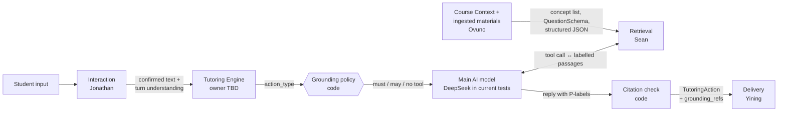

# Course Knowledge Retrieval — V1 Module Specification (Retrieval as a Tool Call)

| | |
|---|---|
| **Spec ID** | `rag-retrieval` |
| **Version** | V1, retrieval as function calling: draft for team review, 2026-10-29. Replaces the V1 draft of 2026-10-16 |
| **Owner** | Course Knowledge Retrieval: Sean (Zixiang Song) |
| **Partners** | Jonathan (Interaction, student understanding), Ovunc (Course Context and ingestion), Tutoring Engine owner (TBD), Yining (Delivery) |
| **Shared contracts** | `interfaces.md` V0.1 is canonical for record names; `architecture.md` for roles; `course-context.md` 0.5.0 for `CourseContext` / `QuestionSchema`. Read at `integration-spec` commit `61728ab` |
| **Implementation** | Prototype package `retrieval_tool/` (Python, 99 offline tests), submitted separately under JDP-42. It calls the Week 3 retrieval code unchanged. File names in this spec (`results/…`, `scripts/…`, `retrieval_tool/…`) refer to that package |
| **JSON Schemas** | `specs/schemas/`: `retrieval-request`, `grounding-bundle`, `retrieval-stop`, `retrieval-plan` (draft 2020-12, generated from the code) |
| **Jira** | JDP-36 (this specification), JDP-19, JDP-42, JDP-43, JDP-44. Where each requirement is covered: Appendix L |

**Status labels**

- **[Contract]**: already in `interfaces.md` / `architecture.md` / `course-context.md`.
- **[Module]**: owned by Retrieval; others may rely on it once this version is accepted.
- **[Proposed]**: changes a shared record or another module's behaviour; needs the named owner's agreement.
- **[Open]**: a team decision still to be made (all listed in §11).
- **Verified**: run against the real component (Week 3 database, the main AI model, Jev) on Sean's Mac; the numbers are in §10.

**Main AI model.** The LLM that acts as the tutor's "brain": it reads the turn, decides optional searches, writes the search plan and the reply. It is **not chosen yet**; different models will be compared on the same labelled sets. The current tests use DeepSeek (`deepseek-chat`), and every result in §10 names the model it was measured with.

MUST, SHOULD and MAY follow RFC 2119.

**V1 at a glance**

1. Retrieval is a **tool** (`search_course_materials`) that the main AI model calls. It is not a stage that every message passes through.
2. **Code decides when** the tool is required, optional or not offered, from the tutoring action (the grounding policy). The main AI model decides only the optional cases, and on those the Jev decider settles most of them first.
3. **What to search for is a validated plan**, not free text. Code drafts it from the Course Context, the model refines it within fixed lists, and code checks and repairs it.
4. **The search itself is Week 3's code with Week 3's thresholds.** Nothing about ranking was re-implemented.
5. Every passage is **checked against the stated needs** before the model sees it, and every citation in the reply is **checked again** before the student sees it.
6. Each boundary with the other modules is explicit (§2): who owns what, which record crosses it, and what Retrieval needs from each partner so that no module works out the same thing twice.

**Template map** (team `README.md`): 1 Purpose → §1 · boundaries and integration → §2 · 2 Responsibilities → §3 · 3 Dependencies → §4 · 4 Inputs → §5 · 5 Functions → §6 · 6 Outputs → §7 · 7 Failures → §8 · 8 Logging → §9 · 9 Examples → §12 and Appendix · 10 Open questions → §11.

---

## 1. Purpose and scope

Retrieval answers one question for a tutoring turn: **"What do this course's approved materials say about what the tutor needs right now?"** It returns exact passages, says which needs each passage supports, and says honestly when nothing supports them.

**V1 delivers**

- the tool definition the main AI model sees, and the per-action grounding policy that controls it;
- the retrieval plan (which concept, which kinds of evidence, which search text) with a JSON Schema and code validation;
- the retrieval service: `RetrievalRequest` → `GroundingBundle` or `RetrievalStop`;
- the citation check (T4) that turns the model's labels into `TutoringAction.grounding_refs`;
- a reference turn loop (`run_turn`) that the Engine owner can call or take apart.

**Out of scope for V1**

- understanding the student's input (Jonathan), choosing the tutoring action (Engine), judging correctness (math tool / Engine);
- ingesting and structuring course materials (Ovunc); V1 searches the Week 3 index of the current development corpus;
- page/line highlighting in the viewer; this needs Ovunc's ingested pages (§7.5);
- other languages than English; more than one course per request.

V1 choices and trade-offs (essential vs optional; accuracy, latency, cost, complexity) are in Appendix J, and the available technical resources in Appendix K.

## 2. Boundaries and how Retrieval plugs in

Retrieval sits between four modules: Course Context and Ingestion (what the course says), Interaction (what the student said), the Tutoring Engine (what the tutor wants to do) and Delivery (what the student sees). Below, "Retrieval" means Sean's module. This section states, for each boundary, who owns what, which record crosses it, and **what Retrieval would like to receive next**.

The rule behind the wish lists: **each fact is worked out once, by the module that knows it best, and passed on.** Retrieval should not guess the topic again if Interaction already understood it, and it should not parse course files that Ingestion has already structured. That keeps each turn short and makes the modules behave as one system.



### 2.1 Course Context and Ingestion (Ovunc) → Retrieval (Sean)

The split is **content layer vs search layer**. Ovunc turns the course materials into **clean, structured JSON**. Once that JSON arrives, Retrieval decides **what goes into the index, how it is cut into retrieval units, which embedding models to use and how to search**. Ovunc does not choose embeddings or search methods.

Both sides "split" text, but not in the same way. Ovunc splits by **content structure**: one block is one complete definition, theorem or worked example. Retrieval then decides **how large a search unit is**, on top of those blocks.

| Step | Ovunc (content layer) | Sean, Retrieval (search layer) |
|---|---|---|
| Original material | Receives the original course files (PDF / LaTeX, not AI-rewritten text); parses and normalizes them, keeping page and line positions | — |
| Structural split | Splits by content: chapter → section → block (definition, theorem, example, explanation, …) | — |
| Labels | Labels each block's type and concepts; builds the Course Context (Course → Module → Concept) and QuestionSchema | States which label fields it needs; they go into the interface |
| Handoff | Outputs the JSON: versions, stable IDs, and each block's text, type, concepts and page/line position | Writes the format note and example; checks that received JSON matches it |
| What gets indexed | — | Decides which blocks enter the search index (e.g. only reviewed sources in production; outlines and table-of-contents rows are not citable evidence) |
| Retrieval unit | — | Decides the unit on top of Ovunc's blocks: one block, merged blocks, a long block split, or an extra concept card |
| Embedding and storage | — | Chooses the embedding models (V1: BGE-base-en-v1.5 + Qwen3-Embedding-0.6B, as in Week 3); PostgreSQL + pgvector, vectors and metadata together so search can filter by course, version and section |
| Search | — | Hybrid vector + full-text search, fused ranking, Jev evidence judge; returns `GroundingBundle` |
| Versions | Versions each document; a new textbook edition gets a new version | Rebuilds or pins the index per version |

**Shared:** one Calculus evaluation set. When a search misses, it tells us whether structure information was missing (Ovunc) or the search strategy was wrong (Retrieval).

**Today (V1):** Retrieval uses the Course Context concept list and `QuestionSchema.concept_ids`. Course text still comes from the Week 3 index of the development corpus (outlines only, Appendix I).

**What Sean (Retrieval) would like to receive next.** As agreed on 2026-10-27, Sean will send Ovunc a format note with an example. The sketch below is its starting point [Proposed, to finalize with Ovunc].

| Wanted | What it lets Retrieval do | Without it |
|---|---|---|
| **A sample ingestion JSON for one chapter** (e.g. Calculus I derivatives) before the full corpus | Build and test the adapter, the line map and the evaluation early | We keep testing on outlines |
| `document_id`, `content_version`, stable chapter / section / block IDs | Pinned snapshots, re-indexing per version, stable passage IDs and citations | Citations are not version-safe |
| Per block: **type** (`definition`, `theorem`, `example`, `exercise`, `remark`, …) | The evidence check reads the type instead of guessing from wording; a theorem need prefers theorem blocks (`preferred_blocks`) | Rules and Jev must guess from the text: more Jev calls, more errors |
| Per block: **`concept_ids`** from the Course Context list | Search the concept's section first and widen only if nothing is found; reliable concept gate | Whole-course search; ranking alone does the locating |
| Per block: **page and line range** in normalized page text, plus the file reference | Real `page_number`, lines and `highlight_url` for Delivery | Locations stay `null` |
| Per block: **provenance** (from the source file, or AI-inferred) | Production policy `allow_unverified_sources = none` | Development mode only |
| Original text with LaTeX math kept | Exact formula matching for formula needs; exact quotes | Formula needs can only be judged approximately |

```json
{
  "document_id": "calc1:textbook", "content_version": "2026-11-01.1",
  "blocks": [{
    "block_id": "calc1.tb.ch4.s5.b03", "chapter_id": "ch4", "section_id": "4.5",
    "type": "theorem", "concept_ids": ["calc1.03-derivatives.chain-rule"],
    "text": "If g is differentiable at x and f is differentiable at g(x), then (f∘g)'(x) = f'(g(x)) g'(x).",
    "page_number": 212, "line_start": 14, "line_end": 17, "provenance": "source_document"
  }]
}
```

*Illustrative only: the values are made up to show the shape.*

### 2.2 Interaction (Jonathan) → Retrieval (Sean)

| Jonathan owns | Sean (Retrieval) owns |
|---|---|
| Recognizing the input (typed, handwriting, voice), confirming ambiguous meaning | Deciding whether this turn searches (grounding policy, may-turn decider) |
| Understanding what the student is asking | Splitting the need into typed evidence needs and search text |
| `StudentEvidence` (factual and label-free by design) | Searching, checking evidence, returning passages |

**Today (V1):** Retrieval receives the confirmed student text and a one-sentence `intent_summary`. It then works out the topic again itself (concept linking, then the main AI model), and for optional turns Jev reads the message once more to decide whether to search.

**What Sean (Retrieval) would like to receive next.** A small per-turn understanding record from Interaction [Proposed, to agree with Jonathan], kept next to `StudentEvidence` so that the evidence stays label-free. These are things Interaction already works out while understanding the message. Passing them on means Retrieval does not read the same message a second time, which saves a model or Jev call per turn and removes a place where two modules could disagree about the topic.

| Field | Example | What it saves Retrieval |
|---|---|---|
| `confirmed_text` | "I got d/dx sin(x²) = cos(x²). Why is that marked wrong?" | Already used: the out-of-course check reads the student's own words |
| `topic`: `concept_ids` from the course list, each with a confidence | chain rule, 0.85 | A confident topic is used like a bank question's concept: no concept linking, no concept choice by the main AI model |
| `request_kind` | `asks_explanation` (others: `asks_definition`, `asks_example`, `asks_hint`, `asks_check`, `submits_work`, `no_content_request`) | Maps straight to need types. `submits_work` / `no_content_request` mean no search on optional turns, without a Jev call |
| `mentions_other_course` (+ the phrase) | `false` | A quick first scope check |
| `intent_summary` | "omitted the derivative of the inner function" | The main search text of the draft and of the system's own search (prefetch) |
| `math_expressions` (normalized LaTeX of what the student wrote) | `\cos(x^2)` | Anchors for formula needs |
| `language` | `en` | The English-only check |

```json
{
  "record_type": "TurnUnderstanding", "turn_id": "turn-chain_rule_explain", "producer": "interaction",
  "confirmed_text": "I got d/dx sin(x^2) = cos(x^2). Why is that marked wrong?",
  "topic": [{"concept_id": "calc1.03-derivatives.chain-rule", "confidence": 0.85}],
  "request_kind": "asks_explanation",
  "mentions_other_course": false,
  "intent_summary": "Student omitted the derivative of the inner function x^2.",
  "math_expressions": ["\\frac{d}{dx}\\sin(x^2) = \\cos(x^2)"],
  "language": "en"
}
```

All of these are hints, not orders. Retrieval still checks concept IDs against the course list, and a bank question's own concepts still win.

### 2.3 Tutoring Engine (owner TBD) ↔ Retrieval (Sean)

The Engine owns the learner state, the choice of action, the pedagogy and the final `TutoringAction`. Sean (Retrieval) provides the grounding policy's retrieval column, the tool, the reference turn loop and the citation check.

**Would like:** an `action_type` (one of the 12) and a `pedagogical_goal` on every turn; the flags `states_course_content` (hint) and `checks_course_convention` (verify) when they apply; a decision on which entry point the Engine uses (§2.5) and which main AI model is used.

### 2.4 Retrieval (Sean) → Delivery (Yining)

For every `grounding_ref`, Delivery can resolve a `GroundingPassage`: `passage_text`, `source_label`, and later `page_number`, lines and `highlight_url` (null in V1, §7.5). Citation labels are stripped from the reply text.

**Would like:** what the viewer can do (open a PDF at a page, highlight lines?), so that `highlight_url` is built in the form Delivery can open, and whether citations are shown inline or as a source list.

### 2.5 How to plug Retrieval in

The main AI model is a parameter (`llm`): any OpenAI-compatible model with tool calling. Changing the model does not change Retrieval.

| Entry point | Call | Use when |
|---|---|---|
| **Whole turn** | `service, decider, notes = build_tutoring_runtime()`, then `run_turn(llm, service, ctx, decider=decider)` | The Engine uses the reference loop as it is |
| **Tool only** | Send `tool_for_decision(decide(action_type))` to the main AI model; on a tool call, `planner.finalize` → `plan_to_request` → `service.handle(request)` → `model_view` back to the model | The Engine runs its own loop (for example LangGraph later) |
| **Citation check** | `verify_grounding_refs(passage_ids, bundles, session_id=…, turn_id=…)` | Before the action goes to Delivery |

### 2.6 What crosses each boundary

| From → to | Now (V1) | Wanted next |
|---|---|---|
| Ovunc → Retrieval | Course Context concept list; `QuestionSchema.concept_ids` | Ingestion JSON with typed blocks, concepts, page/line positions, versions (§2.1) |
| Jonathan → Retrieval | Confirmed text; `intent_summary` | Turn understanding: topic, request kind, scope flag, math (§2.2) |
| Engine → Retrieval | `action_type`, goal | The same, plus flags and the chosen entry point (§2.3) |
| Coordinator → Retrieval | `course_id`, `session_id`, `turn_id`, `question_id`, `correlation_id`, pinned snapshot, bank-sibling IDs | No change |
| Retrieval → main AI model | Labelled passages with `citable` flags, uncovered needs, instructions (Appendix E.2) | No change |
| Retrieval → Engine | `GroundingBundle` / `RetrievalStop`; `grounding_refs` | No change |
| Retrieval → Delivery | `passage_text`, `source_label` | Page, lines, `highlight_url` once Ingestion provides positions (§2.4) |
| Retrieval → logs | Turn events and retrieval report (§9) | Stored once the team decides the logging setup |

## 3. Responsibilities

**Retrieval owns** [Module]

- the tool definition and its per-turn narrowing (allowed purposes, concept enum);
- the retrieval column of the grounding policy (must / may / not_needed / must_not per action) until an Engine owner takes it over [Proposed];
- the retrieval plan: concept linking, the draft, validation and repair;
- validation of every `RetrievalRequest`, the preflight checks, the search, the evidence check and the bundle status;
- the citation check and the mapping from labels to `passage_id`;
- the honesty rules: a missing source returns `no_support_found`, a system fault returns `failed`, and neither is ever disguised as the other.

**Retrieval does not own**

- what the student meant (Interaction), what the student knows or which action comes next (Engine), whether an answer is correct (math tool / Engine);
- how course materials are structured, chunked or versioned (Ovunc);
- how passages are displayed (Delivery);
- the wording of the tutor's reply. Retrieval only constrains what the reply may cite.

**Who does what inside one turn**

| Step | Done by | Can it be wrong in a way that matters? |
|---|---|---|
| Must we search? | Code (policy table) | No: fixed per action |
| Optional cases: search or not? | Jev decider, then the main AI model if Jev is unsure | Yes, so measured (§10) |
| Which concept, what to search for | Code draft → model refinement → code repair | Model choices are limited to the course list, and code keeps the question's own concept |
| Course, version, exclusions | Code (system fields) | No: the model cannot set them |
| Search and ranking | Week 3 code | Same as Week 3 |
| Does a passage state the need? | Jev judge (rules if Jev fails) | Yes, so measured (§10) |
| Are the reply's citations valid? | Code | No: deterministic check |

## 4. Dependencies

| Dependency | Version / location | If unavailable |
|---|---|---|
| Week 3 retrieval code | `week3/knowledge_base/retrieval`, called unchanged | Service cannot start |
| Week 3 index | Docker PostgreSQL 17 + pgvector, `127.0.0.1:55432`, compose project `entagile-kb` | `failed` + `index_unavailable` (retryable) |
| Query encoders | BGE-base-en-v1.5 and Qwen3-Embedding-0.6B, revisions pinned by the Week 3 manifest; loaded once at startup (about 5–8 s) | `failed` + `encoder_unavailable` |
| Course Context | `calc1.course-context.json` (copy of `integration-spec` commit `d3caf0a`) | No concept list: the tool has no concept fields; the plan uses upstream names only |
| Main AI model | Not chosen yet. Any OpenAI-compatible API with tool calling. Current tests: DeepSeek (`deepseek-chat`); adapters for Gemini, Kimi and OpenAI exist, not yet compared | Turn cannot run |
| Jev (TypeSafe Jev, Week 5 client unchanged) | Optional; runs only when the course policy sets `external_processing_allowed = true` | Rules decide evidence; the main AI model decides optional turns |
| Week 3 scope rules | `request_policy.assess_request`, reused as policy data | No free-text scope check (logged) |

## 5. Inputs

### 5.1 Turn context (from the coordinator) [Proposed]

`TurnContext` is what the system already knows before the model is called: the identifiers (`course_id`, `session_id`, `turn_id`, `question_id`, `correlation_id`, pinned snapshot), `action_type`, `course_title`, `question_prompt` (display-safe), `concept_ids` (from `QuestionSchema`), `student_message` (confirmed text), `intent_summary`, `evidence_summary`, `bank_sibling_question_ids`. None of it is written by the main AI model. [Proposed] The turn-understanding fields of §2.2 would join it.

### 5.2 `RetrievalRequest` [Contract + Proposed additions]

JSON Schema: `schemas/retrieval-request.schema.json`. The canonical fields of `interfaces.md` §8 are kept. V1 adds (all [Proposed]):

| Added field | Filled by | Why |
|---|---|---|
| `session_id` | System | The citation check matches bundles by session and turn |
| `evidence_needs[]`: `need_id`, `need_type` (9 types), `description`, `anchor`? | Plan | The evidence check runs per need |
| `query_origin`: `structured` / `student_text` | System | Student wording triggers the free-text scope check |
| `scope_check_text` | System (student's message) | A rewritten query can hide "Calculus II"; the check must see what the student wrote |
| `concept_names` | System (from the plan) | The evidence check requires passages to mention the turn's concept |
| `retrieval_snapshot_id`, `course_context_ref`, `query_language` | System | Pinned index version; English only |
| `exclude` (current question + bank siblings) | System, for `example_lookup` / `practice_generation` | Answer-leak guard |
| `retrieval_plan` | Plan (Appendix C) | Records concepts, needs and every repair |
| purposes `definition_lookup`, `example_lookup`, `prerequisite_review`, `practice_generation` | Model (enum) | Finer purposes per action |

### 5.3 Course retrieval policy [Proposed]

Set once per course at provisioning: `published`, pinned snapshot, `allow_unverified_sources` (`none` in production; `development` for the current corpus), Week 3 limits (top 6, 40 candidates per channel, 12,000 characters, soft limit of 4 per file), `allow_general_knowledge` (may the tutor add a short aside labelled "Not from your course materials"; off by default, on for the dev corpus) and `external_processing_allowed` (may student text go to Jev; off by default, on for the dev corpus because its data is synthetic).

### 5.4 Course Context and AI-inferred information [Module]

The Course Context is used as **structure**, never as **evidence**:

| Course Context part | How Retrieval uses it | Never used as |
|---|---|---|
| Concept list (IDs, names, key definitions, modules) | Controlled vocabulary for the plan: concept linking and the tool's concept enum | A passage to cite |
| `QuestionSchema.concept_ids` | The question's fixed primary concepts | — |
| `Source` records (e.g. `neuhauser.s4-5`) and each concept's `source_ids` | Planned: map passages to Ovunc's source and concept IDs (JDP-44, §11 Q10) | Evidence: their `text_chunk` is a syllabus entry, not course text |
| Fields with `provenance: ai_inferred` (e.g. the course level or length) | Context only | Course facts stated to the student |

A question bank is not part of the Course Context (`course-context.md` §1.1): when one exists it is supplied separately, and a bank question reaches Retrieval only through its `QuestionSchema` (its `concept_ids`, and its ID for the answer-leak exclusion).

Course **material** carries its own provenance. Every passage has `source_provenance` and `review_status`. AI-generated material is returned only under a development policy, always with an `unverified_source` warning; under the production default (`allow_unverified_sources = none`) it returns `no_support_found` + `no_eligible_sources`. A syllabus is a reference, not evidence: in production its passages are not returned, and a course that has only a syllabus returns `no_support_found` + `reference_only` + `no_ingested_sources`.

## 6. How a turn works

Five stages. Stages 1, 2, 4 and 5 are code; stage 3 is the only place where the main AI model writes anything.

### 6.1 Stage 1: grounding policy (code) [Module, Proposed to the Engine owner]

`decide(action_type)` returns one of four modes. The full table is in Appendix A.

| Mode | Actions | What the model gets |
|---|---|---|
| **must** | `explain`, `hint`, `contrast`, `demonstrate` | Tool with `tool_choice = "required"` |
| **may** | `probe`, `diagnose`, `check_understanding`, `transfer` | Jev decides first: p ≥ 0.7 → treated as must; p < 0.3 → no tool; otherwise `tool_choice = "auto"` |
| **not_needed** | `elicit`, `retry` | No tool |
| **must_not** | `inspect`, `verify` | No tool; a call is rejected |

A must turn **always** gets a bundle. If the provider rejects `required`, or the model answers without calling the tool, the system runs the search itself (prefetch) from the code-made plan and asks the model again. A turn allows at most 2 tool calls.

### 6.2 Stage 2: retrieval plan (code first) [Module]

Code decides which course concepts the turn is about and drafts what to look for:

1. **Concepts.** A bank question uses its `QuestionSchema.concept_ids` (always primary). Otherwise the turn's text is matched against the concept names, slugs and key definitions of the Course Context; only a clear, full-phrase match is selected. Vague wording selects nothing and is left to the model.
2. **Draft.** One main search text plus one need for each of the first two need types the policy lists for the action. Each need uses a fixed template ("statement of the chain rule", "worked example using …").
3. The draft and the course concept list go into the main AI model's instructions.

[Proposed] When Interaction supplies a confident topic (§2.2), it enters step 1 as one more source, after the QuestionSchema and before linking, and the main AI model no longer has to choose the concept.

### 6.3 Stage 3: the tool call (the model) [Module]

The main AI model calls `search_course_materials` with `query`, `purpose` (narrowed to the action's purposes), 1–4 `evidence_needs`, one `concept_id` (an enum of the course's concepts plus `not_in_course`) and up to 2 `related_concept_ids`. Appendix B has the definition.

Code then **finalizes the plan** (Appendix C): unknown concepts are dropped; the question's own concepts cannot be removed or demoted; `not_in_course` cannot override a bank question; missing or empty parts are taken from the draft; invalid need types, duplicates and limits are handled. Every change is recorded in `repairs`. Only **primary** concepts enter the request; related concepts are recorded for later scope widening. A plan with no usable need goes back to the main AI model as an argument error.

The system then injects the fields in §5.2. The main AI model cannot set course, question, version or exclusions.

### 6.4 Stage 4: the retrieval service (code + Week 3) [Module]

`RetrievalService.handle(request)`:

1. **Validate** → `RetrievalStop: invalid_request`.
2. **Preflight A**: course published (`course_not_ready`), pinned snapshot (`version_mismatch`), eligible documents under the provenance policy (`no_support_found` + `no_eligible_sources`), English only.
3. **Preflight B**: the Week 3 scope rules run on the student's own words (`scope_check_text`, and the query when it copies the student). Out of course → `no_support_found` + `excluded_scope`, and the turn may not search again. Ambiguous course or part → `RetrievalStop: needs_clarification`.
4. **Search: Week 3 code, unchanged.** `Retriever._search_with_vectors`: BGE and Qwen vector channels plus two PostgreSQL full-text channels, fused with RRF (k = 60), Week 3 sub-questions, top 6, 12,000 characters, soft limit of 4 per file. The only addition is that `course_id` is always passed (one course per request). Appendix F lists the parameters.
5. **Location**: `passage_id` is a hash of (document, content version, page, lines). Week 3's order is kept as `retrieval_rank`.
6. **Evidence check per need**. Pinned (human-confirmed) passages count first. Then the Jev judge, one call per passage covering all needs, run in parallel: p ≥ 0.7 → covered, ≥ 0.35 → partially covered. If Jev fails, rules by need type decide. The check **annotates**; it never re-ranks Week 3's passages. One exception, the **evidence gate**: if every passage is off-topic for every need, the bundle is emptied.
7. **Status**: every need covered → `supported`; passages but some needs uncovered → `partial`; nothing usable → `no_support_found`; component fault → `failed` (retryable). The bundle invariants (Appendix E) are asserted on every bundle.

### 6.5 Stage 5: reply and citation check (model + code) [Module]

The main AI model receives a compact view: passages labelled `P1, P2, …`, each with `citable: true/false` and the needs it supports, the uncovered needs, and an instruction that depends on the status (Appendix E.2). It writes the reply and cites labels.

The citation check then maps labels to passage IDs. Each cited passage must come from a bundle of the **same session and turn** whose status is `supported` or `partial`, and must support a stated need. On failure the model gets one internal rewrite request (the student never sees it). If citations are still invalid, those labels are removed. Accepted IDs become `TutoringAction.grounding_refs`, and the labels are stripped from the text sent to Delivery.

### 6.6 Gatekeeper and Selector (terms from JDP-36 and the 2026-10-16 draft)

The earlier draft had one "Gatekeeper" before retrieval and a "Selector" after it. V1 splits the Gatekeeper into **three separate judgments**, because each one fails differently and has a different owner:

| Old term | V1 component | When | What it decides | When it fails or is unsure |
|---|---|---|---|---|
| Gatekeeper: **necessity** | Grounding policy (code) + Jev decider on may-turns (§6.1) | Before the main AI model is called | Must this turn search, may it, or must it not? | Jev error or no Jev → the main AI model decides. Must turns cannot be skipped: if the model does not search, the system does |
| Gatekeeper: **scope** | Preflight B: Week 3 rules on the student's own words; an optional model check can only make it stricter (§6.4) | Before the search | Is this about this course, and about a part it covers? | Model check error → rules only (`gate_fallback`). A wrongly blocked request: the tutor says it looks outside the course, the student can rephrase, and the case is logged in the report |
| Gatekeeper: **answerability** | Evidence check after the search (Jev judge; rules fallback) (§6.4 step 6) | After the search | Do the returned passages actually state what each need asks for? | Jev error → rules + `sufficiency_uncertain`. Unsure (`partially_covered`) → `partial`; the passage may be cited only for that need, with a warning |
| Selector | Week 3 selection, unchanged: hybrid channels, RRF, sub-questions, soft per-file limit, character budget (§6.4 step 4) | During the search | Which 6 passages, in which order | Index or encoder down → `failed` (retryable). It never re-ranks on evidence; only the evidence gate can empty an all-off-topic bundle, and production drops reference-only passages |

**In scope is not the same as supported.** The scope check answers "should this course cover it?"; the evidence check answers "do the materials we have actually state it?". The chain rule is in scope (it is a course concept), but the development corpus only names it in an outline, so the bundle is `partial` with the needs uncovered. The tutor then says the materials do not state it, instead of pretending they do.

**Incomplete or missing materials.** Only a syllabus → `reference_only` + `no_ingested_sources`. Only unreviewed AI material under the production policy → `no_eligible_sources`. Materials exist but do not state the need → `partial` or `no_support_found`. The system is down → `failed`. Each case is a different status or warning code, so the Engine and the logs can tell them apart.

## 7. Outputs

### 7.1 `GroundingBundle` [Contract + Proposed additions]

JSON Schema: `schemas/grounding-bundle.schema.json` (includes `GroundingPassage`, `NeedCoverage` and `Warning`). This is the record the JDP-36 ticket calls **RetrievedEvidence**; `interfaces.md` names it `GroundingBundle`. It has the `interfaces.md` §9 fields, plus `course_id`, `question_id` (passed through unchanged from the request), `session_id`, `turn_id` (needed by the citation check), `retrieval_snapshot_id`, `need_coverage[]` (`need_id`, `coverage`, `passage_ids`, `method` = pinned / judge / rule), and `uncovered_needs[]`. Statuses:

| `retrieval_status` | Meaning | Passages |
|---|---|---|
| `supported` | Every need is covered | ≥ 1 |
| `partial` | Passages returned, some needs not (fully) covered | ≥ 1 |
| `no_support_found` | The course materials do not cover this, or the request is out of scope | 0 |
| `failed` | System fault; retryable; never reported as `no_support_found` | 0 |

### 7.2 `GroundingPassage` [Contract + Proposed additions]

Contract fields, plus `source_provenance`, `review_status`, `source_label` (a human-readable source name), `role`, `visibility`, `document_role`, and in development only `legacy_locator` (Week 3 file and LaTeX lines).

### 7.3 `RetrievalStop` [Proposed new shared record]

JSON Schema: `schemas/retrieval-stop.schema.json`. Returned instead of a bundle when retrieval must not run: `stop_reason` ∈ `invalid_request`, `needs_clarification`, `course_not_ready`, `version_mismatch`; plus `reason_code`, `retryable`, `policy_version`, the request's identifiers (`course_id`, `question_id`, `session_id`, `turn_id`), and optionally `validation_errors` or `clarification_prompt_hint`.

### 7.4 JSON Schemas [Proposed]

The three records above and the retrieval plan have JSON Schema files (draft 2020-12) in `specs/schemas/`. Other modules can validate what they send or receive with any JSON Schema validator; in Python, `retrieval_tool.schemas.validate_record(record)`.

- **Generated from the code.** Enums (purposes, need types, statuses, stop reasons, warning codes) come from the same constants the service uses, and a test fails if a file is out of date (`scripts/export_schemas.py` rewrites them). The schema and the implementation cannot drift apart.
- **Labelled.** Every field description starts with [Contract] (already in `interfaces.md`) or [Proposed] (added by this spec), so the review can go field by field.
- **Strict.** Unknown fields are rejected (`additionalProperties: false`), so a typo or an unagreed field shows up at once; changes go through `schema_version`.
- **Status rules included.** `supported` and `partial` need passages, `partial` needs uncovered needs, `no_support_found` and `failed` have none. The rules JSON Schema cannot express (ranks 1..n, `unverified_source` on every AI-generated passage, faults never reported as `no_support_found`) stay in code (`check_bundle_invariants`).
- **Checked against real output.** Every request, bundle and stop the code can emit validates, including the 50 benchmark bundles built from Week 3's saved results. The records of the 2026-10-29 DeepSeek run validate except for the two changes made after that run (bundle `course_id` / `question_id`, plan format @2).

### 7.5 Locations in V1

The current corpus is LaTeX source, not paged documents. So `page_number`, `line_start/line_end` and `highlight_url` are `null` with a `location_unavailable` warning, and the source lines are kept in `legacy_locator`. No page number is invented. When Ovunc's `IngestedSource` pages arrive, only the adapter changes.

### 7.6 `RetrievalReport` (internal diagnostics) [Proposed]

One report per request, for logs and evaluation; **not consumed by the Engine or the main AI model**. It records the preflight results (eligible documents, scope check by rules and model), the query plan, the retrieval plan with its repairs and schema check, Week 3's own diagnostics (channels and candidate counts, selected passages, skip reasons), the evidence check by rules, the judge's verdicts next to the rules', the options, the timings and the final status. Example: Appendix E.4.

| Output | Consumed by | Purpose |
|---|---|---|
| `GroundingBundle` / `RetrievalStop` | Tutoring Engine | Decision input; what the turn may cite |
| Model view (Appendix E.2) | Main AI model | Writing the reply |
| `grounding_refs` + `GroundingPassage` | Delivery | Showing sources |
| `RetrievalReport`, turn events | Logs, evaluation, Sean | Diagnosis and measurement only |

### 7.7 Turn result (reference loop)

`run_turn` returns the reply, the policy decision, all requests and bundles/stops, `grounding_refs`, the citation-check result, events and the number of model calls. `tutoring_action()` drafts the `TutoringAction` fields the Engine completes.

## 8. Expected failures

| Condition | Detected at | Result | Turn continues? |
|---|---|---|---|
| Model sends invalid arguments, a wrong purpose, or a plan with no usable need | Stage 3 | Tool error returned to the model; it may retry within the 2-call limit | Yes |
| Provider rejects `required`, or the model skips a required search | Stage 1/3 | System prefetch from the code-made plan | Yes |
| No structured context for a prefetch | Stage 1 | Internal note to the model: answer without course citations | Yes, ungrounded |
| Malformed request, unknown course | Validate | `RetrievalStop: invalid_request` | Yes, ungrounded |
| Course not published / pinned snapshot retired | Preflight A | `RetrievalStop: course_not_ready` / `version_mismatch` | Yes, ungrounded |
| Only reference documents (a syllabus) and no ingested course text | Preflight A | `no_support_found` + `reference_only` + `no_ingested_sources` | Yes |
| No eligible sources under the provenance policy; non-English query | Preflight A | `no_support_found` + `no_eligible_sources` / `query_language_unsupported` | Yes |
| Student asks about another course or a part not covered | Preflight B | `no_support_found` + `excluded_scope`; no further search this turn | Yes, the tutor says so |
| Ambiguous course or part | Preflight B | `RetrievalStop: needs_clarification` | Ask the student first |
| Database or encoder down | Search | `failed` + `index_unavailable` / `encoder_unavailable` (retryable) | Yes, ungrounded |
| Every passage off-topic | Evidence gate | `no_support_found` | Yes |
| Jev judge error | Evidence check | Rules decide + `sufficiency_uncertain` warning | Yes |
| Jev decider error, no Jev key, or `external_processing_allowed = false` | Stage 1 | The main AI model decides optional turns | Yes |
| Reply cites a passage not from this turn or not supporting a need | Citation check | One internal rewrite, then the label is removed | Yes |

## 9. Logging and observability

Every turn returns, in memory, a list of events and a per-request report:

| Event / report | Contents |
|---|---|
| `retrieval_decision` | Decider (Jev or model), probability, choice, thresholds |
| `retrieval_plan_draft`, `retrieval_plan` | Concepts with source and role, `concept_status`, needs, `repairs` |
| `retrieval` | Request ID, result status, `query_origin`, timings (Week 3 search, judge, total), judge and rule verdicts side by side |
| `model_call` | Duration of each model call |
| `tool_argument_error`, `citation_rewrite`, `policy` | Argument errors, rewrites, prefetches |
| Retrieval report | Preflight results, scope check (rules and model), query plan, Week 3 diagnostics (channels, candidate counts, selected passages), evidence check, options |

The student's message is used for the scope check but is not copied into the diagnostics. [Open] The logging on/off setting and persistence (`interfaces.md` §14) are not implemented in V1: everything above goes back to the caller, and Retrieval stores nothing itself.

## 10. Verification status (2026-10-29, Sean's Mac)

| Check | Result |
|---|---|
| Offline tests | 99/99 pass |
| Records match the JSON Schemas | All record kinds the code emits; 50 benchmark bundles from Week 3's saved results; the 2026-10-29 DeepSeek run apart from the two fields added since |
| Same passages as Week 3 (50 benchmark questions) | Tool path = Week 3 with course filter, passage for passage. 45/46 complete at 6 and 4/4 non-answerable withheld; Week 3 without a course filter is 46/46, and the one difference comes from the course filter itself. Replaying Week 3's saved run through the tool gives 46/46 |
| Optional turns: search or not (24 labelled turns; main AI model = DeepSeek) | Main AI model alone 17/24 (7 unneeded searches); Jev + main AI model 22/24, with 11% fewer model calls |
| Does a passage state the need? (28 labelled pairs) | Rules 18/28 with 8 false "covered"; Jev 25/28 with 0 false "covered" |
| Retrieval plan: right concept (36 labelled turns) | Code alone 22/36 (named topics 17/17; paraphrases left to the model). Code + main AI model (DeepSeek) 35/36: paraphrases 14/14; 3/3 out-of-course turns marked `not_in_course`. The one miss ("Can I think for a sec?") is an artifact of the test forcing a search |
| End-to-end turns (main AI model = DeepSeek) | 6 demo scenarios run; all citation checks pass |
| Time per turn | Main AI model 1.6–4.6 s (all calls, DeepSeek); retrieval ≤ 0.5 s including Jev 0.2–0.3 s; encoder loading 5–8 s once at startup |

Limits: all labels are Sean's silver labels on small sets. The development corpus contains course outlines, not full text (Appendix I), so V1 cannot yet produce real course citations for definitions and theorems. In those turns the honest result is `partial` / `no_support_found`, and the tutor says the materials do not state it.

## 11. Open questions and asks

| # | Question | Owner |
|---|---|---|
| Q1 | Accept the grounding-policy table (Appendix A) and who applies it once an Engine owner exists | Engine owner, team |
| Q2 | Who sends the final `RetrievalRequest`: this spec has the turn loop build it from the model's tool arguments plus system fields | Jonathan, Engine owner |
| Q3 | Will Interaction provide the turn-understanding record of §2.2 (topic, request kind, scope flag, math), and under which record name? `StudentEvidence` stays label-free | Jonathan |
| Q4 | Accept the [Proposed] fields in §5.2 and §7, the record `RetrievalStop`, and `retrieval_plan` | Team |
| Q5 | Ingestion JSON as in §2.1: first a one-chapter sample, then typed blocks with concepts, page/line positions and versions | Ovunc |
| Q6 | May student text go to external models (Jev, the main AI model's provider) for real students? V1 defaults to no | Team (privacy) |
| Q7 | Is a labelled "Not from your course materials" aside allowed in production? V1 defaults to no | Team, instructor |
| Q8 | Logging switch and where turn events are stored | Team |
| Q9 | Which main AI model: compare candidates (only DeepSeek tested so far) on the same labelled sets for decisions, planning, reply quality, cost and latency; and which providers support `tool_choice = "required"` (prefetch covers the rest) | Team |
| Q10 | Map passages to Course Context `Source` and concept IDs (JDP-44): the textbook breakdown's section numbers match `neuhauser.s4-5`-style IDs, which each concept already lists in `source_ids`. Confirm the mapping rule, and the ID scheme for ingested blocks | Sean, Ovunc |
| Q11 | JHU WSE AI Gateway access for production models (Appendix K) | Team |

---

## 12. Walkthrough: one turn, end to end

The student is working on the bank question "Differentiate f(x) = sin(x²)", whose `QuestionSchema` concept is the chain rule. They write:

> "I got d/dx sin(x²) = cos(x²). Why is that marked wrong?"

Interaction has confirmed the text and summarized the need ("omitted the derivative of the inner function"). The Engine has chosen `explain`. From here on it is Retrieval.

| # | What happens | Who | Result in this turn |
|---|---|---|---|
| 0 | At startup, load the Week 3 encoders | System | Once, about 7.5 s |
| 1 | Policy: `explain` = **must** | Code | Tool offered with `tool_choice = "required"` |
| 2 | Concept: the question's own concept is the chain rule. Draft needs: "definition of chain rule", "statement of chain rule" | Code | Draft plan in the model's instructions, plus the 33-concept list |
| 3 | The model calls the tool: query "chain rule for composite functions derivative"; needs: theorem statement, formula f′(g(x))·g′(x), worked example | Main AI model | Code checks the plan: chain rule stays primary; any extra concept the model adds is recorded as related |
| 4 | System fields are added (course, question, snapshot); the student's own words pass the scope check | Code | `RetrievalRequest` (Appendix D) |
| 5 | Week 3 search | Week 3 | 6 passages in 0.2 s |
| 6 | Jev checks each passage against the 3 needs | Jev | **No passage states the rule.** The best match is a table-of-contents row: "4.5.1 & The Chain Rule & Differentiate composite functions." The bundle is `partial`; no passage is citable |
| 7 | The model replies. Its first draft cited a passage, which the citation check rejected; one internal rewrite followed | Main AI model + code | Final reply below; `grounding_refs = []` |
| 8 | Labels are stripped; the reply goes to Delivery | Code | Turn time: model 4.2 s, retrieval 0.5 s (Jev 0.3 s) |

Final reply (abridged):

> "Your answer is missing a factor: sin(x²) is a composite function, so differentiating it calls for the chain rule. The course materials here don't give the full statement of that rule, so: *Not from your course materials:* for f(g(x)) the derivative is f′(g(x))·g′(x)… You did the first part correctly… So, what is g(x) here, and what is g′(x)?"

Three things to notice: the reply **does not pretend** the materials state the rule; the general-knowledge part is **labelled** (allowed in development only); and it ends with a question, so the student takes the last step.

*Source: the 2026-10-29 test run (main AI model = DeepSeek). That run used plan format @1, where the model's extra concept (trigonometric derivatives) was still treated as primary. Under @2 it is recorded as related. The outcome of this turn is the same.*

**The same system on other turns**

| Student / action | What happens | Result |
|---|---|---|
| "The answer is 2x cos(x²)." / `inspect` | must_not: no tool | Tutor asks for the working before saying anything about correctness |
| "So is it cos(x²) times something?" / `probe` | may: Jev p = 0.22 < 0.3 → no tool | Socratic question, no search (1 model call) |
| "What does the Calculus II material say about gradients?" / `explain` | Scope check on the student's words → `excluded_scope` | `no_support_found`; tutor says it is outside this course and steers back; no second search |
| "Can you explain Laplace transforms?" / `explain` | The plan marks it `not_in_course` (as in the planning check); the search still runs; no passage relates to the needs, so the evidence gate empties the bundle | `no_support_found`; tutor says the course does not cover it |
| Any must turn while the database is down | Search raises | `failed` + `index_unavailable` (retryable); tutor answers without course citations (covered by tests, not observed live) |

---

## Appendix A. Grounding policy table

| `action_type` | Mode | Purposes offered | Typical need types | Notes |
|---|---|---|---|---|
| `elicit` | not_needed | — | — | Ask for the attempt |
| `inspect` | must_not | — | — | Ask for the working first |
| `probe` | may | definition_lookup | definition, notation_convention | |
| `diagnose` | may | diagnosis_support | definition, theorem_statement | Engine-facing |
| `hint` | must | hint_support | formula_statement, method_guidance | Excludes the current problem. `states_course_content = false` → may |
| `contrast` | must | example_lookup, hint_support | worked_example, method_guidance | Excludes the current problem |
| `demonstrate` | must | example_lookup | worked_example | Excludes the current problem |
| `explain` | must | answer_grounding, prerequisite_review, definition_lookup | definition, theorem_statement, prerequisite_explanation | |
| `retry` | not_needed | — | — | |
| `verify` | must_not | — | — | Correctness is not retrieval. `checks_course_convention = true` → may (notation) |
| `check_understanding` | may | practice_generation | worked_example, exercise | Excludes the current problem |
| `transfer` | may | practice_generation | exercise, worked_example | Excludes the current problem |

If the course is not ready, no tool is offered and the action's fallback applies. Policy version `grounding-policy@0.1`; the machine-readable table is `results/grounding_policy_table.json`.

**Jev may-turn decider.** One yes/no question ("Will a good tutor reply need to state course-specific content?"), given the action, goal, student message, upstream understanding and the question. Thresholds: force at 0.7, skip below 0.3. Responses are cached.

## Appendix B. Tool definition

Name `search_course_materials`; full JSON (OpenAI format, Calculus I enum filled in) in `results/tool_definition.openai.json`.

| Field | Type | Filled by the model |
|---|---|---|
| `query` | string, 3–300 chars | What to look for, in course terms, not the student's raw words |
| `purpose` | enum, narrowed to the action's purposes | Why the material is needed |
| `evidence_needs[]` | 1–4 × {`need_type` (9 types), `description`, `anchor`?} | One entry per kind of evidence; `anchor` = an exact term or formula that must appear |
| `contains_student_wording` | boolean, optional | True if the query copies the student |
| `concept_id` | enum: the course's concepts + `not_in_course` | The one concept the turn is mainly about |
| `related_concept_ids` | ≤ 2, enum of the course's concepts | Other concepts the reply also needs; recorded only |

Need types: `definition`, `theorem_statement`, `formula_statement`, `worked_example`, `exercise`, `method_guidance`, `prerequisite_explanation`, `notation_convention`, `course_policy`.

## Appendix C. RetrievalPlan (`retrieval-plan@2`)

JSON Schema: `specs/schemas/retrieval-plan.schema.json` (draft 2020-12), enforced in code by `validate_plan`. Three worked examples (bank question, paraphrase, out of course): `results/retrieval_plan_example.json`.

| Field | Meaning |
|---|---|
| `plan_version` | `retrieval-plan@2` |
| `concepts[]` (≤ 3) | `concept_id`, `name`, `module_id`, `source` (`question_schema` / `linked` / `model`), `role` (`primary` / `related`) |
| `concept_status` | `found` / `none_found` / `not_in_course` (must match whether a primary concept exists) |
| `main_query` | 3–300 chars; the Week 3 search question |
| `needs[]` (1–4) | `need_id` (`n1`…), `need_type`, `query` (≤ 200 chars), `anchor`?, `concept_id`?, `preferred_blocks` (block types to prefer once `blocks[]` exist) |
| `scope` | `module_ids`, `narrowing` (`not_enforced` until a concept → section map exists; later `module` / `section`) |
| `origin` | `draft` (code only, used for prefetch) / `model` |
| `repairs[]` | `{field, code, detail?}` for every change code made |
| `linking` | Method `lexical@1`, top candidates with scores, Course Context file |

Repair codes: `unknown_concept_dropped`, `question_schema_kept_primary`, `not_in_course_ignored`, `first_related_promoted_to_primary`, `concepts_from_draft`, `main_query_from_draft`, `needs_from_draft`, `invalid_need_dropped`, `empty_need_dropped`, `duplicate_dropped`, `not_a_plan_concept_dropped`, `not_a_list`, `truncated`.

Example (paraphrase turn "How do I find dy/dx for x² + y² = 25?"; code links nothing, the model chooses):

```json
{
  "plan_version": "retrieval-plan@2",
  "course_id": "calc1",
  "concepts": [
    {"concept_id": "calc1.03-derivatives.implicit", "name": "Implicit differentiation",
     "module_id": "calc1.03-derivatives", "source": "model", "role": "primary"},
    {"concept_id": "calc1.03-derivatives.chain-rule", "name": "The chain rule",
     "module_id": "calc1.03-derivatives", "source": "model", "role": "related"}
  ],
  "concept_status": "found",
  "main_query": "implicit differentiation of a circle",
  "needs": [
    {"need_id": "n1", "need_type": "method_guidance", "query": "steps for implicit differentiation",
     "concept_id": "calc1.03-derivatives.implicit", "preferred_blocks": ["remark", "example"]},
    {"need_id": "n2", "need_type": "worked_example",
     "query": "worked example of implicit differentiation on x^2 + y^2 = r^2",
     "concept_id": "calc1.03-derivatives.implicit", "preferred_blocks": ["example"]}
  ],
  "scope": {"module_ids": ["calc1.03-derivatives"], "narrowing": "not_enforced"},
  "origin": "model",
  "repairs": []
}
```

## Appendix D. `RetrievalRequest` example (walkthrough turn)

Abridged and illustrative, built from the 2026-10-29 run with the plan shown in the @2 format.

```json
{
  "record_type": "RetrievalRequest", "schema_version": "0.1", "producer": "tutoring-engine",
  "retrieval_request_id": "rr-5c06a8b1747e", "correlation_id": "corr-chain_rule_explain",
  "course_id": "calc1", "question_id": "calc1.03.chain-rule.adhoc-1f2e3d4c",
  "session_id": "demo-session", "turn_id": "turn-chain_rule_explain",
  "query": "chain rule for composite functions derivative",
  "query_origin": "structured", "purpose": "answer_grounding", "query_language": "en",
  "evidence_needs": [
    {"need_id": "n1", "need_type": "theorem_statement",
     "description": "Statement of the chain rule for differentiating a composite function", "anchor": "chain rule"},
    {"need_id": "n2", "need_type": "formula_statement",
     "description": "Formula for derivative of f(g(x)) involving the inner derivative g'(x)", "anchor": "f'(g(x))g'(x)"},
    {"need_id": "n3", "need_type": "worked_example",
     "description": "Worked example differentiating a composite such as sin of a function of x"}
  ],
  "concept_ids": ["calc1.03-derivatives.chain-rule"], "concept_names": ["The chain rule"],
  "retrieval_snapshot_id": "snap.calc1.dev-ai-breakdown.1",
  "scope_check_text": "I got d/dx sin(x^2) = cos(x^2). Why is that marked wrong?",
  "retrieval_plan": {"plan_version": "retrieval-plan@2", "concept_status": "found", "origin": "model", "...": "..."}
}
```

## Appendix E. Outputs: examples and invariants

### E.1 `GroundingBundle` (walkthrough turn, abridged: 1 of 6 passages)

```json
{
  "record_type": "GroundingBundle", "status": "completed", "producer": "retrieval",
  "grounding_bundle_id": "gb-461f2106d20c", "retrieval_request_id": "rr-5c06a8b1747e",
  "retrieval_status": "partial", "retrieval_snapshot_id": "snap.calc1.dev-ai-breakdown.1",
  "session_id": "demo-session", "turn_id": "turn-chain_rule_explain",
  "passages": [{
    "passage_id": "psg_2bcc654c8c841989", "document_id": "calc1:textbook_reference",
    "content_version": "cv-src-bac96a264f0c", "page_number": null, "line_start": null, "line_end": null,
    "passage_text": "4.5.1 & The Chain Rule & Differentiate composite functions. & \\diffH \\\\",
    "highlight_url": null, "relevance_score": null, "retrieval_rank": 5,
    "source_provenance": "ai_generated", "review_status": "unverified",
    "source_label": "AI-prepared textbook breakdown (unverified)",
    "legacy_locator": {"file": "Calc1_Book_Claude.tex", "source_line_start": 469, "source_line_end": 469}
  }],
  "need_coverage": [
    {"need_id": "n1", "coverage": "not_covered", "passage_ids": [], "method": "judge"},
    {"need_id": "n2", "coverage": "not_covered", "passage_ids": [], "method": "judge"},
    {"need_id": "n3", "coverage": "not_covered", "passage_ids": [], "method": "judge"}
  ],
  "uncovered_needs": ["n1", "n2", "n3"],
  "warnings": [
    {"code": "unverified_source", "passage_id": "psg_2bcc654c8c841989", "message": "AI-generated course breakdown; not reviewed course material."},
    {"code": "location_unavailable", "passage_id": "psg_2bcc654c8c841989", "message": "Development corpus: LaTeX source lines only (legacy_locator); no page, line map or highlight link yet."}
  ],
  "query_interpretation": {"question": "chain rule for composite functions derivative", "backend": "pgvector",
    "selection": "week3_production", "channel_candidate_counts": {"bge_base_en_v1_5": 40, "qwen3_embedding_0_6b": 40, "lexical_exact": 3, "lexical_broad": 40}}
}
```

**Invariants** (asserted on every bundle): `supported` needs passages and every need covered; `partial` needs passages and at least one uncovered need; `no_support_found` and `failed` have no passages; ranks are 1..n without gaps; every `ai_generated` passage carries an `unverified_source` warning; a component fault is never reported as `no_support_found`.

### E.2 What the model sees (same turn, abridged)

```json
{
  "retrieval_status": "partial",
  "passages": [{"label": "P5", "citable": false, "source": "AI-prepared textbook breakdown (unverified)",
                "supports_needs": [], "text": "4.5.1 & The Chain Rule & Differentiate composite functions. ..."}],
  "uncovered_needs": ["Statement of the chain rule ...", "Formula for derivative of f(g(x)) ...", "Worked example ..."],
  "instructions": "Cite a citable passage only for the need it supports; never cite a passage with citable=false. For the uncovered needs, do not claim the course materials say anything. Fallback: Brief general explanation labelled 'not from course materials' if policy allows; ...",
  "source_note": "Development corpus: AI-prepared, unverified course outline (topic lists, few full statements)."
}
```

### E.3 Citation check result

`{"ok": true, "accepted": [], "rejected": [], "warnings": []}` after the rewrite. Rejection codes: `citation_not_from_turn_bundle`, `citation_need_not_covered`; warning `citation_need_partially_covered`.

### E.4 `RetrievalReport` (walkthrough turn, abridged)

Field structure from the code; timings, channel counts and verdicts from the 2026-10-29 run.

```json
{
  "retrieval_request_id": "rr-5c06a8b1747e",
  "preflight": {
    "eligible_documents": ["calc1:syllabus", "calc1:context", "calc1:textbook_reference"],
    "policy_version": "calc1-retrieval-policy@dev-0.1",
    "scope_check": {"student_message": {"rules": {"decision": "retrieve", "category": "within_selected_scope"}}}
  },
  "query_plan": {"question": "chain rule for composite functions derivative", "facets": [], "facet_source": "none"},
  "retrieval_plan": {"origin": "model", "concept_status": "found",
                     "concepts": [["calc1.03-derivatives.chain-rule", "primary"]], "repairs": [], "schema_problems": []},
  "week3": {"status": "found", "channel_candidate_counts": {"bge_base_en_v1_5": 40, "qwen3_embedding_0_6b": 40,
            "lexical_exact": 3, "lexical_broad": 40},
            "selection_skip_reasons": {"broad_lexical_only": 0, "document_cap": 0, "context_budget": 0},
            "selected": ["...6 Week 3 passage ids..."]},
  "evidence_check": [{"need_id": "n1", "coverage": "covered", "method": "rule:theorem_statement"},
                     {"need_id": "n2", "coverage": "not_covered", "method": "none"},
                     {"need_id": "n3", "coverage": "not_covered", "method": "none"}],
  "judge": {"mode": "on", "verdicts": [["n1", "not_covered"], ["n2", "not_covered"], ["n3", "not_covered"]],
            "agrees_with_rules": [false, true, true]},
  "options": {"facet_source": "week3", "evidence_gate": true, "judge_mode": "on"},
  "timings_ms": {"week3_search": 221.6, "judge": 272.1, "total": 500.2},
  "final": "partial"
}
```

Here the rules alone would have marked n1 covered on the strength of a table-of-contents row; the judge did not, and the judge decides when it is on.

## Appendix F. Week 3 parameters and switches

| Setting | Value (= Week 3) |
|---|---|
| Results | top 6 |
| Candidates per channel | 40 |
| Context budget | 12,000 characters |
| Per-file limit | soft, 4 per file, score factor 0.95 beyond |
| Sub-questions | Week 3 `query_facets`, up to 2 passages each |
| Channels and weights | BGE 1.0, Qwen 1.0, exact full-text 1.4, broad full-text 0.45; RRF k = 60 |

| Switch (`RetrievalOptions`) | Tutoring default | Effect |
|---|---|---|
| `evidence_gate` | on | All passages off-topic → `no_support_found`. `week3_parity()` turns it off to compare with Week 3 |
| `judge_mode` | `on` with Jev; `off` without | `shadow` logs the judge next to the rules without effect |
| `facet_source` | `week3` | `evidence_needs` searches each need as a sub-question. Not adopted: no measurable gain on the current corpus; to be evaluated with ingested content |

## Appendix G. Evidence check details

- **Order:** pinned passages → Jev judge (on) → rules if Jev fails.
- **Jev judge:** per passage, one yes/no question per need ("Does the passage itself state what the need asks for?"). Section titles, learning objectives, "difficult topics" bullets and other topics count as no. Covered at p ≥ 0.7, partially covered at p ≥ 0.35. The calls run in parallel.
- **Rules by need type:** the passage must mention the turn's primary concept (≥ 60% of its terms); a formula need is covered only by a real formula matching its anchor; the word "rule" alone is not a theorem statement; other types use markers per type.
- **Evidence gate:** uses a looser "related" test, so incomplete but relevant passages are kept.

## Appendix H. Code map and how to run

| File (`retrieval_tool/`, JDP-42 package) | Role |
|---|---|
| `policy.py` | Grounding policy table, `decide()` |
| `planner.py` | Concept catalog and linking, draft, `finalize`, `PLAN_SCHEMA`, `validate_plan`, `plan_to_request` |
| `tool_schema.py` | Tool definition, `TurnContext`, `build_request` (system fields) |
| `service.py` | `RetrievalService.handle`, `CoursePolicy`, `RetrievalOptions` |
| `backends.py` | Week 3 pgvector backend (real), replay backend (alignment), in-memory test stand-in |
| `evidence.py` | Rules, `related()`, `JevEvidenceJudge` |
| `jev_decider.py` | Jev may-turn decider; Week 5 client loader |
| `citations.py` | Model view, labels, `verify_grounding_refs`, `strip_labels` |
| `agent_loop.py` | Reference turn loop `run_turn`, prompt, prefetch, citation rewrite |
| `schemas.py` | JSON Schemas of the exchanged records, `validate_record`; `scripts/export_schemas.py` writes `schemas/` |
| `__init__.py` | `build_tutoring_runtime()`: the recommended setup in one call |

Run instructions ship with the JDP-42 package. On Sean's Mac today (Week 3 Docker database started; key typed, never stored). The current scripts test with DeepSeek; `--llm` also accepts `gemini`, `kimi`, `openai`:

```bash
cd ~/Desktop/entagile/week8
PY=../week3/knowledge_base/.venv/bin/python
$PY -m unittest discover -s tests
$PY scripts/benchmark_check.py
read -s "DEEPSEEK_API_KEY?DeepSeek key: "; export DEEPSEEK_API_KEY
$PY scripts/demo_turn.py --all --llm deepseek
$PY scripts/eval_planning.py --llm deepseek
```

Evaluation scripts: `benchmark_check.py` (Week 3 alignment), `eval_tool_decisions.py` (24 optional turns), `eval_evidence_judge.py` (28 pairs), `eval_planning.py` (36 turns). One click: `scripts/run_week3_alignment.command`.

## Appendix I. Development corpus (until ingested content arrives)

| Field / behaviour | V1 now | Why |
|---|---|---|
| Page, lines, `highlight_url` | `null` + `location_unavailable`; LaTeX lines in `legacy_locator` | Source-file lines are not page lines; nothing is invented |
| Provenance | `ai_generated` + `unverified_source` on every passage | All six files are AI course breakdowns |
| Course policy | `allow_unverified_sources = development` | Under `none` (production default) every request returns `no_eligible_sources` |
| Content | Course outlines and tables of contents; no formula or theorem text | A search for the chain-rule formula or the FTC statement finds nothing. The evidence check correctly marks such needs uncovered |
| Scope narrowing | Recorded, not enforced | No concept → section map yet |

Moving to Ovunc's data means a new catalog/backend adapter. The tool, the policy, the plan, the records and the citation check do not change.

## Appendix J. V1 choices and trade-offs

**The contract does not depend on a model or a store.** The records, statuses, tool definition and citation check do not name an embedding model, a vector store, a reranker or the main AI model. V1 runs on the Week 3 stack as its measured baseline; any of these can be replaced without changing what other modules receive.

**Essential for V1 vs optional**

| Capability | V1 | Reason |
|---|---|---|
| Tool contract, statuses, `RetrievalStop`, warnings, identifiers passed through | Essential | Other modules integrate against them |
| Grounding policy (code) | Essential | Decides when the tool runs; must turns are never skipped |
| Retrieval plan with schema, concept enum and repair | Essential | What to search for is checked, not trusted |
| Preflight A and B (rules) | Essential | Readiness, provenance and scope do not depend on a model |
| Week 3 hybrid search, unchanged | Essential | Measured baseline; same passages as Week 3 |
| Evidence check (rules) + evidence gate; honest statuses | Essential | Never claims support the materials do not give |
| Citation check (T4) | Essential | No invalid citation reaches the student |
| Development mode with `unverified_source` labels | Essential for development | Lets the team integrate end to end now |
| Jev may-turn decider, Jev evidence judge | Recommended, on when the course policy allows external processing | Measured better (§10); each falls back to the model or the rules |
| Model scope check on the student's words (Week 5 Jev gate) | Optional, next step | Week 5: 41/42 out-of-scope stopped, 0/88 false blocks; not yet wired into V1 |
| Per-need sub-searches (`facet_source = evidence_needs`) | Optional, off | No measurable gain on the outline corpus; evaluate on ingested content |
| Scope narrowing by concept → section | Later | Needs Ovunc's concept → section map |
| Page/line highlighting | Later | Needs ingested pages |
| Reranker, multilingual, figures | Deferred | Not needed for the V1 contract |

**Trade-offs**

| Decision | Accuracy | Latency | Cost | Complexity | V1 choice |
|---|---|---|---|---|---|
| Search as a tool per policy vs on every message | Searches only when the turn needs it; must turns guaranteed | Saves searches on turns that need none | Lower | A policy table to maintain | Tool per policy |
| Jev settles may-turns vs the main AI model alone | 22/24 vs 17/24 | One Jev call (cached when repeated) | About $0.0005 for 24 turns | External dependency with fallback | Jev, then the model |
| Validated plan vs free-text query | Right concept on 35/36 turns with the model | No extra call (inside the tool call) | None | Schema and repair code | Validated plan |
| Week 3 search unchanged vs a new pipeline | Same passages as Week 3 | Under 0.2 s once encoders are loaded | Local | Reuse | Week 3 |
| Jev evidence judge vs rules | 0 vs 8 false "covered" on 28 pairs | +0.2–0.3 s per turn (passages in parallel) | About $0.0009 for 28 pairs | External dependency with fallback | Jev, rules on failure |
| Evidence gate | Removes all-off-topic bundles; replay stays 46/46 | None | None | Low | On |
| Citation check with one rewrite | Invalid citations never reach the student | +1 model call only when triggered | One call | Low | On |
| Labelled general-knowledge aside | Helps when the materials lack a statement | None | None | A policy decision | On in development, off by default (Q7) |

## Appendix K. Technical resources inventory

| Resource | Use in V1 | Status |
|---|---|---|
| Sean's Mac with BGE-base-en-v1.5 and Qwen3-Embedding-0.6B | Query encoding, Week 3 index | **Confirmed**, used in the 2026-10-29 runs; not a shared service |
| Docker PostgreSQL 17 + pgvector + full-text search | Week 3 index | **Confirmed**, used in the 2026-10-29 runs |
| Jev (TypeSafe Jev), personal key | May-turn decider, evidence judge | **Development only**, on synthetic course data; not approved for student data (Q6) |
| DeepSeek API, personal key | Main AI model in the current tests | **Development only**; a candidate, not a decision (Q9) |
| Gemini, Kimi, OpenAI APIs | Other candidate main AI models | Adapters exist; **not tested** |
| JHU WSE AI Gateway | Hosted models for production | **Requires approval** (project owner, cost center, models, quotas); Week 1 notes |
| HopGPT, ChatGPT Edu | Manual exploration only | Chat tools, **not** an application API |
| HopGPT-supported API | Alternative hosted API | **Requires approval and payment** (Week 1 notes) |
| Azure / AWS Bedrock via WSE IT | Hosted models, managed vector stores | **Requires investigation** |
| Team deployment environment (server, database, viewer) | Shared index and viewer | **Not decided**; needed before any student pilot |

Week 1 prices and model lists date from September 2026 and must be re-checked.

## Appendix L. Jira ticket coverage

| Ticket | Requirement | Where | State |
|---|---|---|---|
| **JDP-36** Define KB and RAG Retrieval Specifications | Module responsibilities; Engine boundary | §2, §3 | Done in this revision |
| | Use of Course Context and source references | §2.1, §5.4 | Done; passage → `Source` ID mapping planned (Q10) |
| | Flow from request to evidence; incomplete or unavailable materials | §6, §6.6, §8 | Done |
| | Gatekeeper and Selector: roles, sufficiency, failure and uncertain results | §6.6 | Done |
| | RetrievalRequest, RetrievedEvidence (`GroundingBundle`), RetrievalReport, and who consumes what | §5.2, §7, Appendix D–E | Done |
| | AI-inferred course information; in scope vs supported | §5.4, §6.6 | Done |
| | V1 essentials, optional items, trade-offs; models left open | Appendix J | Done |
| | Technical resources inventory | Appendix K | Done |
| | Workflow diagram | §2 | Done |
| **JDP-19** Design Retrieval and Model Interface for the Loop | Retrieval as a tool of the main AI model inside the tutoring loop | §2.5, §6, Appendix A–B | Designed and implemented; team review pending (Q1, Q2, Q4) |
| **JDP-42** Retrieval Tool Using Shared Interfaces v1 | Accepts a valid `RetrievalRequest` | §5.2, §6.4 step 1 | Implemented, tested |
| | Reuses the existing search | §6.4 step 4 | Week 3 code unchanged |
| | Passages, references, identifiers, status | §7 | Implemented |
| | Keeps course, question, turn and request IDs | §7.1, §7.3 | Implemented (bundle and stop) |
| | Callable by the Tutoring Engine | §2.5 | Three entry points |
| | Sample input/output, automated tests | Appendix D–E, §7.4, §10 | JSON Schemas in `specs/schemas/`; 99 tests; demo outputs in `results/` |
| | A real retrieval call | §10, §12 | Week 3 database on Sean's Mac |
| **JDP-43** Retrieval Status and Failure Handling | Supported, missing, unverified and operational failure kept apart | §6.6, §7.1, §8 | Implemented |
| | Reference scenarios a, d, h | §8 | a: `reference_only` + `no_ingested_sources`; d: `failed` + `index_unavailable`; h: `partial` + `unverified_source` (each has a test) |
| **JDP-44** Integrate Course Knowledge Dataset | Connect to the Calculus I development dataset | §4, Appendix I | Done (Week 3 index) |
| | Align source identifiers with the Course Context | §5.4 | Concept IDs aligned; passage → `Source` mapping open (Q10) |
| | Minimum data contract for future ingestion | §2.1 | Drafted; to confirm with Ovunc |

## Appendix M. Changes from the 2026-10-16 draft

- Retrieval is framed as a **tool call** with a code-owned grounding policy; the model only writes the search and decides optional turns.
- New **RetrievalPlan** with a schema, a concept enum, `not_in_course`, primary/related concepts and recorded repairs.
- The search is **Week 3's code** unchanged. The earlier re-implemented selector is withdrawn.
- **Jev** was adopted where it measured better: the may-turn decider and the evidence judge. Each falls back to rules or the model.
- The **scope check** reads the student's own words (`scope_check_text`), not only the rewritten query.
- **Citation check** with one internal rewrite and label stripping.
- Per-course tutoring settings: `allow_general_knowledge`, `external_processing_allowed`.
- New §2: the boundary with each partner, how to plug Retrieval in, and what Retrieval asks each partner for (a one-chapter ingestion sample from Ovunc; a per-turn understanding record from Interaction).
- The tutor's "brain" is called the **main AI model** and is not fixed; DeepSeek is only the model used in the current tests.
- Gatekeeper split into necessity, scope and answerability (§6.6); `RetrievalReport` defined (§7.6, E.4); Course Context used as structure, not evidence (§5.4); reference-only sources (`reference_only`, `no_ingested_sources`); bundles and stops carry `course_id` and `question_id`; JSON Schema files for the request, bundle, stop and plan (§7.4); Appendices J–L (trade-offs, resources, Jira coverage).
