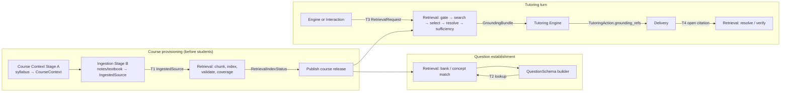
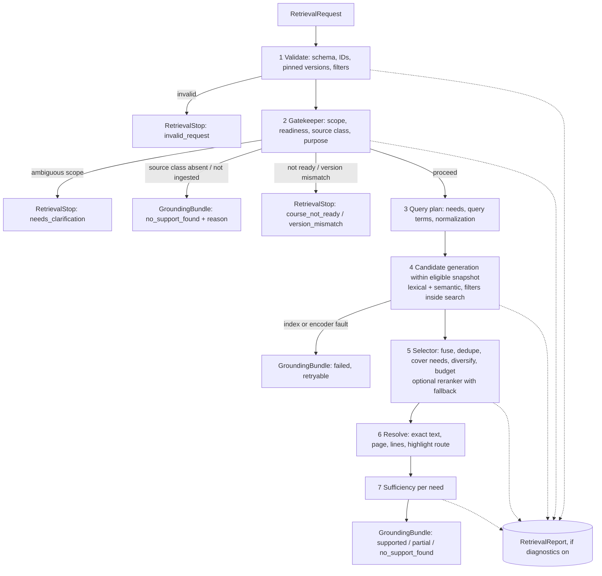

# Course Knowledge Retrieval (Knowledge Base / RAG) — V1 Module Specification

| | |
|---|---|
| **Spec ID** | `rag-retrieval` (team README proposes the filename `knowledge-retrieval.md`; see Open question Q1) |
| **Status** | Working draft toward the team's interface V0.1 freeze. Not yet reviewed. |
| **Revision** | 2026-10-16. Supersedes the local draft of 2026-10-13. |
| **Owner** | Course Knowledge Retrieval: Sean (Zixiang Song) |
| **Primary partners** | Ovunc (Course Context and Ingestion), Jonathan (Interaction, routing, shared interfaces), Tutoring Engine owner (TBD), Yining (Delivery) |
| **Shared contracts** | `interfaces.md` V0.1 is canonical for record names and fields; `architecture.md` defines component ownership; `course-context.md` 0.5.0 defines `CourseContext`, `QuestionSchema` and Stage A/B ingestion. Reviewed at `integration-spec` commit `088c6ec` (2026-10-15). |
| **Companion files** | Mermaid sources in `diagrams/` (`retrieval-touchpoints.mmd`, `retrieval-turn-flow.mmd`, `identity-and-versions.mmd`); scenario fixtures in `examples/` (`calc1.retrieval.*.json`) |

**Status labels used in this document**

- **[Module]**: behavior owned by Retrieval. Other modules may rely on it once V0.1 is frozen.
- **[Proposed]**: a change to a shared record or another module's behavior. Not final until the affected owners agree. It is never applied silently.
- **[Open]**: a decision the team still has to make; listed again in §15.

The keywords MUST, SHOULD and MAY follow RFC 2119.

---

## 1. Purpose and scope

Course Knowledge Retrieval supplies **verifiable course-source evidence**. It turns approved, published course materials into a searchable index. When asked, it returns the exact passages that support a specific tutoring need, with a precise source location and an explicit statement of how well the need is supported.

The module answers one question for its callers:

> *Which approved course text, at which exact location, supports this specific need, and how completely?*

It does **not** answer whether the student is right, what the student knows, or what to do next. Those decisions belong to the Tutoring Engine.

### 1.1 What V1 must deliver

1. A stable retrieval contract (`RetrievalRequest` → `GroundingBundle`) that the Interaction module and the Tutoring Engine can integrate against now, even while only syllabus-derived context exists.
2. An honest V1 result while the course is syllabus-only. Course Context Stage A produces `Source` records that hold references only, with no document text. Every grounding request in that state therefore completes as `no_support_found` with a `reference_only` warning. Retrieval MUST NOT turn a syllabus citation into a fake textbook passage.
3. The ingestion handoff (`IngestedSource`) and index lifecycle needed for lecture notes and textbooks, so that passage-level grounding can be switched on once Stage B ingestion exists without changing the turn-time contract.
4. Lookups that the QuestionSchema builder needs (bank match and concept match). These run before a `question_id` exists (§7.10).

### 1.2 Out of scope for V1

Live web search; cross-course retrieval for student-facing grounding; retrieval over student work or learner history; automatic generation of course content; images and figures as retrievable evidence (text and equations only); retrieval in languages other than English (§11); and any judgment of mathematical correctness.

---

## 2. Where Retrieval sits in the workflow

Retrieval is not a single call inside the tutoring turn. It has **four touchpoints**, and each one has a different caller, a different input and a different failure meaning. See `diagrams/retrieval-touchpoints.mmd`.

| # | Touchpoint | When | Caller | Input | Output |
|---|---|---|---|---|---|
| T1 | **Index build and readiness** [Module + Proposed] | Course provisioning, before student access; again on each approved upload | Course Context and Ingestion (Stage B) / provisioning pipeline | `IngestedSource` records + course retrieval policy | `RetrievalIndexStatus` (ready / partial / failed) + coverage report |
| T2 | **Course-Context lookups** [Proposed] | QuestionSchema build (`build_question_schema`), before a `question_id` exists | QuestionSchema builder (Course Context) | Course ID + confirmed question text | `CourseContextLookupResult` (bank match / concept match / `NO_CONCEPT_MATCH`) |
| T3 | **Turn-time grounding** [Module] | During a tutoring turn, when a course-specific claim needs support | Tutoring Engine or Interaction coordinator ([Open] Q2) | `RetrievalRequest` | `GroundingBundle`, or a `RetrievalStop` [Proposed] |
| T4 | **Citation resolution and verification** [Module] | When Delivery opens a citation; when a session resumes; when an action's `grounding_refs` are checked | Delivery, coordinator, Engine | Passage reference (`document_id`, `content_version`, `passage_id`) | Resolved passage, or `revoked` / `unavailable` |



The touchpoints are separated for two reasons. First, the existing shared `RetrievalRequest` requires a `question_id`, which T2 cannot provide. Second, a failure at T1 should block student access rather than surface later as a `no_support_found` during a turn.

---

## 3. Responsibilities

### 3.1 Retrieval owns [Module]

| Responsibility | Concretely |
|---|---|
| Index lifecycle | Chunking ingested pages (default owner per `course-context.md` Q13), embedding and lexical indexing, index versioning, build validation, coverage report, and atomic switch to a new index version |
| Request validation | Schema checks, ID resolution against the pinned Course Context and QuestionSchema, and scope consistency |
| Pre-retrieval Gatekeeper | Course scope, source-class availability, purpose consistency, readiness and version checks (§7.4) |
| Query planning | Building search queries from the request, Course Context terms and evidence needs; notation normalization (§7.5) |
| Eligibility filtering | Enforcing course, release, approval, visibility and scope filters **inside** the search, not after it (§7.6) |
| Candidate generation and the Selector | Hybrid search, fusion, deduplication, diversity, coverage, budget, optional reranking (§7.7) |
| Location resolution | Exact passage text, page, line range and `highlight_url` for every returned passage; verified against the ingested page text (§7.8) |
| Post-retrieval sufficiency | A per-need assessment of whether the returned passages support the stated need (§7.9) |
| Status and warnings | The canonical `retrieval_status`, machine-readable warnings, and failures that are never disguised (§8, §9) |
| Citation resolution and verification | Re-resolving and validating passage references for Delivery, session resume and action checks (§7.12) |
| Retrieval diagnostics | The optional `RetrievalReport` for evaluation and debugging (§8.4) |

### 3.2 Retrieval does not own

| Not owned | Owner | Why the boundary matters |
|---|---|---|
| Registering, approving and publishing documents; normalized page text; stable line maps | Course Context and Ingestion (Stage B) | Retrieval consumes `IngestedSource` as the location source of truth. It never invents or renumbers lines. |
| `CourseContext` and `QuestionSchema` content, including AI-inferred fields | Course Context | Retrieval reads them and uses them to scope and phrase queries. It never cites them as source text. |
| Whether the student's mathematics is correct; mastery; misconceptions; gaps | Tutoring Engine | A passage with a high score says nothing about the student. |
| Whether a course-specific claim may be shown, and which action to take with `supported` / `partial` / `no_support_found` | Tutoring Engine | Retrieval reports what the evidence supports; the Engine decides what to do with it. |
| Composing tutoring text; quoting passages to the student | Engine (content), Delivery (presentation) | Delivery presents only the passages referenced by `TutoringAction.grounding_refs` (§8.6). |
| Capturing and recognizing student input; constructing `StudentEvidence` | Interaction | Retrieval receives at most a minimal `evidence_summary` (§6.4). |
| Session state storage and the trace index | Session State and Trace | Retrieval emits records and trace events; it does not own session continuity. |

### 3.3 What the Tutoring Engine decides with Retrieval's output

The Engine, not Retrieval, decides:

- whether a turn needs grounding at all, and for which claim (unless Q2 assigns request production to Interaction);
- whether `partial` support is enough for the intended action, given that `partial` passages MUST NOT be cited for uncovered needs;
- how to act on `no_support_found`. Typical options are to proceed without a course-specific citation, to ask a conceptual question, or to tell the student that course material is unavailable. The Engine may not present inferred content as a citation;
- how to act on `failed`. Typical options are to retry through the coordinator, or to continue with an action that does not depend on sources;
- which returned passages, if any, to attach to `TutoringAction.grounding_refs`.

---

## 4. Dependencies

| Dependency | Required for | V1 status | If missing or failing |
|---|---|---|---|
| `CourseContext` (published, versioned) | T2, T3 scope and query terms | Available: Stage A syllabus output (`calc1` example, schema 1.1) | `course_context_unavailable` stop; no search |
| `QuestionSchema` (frozen) | T3 for an established question | Available for bank and runtime questions | `question_context_mismatch` stop |
| `IngestedSource` (normalized pages + line maps) | T1, and any passage-level grounding at T3 | **Not yet available**: Stage B is post-V1 | T3 completes with `no_support_found` + `reference_only` or `no_ingested_sources` warning |
| Course retrieval policy (configuration) | T1, T3 | To be defined with the course setup | Fall back to the strictest defaults (§6.5) |
| Text index (lexical) | T1, T3 | Historical: PostgreSQL full-text search validated in Week 3 | `failed` (`index_unavailable`), retryable |
| Embedding encoder + vector index | T1, T3 semantic channel | Historical: BGE-base and Qwen3-0.6B local embeddings; pgvector | Degrade to lexical-only with a `semantic_channel_unavailable` warning **if** the policy allows; otherwise `failed` |
| Source viewer / location resolver | T3 `highlight_url`, T4 | **Not yet available**; target viewer is [Open] Q8 | Passages without a resolvable location are excluded with `location_unavailable` |
| Optional model gate / reranker / sufficiency judge (e.g., Jev) | Quality improvements only | Historical experiments; external provider | Deterministic baseline path with a `*_fallback` warning (§7.4, §7.7, §7.9) |
| Session/trace service | Pinning and trace events | Defined in `interfaces.md` §13–14 | Retrieval still returns its records; the trace gap is reported by the coordinator |

Provider-specific names (models, databases, vendors) MUST NOT appear as required interface fields. They appear only in `RetrievalReport` diagnostics and in index manifests.

---

## 5. Identity, versioning and location model

This section defines the identity chain that every other part of the contract relies on. Parts that change shared records are marked **[Proposed]**. See `diagrams/identity-and-versions.mmd`.

### 5.1 Identifier chain

| Identifier | Meaning | Assigned by | Stability rule |
|---|---|---|---|
| `course_id` | Course instance (`Course.id`) | Course Context | Stable; every retrieval is scoped to exactly one course |
| `Source.id` | A citation entry in one Course Context file (e.g., `neuhauser.s7-2`) | Course Context | Unique **within one file only**; Retrieval keys it as `(course_id, Source.id)` |
| `document_id` | One logical uploaded work (a textbook, a lecture-note set) | Ingestion registrar | Stable across versions of the same work |
| `content_version` | One immutable parsed/OCR text of a document version | Ingestion | A new value whenever page text or line numbering changes |
| `SourceDocumentLink` [Proposed] | Versioned mapping `(course_id, Source.id) → (document_id, section/page range)` | Ingestion (Stage B), reviewed by the instructor | Required before a `Source` can lead to passages; never inferred from matching titles alone |
| `passage_id` | One exact citable span: `(document_id, content_version, page_number, line_start, line_end)` | Retrieval [Module] | Deterministic, e.g. a hash of those five values; stable within a `content_version` |
| `chunk_id` / `chunking_policy_version` | One internal search unit and the policy that produced it | Retrieval | Internal; may change on re-chunking without changing any `passage_id` |
| `index_version` | One built index: content versions + chunking policy + embedding model revisions + lexical configuration | Retrieval | Immutable once built; old versions stay resolvable for audit (§7.11) |
| `retrieval_snapshot_id` [Proposed] | The set of published `(document_id, content_version)` pairs plus `index_version` that a course release exposes | Retrieval, at publish | Pinned to a session or turn; never switched inside a turn |

Lesson from the existing code: the Week 3 prototype derives `passage_id` from `document:start_line:end_line` without any content version. If the text changes but the line numbers stay the same, the old ID silently points at new text. V1 identity MUST include `content_version`.

### 5.2 Search unit vs citation unit

- **Chunk (search unit).** Sized for the index. It may overlap its neighbours and may be shorter or longer than a passage. The Week 3 baseline splits text at paragraph boundaries, caps a passage at about 2,300 characters, and caps an embedding segment at 384 tokens with a 25-word overlap.
- **Passage (citation unit).** An exact, non-overlapping line span on **one page** of a `content_version`. Retrieval returns passages, never chunks.
- **Mapping.** Every chunk records which passage span(s) it came from. A chunk hit resolves to the passage span(s) it covers, and the results are deduplicated at passage level.
- **Single-page rule [Module].** The canonical `GroundingPassage` has one `page_number`. A span that crosses a page boundary is therefore returned as two adjacent passages, and both are listed when both are needed. The alternative of adding `page_end` is listed in Q9.
- **Concept cards** from the Week 3 prototype were auto-extracted summaries. In V1, Course Context `Concept` text (`summary`, `key_definitions`) is mostly `ai_inferred`. It MAY be used to expand or route queries. It MUST NOT be indexed as a citable passage.

### 5.3 Page and line semantics [Proposed clarification of `interfaces.md` §9]

- `page_number` is the **1-based physical page index in the ingested file** of that `content_version`. It is the unit the viewer opens. "Display page" is ambiguous in the current wording. Jonathan's prototype evaluation found that a model cited PDF page 4 for content printed on page 5, which shows how easily the two numbers diverge.
- `page_label` [Proposed optional field]: the printed page label, for example `"214"` or `"xii"`, when ingestion can read it. Delivery shows the label; the viewer opens `page_number`.
- `line_start` / `line_end`: 1-based line numbers in the **normalized page text** of `IngestedSource.pages[]`, inclusive, with `line_end ≥ line_start`. Retrieval never computes its own line numbers.
- LaTeX or Markdown sources: line numbers in the source file are **not** page lines. The V1 recommendation is to ingest the compiled PDF so that pages exist; source-file line numbers remain internal provenance only (this is how the Week 3 prototype cites today).

### 5.4 `highlight_url` [Proposed]

- `highlight_url` SHOULD be a **stable application route**, not a pre-signed or expiring link. For example: `/courses/{course_id}/sources/{document_id}/versions/{content_version}/view?page={page_number}&lines={line_start}-{line_end}`.
- Authorization is enforced **when the link is opened**, by the same rules as the source document. Records therefore never store credentials, and an old trace still resolves the same target.
- Retrieval emits a `GroundingPassage` only after the location resolver confirms that the route resolves to the same document, version, page and lines. If highlighting by line needs line geometry, ingestion supplies it (§6.3). Retrieval MUST NOT guess a PDF fragment.

---

## 6. Inputs

### 6.1 `CourseContext` (producer: Course Context; consumer: Retrieval) [Module usage]

| Field(s) | How Retrieval uses it | Trust treatment |
|---|---|---|
| `Course.id`, `course_context_schema_version`, file `content_sha256` | Scope key; version pin; mismatch detection | Structural; trusted |
| `Module.id`, `Module.concept_ids`, `Concept.module_id` | Scope narrowing (course → module → concept); filters on section-to-concept links | Structural |
| `Concept.id`, `name`, `key_definitions`, `summary` | Query expansion and routing; concept-match candidates (T2) | Usually `ai_inferred`. Used as **search hints only**, never returned as evidence |
| `Concept.prerequisite_ids` | Optional scope expansion to the concept plus its direct prerequisites (`course-context.md` §5 guarantee) | Usually `ai_inferred`; scope hint only |
| `Concept.source_ids` → `Source.{id, type, citation, section, text_chunk, provenance}` | Leads to eligible documents through `SourceDocumentLink`; citation label for display | `source_backed` means only that *the syllabus names the source*. `text_chunk` starting with `Syllabus entry:` or `Syllabus reference:` is a reference and MUST NOT be embedded or returned (`course-context.md` Q2) |
| `AssessmentQuestion.{id, prompt, concept_ids}` | Bank-match candidates (T2) | The prompt is indexed in a **separate lookup index**, never in the source-passage index |
| `AssessmentQuestion.solution`, `rubric`, `common_wrong_answers` | **Not used** | Restricted to the Engine; never indexed |
| `assumptions[]` | Passed through in diagnostics only | Trust signal for the Engine |

### 6.2 `QuestionSchema` (frozen; producer: Course Context builder) [Module usage]

Retrieval reads only `question_id`, `origin`, `course_id`, `module_id`, `concept_ids` (primary first), `prompt` (display-safe), `question_type`, `source_reference`, `provenance` and `built_from`. It MUST NOT read or index `correct_approach`, `alternative_approaches`, `reference_answer`, `rubric` or `common_misconceptions`. Whether the Engine may place restricted terms in a query is covered in §6.4.

Retrieval checks that `QuestionSchema.course_id` and every `concept_id` resolve in the Course Context identified by `built_from`. A mismatch stops the request with `question_context_mismatch`.

`source_reference.grounding` currently takes the values `reference_only` and `excerpt`. When `grounding = excerpt` and the frozen schema carries approved passage references, Retrieval returns those **pinned passages** first, re-resolved on the pinned `content_version` (§7.9). The proposed `source_reference.passage_refs` is Q7.

### 6.3 `IngestedSource` (producer: Ingestion Stage B; consumer: Retrieval) [Response to the `interfaces.md` §9 proposal]

Retrieval **accepts** `IngestedSource` as the handoff and **accepts chunking ownership** (default in `course-context.md` Q13). Retrieval chunks from `pages[]` and preserves the page and line map exactly. If ingestion also supplies `chunks[]`, Retrieval treats them as structural hints, not as citation spans.

To make grounding and highlighting work, the following fields are proposed. They are additions only (a minor version change):

| Proposed field | Required? | Why Retrieval needs it |
|---|---|---|
| `course_id` | Yes | `document_id` alone does not say which course may use the document. Cross-course isolation is enforced at index time. |
| `document_role` | Yes | One of `lecture_notes`, `textbook`, `slides`, `worked_examples`, `problem_set`, `solutions`, `exam`, `syllabus`, `other`. Drives source-class availability (gate) and visibility (§6.5). |
| `approval` (`status`, `approved_by`, `approved_at`) | Yes | Only approved versions are indexed (`architecture.md` §6) |
| `pages[].page_label` | No | Printed page label for display (§5.3) |
| `pages[].text_sha256` | Yes | Lets Retrieval prove that a passage text equals the ingested page lines at resolve time |
| `pages[].lines[]` with optional `bbox` | Optional in V1 | Needed only if the viewer highlights by line geometry |
| `outline[]` (`section_id`, `title`, `level`, `page_start/line_start`, `page_end/line_end`, `concept_ids`, `mapping_confidence`, `structure_inferred`) | Yes, possibly empty | Section-aware chunking, scope filtering by concept, and parent/neighbour expansion |
| `source_ids` → `SourceDocumentLink` entries with section or page range | Yes, possibly empty | Turns a syllabus `Source` reference into an eligible page range |
| `extraction_warnings[]` | Yes, possibly empty | Low-confidence pages (OCR, broken equations) are excluded from grounding or flagged |

Validation at T1: every page has text and a positive line count; outline ranges fall inside the document; every `concept_id` resolves in the published Course Context; approval is present. A failed document is reported with `ingest_rejected` and is not indexed. The other documents still build (`partial` readiness).

### 6.4 `RetrievalRequest` (canonical, `interfaces.md` §8)

**Producer:** Tutoring Engine (recommended) or Interaction coordinator ([Open] Q2). **Consumer:** Retrieval.

**Canonical fields.** The common envelope plus:

- required: `retrieval_request_id`, `course_id`, `question_id`, `turn_id`, `query`, `purpose`;
- optional: `concept_ids`, `document_filters`, `evidence_summary`, `top_k`.

**Proposed optional additions** (minor version). Each one is needed to make an existing requirement checkable:

| Field | Type | Why |
|---|---|---|
| `evidence_needs[]` | `[{need_id, description, concept_ids?}]` | Sufficiency is only checkable **relative to stated needs**. Without them, Retrieval can report relevance but not support. Example: a hint about choosing *u* in integration by parts needs (1) the integration-by-parts formula and (2) the guidance on choosing *u*. |
| `course_context_ref` | `{course_context_schema_version, content_sha256}` | Lets Retrieval verify that it reads the same Course Context the caller used (copied from `QuestionSchema.built_from`) |
| `retrieval_snapshot_id` | string | Pins the release; resumed sessions MUST reuse it (§7.12) |
| `scope` | `{module_ids?, include_prerequisites?: bool}` | Explicit narrowing; replaces ad-hoc flags such as the prototype's `include_outside_course` |
| `query_language` | BCP-47 tag, default `en` | V1 supports English; any other language returns a warning or a stop (§7.5) |
| `max_passage_chars` | int | Context budget of the consumer; Retrieval never exceeds it |

**Validation [Module]**

1. Schema-valid envelope; non-empty `query` of at most 2,000 characters; `top_k` between 1 and 10 (default 4).
2. `course_id` exists and has a published release; otherwise `course_not_ready`.
3. `question_id` resolves to a frozen `QuestionSchema` of the same course; `concept_ids` are a subset of the question's concepts, their direct prerequisites, or explicitly exploratory.
4. `document_filters` may only **narrow** the eligible set. Requests for unapproved, cross-course or engine-only documents are rejected for student-facing purposes (`filter_not_permitted`).
5. `evidence_summary` is at most 500 characters and contains no student identifiers. Retrieval MUST reject a request that contains a full transcript or history (`evidence_summary_too_broad`).
6. **Restricted-field rule.** If Interaction produces the request, the query and needs MUST be built only from display-safe fields (`student-interaction.md` §14). If the Engine produces it, it MAY phrase needs using restricted knowledge (e.g., "the technique is integration by parts"). The resulting **passages** are then marked as Engine-facing for that turn, and Delivery shows only those that the Engine attaches to the action.
7. An invalid request returns a `RetrievalStop` with `invalid_request`, never `no_support_found`.

### 6.5 Course retrieval policy (configuration) [Proposed]

This is a small versioned configuration record for each course, set during provisioning. It replaces the Week 3 hard-coded rules (`calc2`, "second semester", per-file line ranges):

| Setting | Example | Default if absent |
|---|---|---|
| `allowed_source_classes` | `[lecture_notes, textbook, worked_examples]` | Only document roles present in the published release |
| `excluded_scopes` | Out-of-course sections (e.g., Calculus II material in a Calculus I textbook) by outline range | None excluded; cross-course is always excluded |
| `visibility` by `document_role` | `solutions`, `exam` → `engine_only`; others → `student_visible` | `solutions`, `exam`, `problem_set` answers → `engine_only` |
| `authority_order` | `lecture_notes > worked_examples > textbook` | Equal weights |
| `model_gate`, `reranker`, `sufficiency_judge` | `off` / `shadow` / `on` | `off` |
| `external_processing_allowed` | `false` | `false`: no student text is sent to an external model provider |
| `policy_version` | `calc1-retrieval-policy@1` | Required; recorded in every report |

---

## 7. Functions and expected behavior

### 7.1 Turn-time flow (T3) [Module]

See `diagrams/retrieval-turn-flow.mmd`.



### 7.2 Three separate judgments [Module]

| Judgment | Question | Decided by | Does **not** imply |
|---|---|---|---|
| In scope | Is the request about this course and an allowed source class? | Gatekeeper (before search) | That any source covers it |
| Candidates found | Did search return plausible indexed text? | Candidate generation and the Selector | That the text supports the need |
| Evidence sufficient | Do eligible, exact, located passages directly support **each stated need**? | Sufficiency assessment (after resolution) | That the student is right, or that the Engine must use it |

Similarity scores, fusion scores and reranker probabilities are **ranking signals**. They are not probabilities of truth and not sufficiency findings.

### 7.3 Validation [Module]

Validation follows §6.4. Its failures are caller errors. They return a `RetrievalStop` with field-level `validation_errors` (`interfaces.md` §1.4) and are not retried automatically.

### 7.4 Pre-retrieval Gatekeeper [Module]

**What it checks, answering the ticket's question:**

| Check | Does the Gatekeeper decide it? | Detail |
|---|---|---|
| Course scope | **Yes** | The request names or implies a course, module or semester different from the request's `course_id`, or mixes allowed and excluded scopes → `needs_clarification`. Excluded scope explicitly requested → `no_support_found` with `excluded_scope`. |
| Source-class availability | **Yes** | The request explicitly asks for a source class that the release does not have, such as a lecture transcript, a student's grade record, or a document role absent from the release → `no_support_found` with `source_class_unavailable` (it is a healthy, completed answer). |
| Readiness and versions | **Yes** | No published release → `course_not_ready`. Pinned snapshot no longer available → `version_mismatch`. |
| Retrieval necessity | **Only for declared purpose** | The caller decides whether a turn needs grounding; that is an Engine decision. The Gatekeeper only rejects a purpose that cannot be served by course sources (`retrieval_not_needed` [Proposed stop]). It never infers "not needed" from the query text. |
| Answerability | **No** | The Gatekeeper never predicts whether the corpus can answer. That is decided only after search, per need, by the sufficiency assessment. |

**Rules [Module]**

- The **deterministic floor** is always applied: course and release filters, policy-driven scope rules, source-class inventory, and readiness. A model gate MAY add signals but MUST only make the outcome **stricter or more clarifying**. A model "allow" can never grant access that the deterministic floor denies.
- Scope rules are **data-driven**. They come from the course retrieval policy and the Course Context (`module_ids`, excluded outline ranges, available document roles), not from course names in code. The Week 3 regex rules (Calculus II, second-semester Number Theory, lecture transcript, student grade) become policy entries for the pilot course.
- **Model gate timeout or error:** use the deterministic floor only, add `gate_fallback` and continue only where the floor permits. The default budget is 800 ms.
- **False rejection of a valid request:** every stop carries a `reason_code`, the matched rule or signal and the `policy_version`, so it can be reviewed. The coordinator may re-issue the request with a corrected scope. A rejection never alters the student's question.
- **Uncertain scope** is clarified, never silently allowed: `needs_clarification` with a short `clarification_prompt_hint` that Interaction or Delivery may phrase. This covers the known Week 5 miss "What does the second semester cover?".
- **Untrusted text.** The query and `evidence_summary` are data. Instructions inside them, such as "ignore the course filter", have no effect on filters or policy.

### 7.5 Query planning [Module]

1. **Needs.** Use `evidence_needs[]` if supplied. Otherwise derive needs only from explicit structure in the query: comparison of A and B, or "X and where/how Y". This is the Week 3 `query_facets` behavior. When needs are derived, the bundle carries `needs_derived`.
2. **Query text per need.** Combine the need description, `concept_ids` → `Concept.name` and `key_definitions` terms (as hints), the display-safe question prompt, and the minimal `evidence_summary`. Restricted QuestionSchema text is used only under the rule in §6.4 item 6.
3. **Notation normalization** (lexical channel only; `course-context.md` Q9 assigns matching to Retrieval): map Unicode and LaTeX variants to one form (`∫`↔`\int`, `²`↔`^2`, `\cos`↔`cos`, `dx` spacing). The original query is kept unchanged in the report.
4. **Language.** V1 indexes English. A non-English query returns `no_support_found` with `query_language_unsupported`, unless the policy enables translation [Open] Q14. This is never a silent mistranslation.
5. **Bounds.** At most 4 needs and 8 query variants per request. Additional needs → `budget_truncated` warning.

### 7.6 Candidate generation and eligibility filtering [Module]

- **The eligible set is computed before ranking.** It is the documents in the pinned `retrieval_snapshot_id`, with the same `course_id`, approval `approved`, visibility allowed for the purpose, not in `excluded_scopes`, and optionally restricted to the outline ranges linked to the requested concepts (plus prerequisites if requested). No candidate outside the eligible set may enter fusion, even temporarily.
- **Channels (baseline).** A lexical channel (exact phrase plus broad terms) and one or more semantic channels. The contract fixes no model. The Week 3 baseline uses two embedding models plus PostgreSQL full-text search, fused with reciprocal-rank fusion (k = 60).
- **Filtered vector search.** For small, heavily filtered course corpora, approximate indexes can return too few rows after filtering. V1 SHOULD use exact search inside the eligible set, or verify recall when an approximate index is used. Isolation is a correctness property; recall is a quality property. They are tested separately.
- **Known-issue exclusion.** Pages or lines with unresolved ingestion warnings of `blocking` severity are excluded. Lower-severity issues pass with a `source_quality_warning`.
- **Encoder lifecycle.** The query encoder MUST use the same model revision recorded in `index_version`; a mismatch → `failed` (`index_encoder_mismatch`). The encoder is long-lived. The Week 3 prototype reloads both models on every call, costing about 1.3–2 s per query, which is not acceptable at turn time.

### 7.7 Selector [Module]

**Input:** eligible candidate passages with their location metadata, provenance and `document_role`; channel ranks; needs; budget (`top_k`, `max_passage_chars`); the authority order from the policy.

**Steps:**

1. Resolve chunk hits to passages and **deduplicate** overlapping spans, keeping the best-ranked span.
2. **Fuse** channel ranks (RRF), then apply the policy's authority weights. The Week 3 default weights were syllabus 1.04, context 1.08, textbook 1.0.
3. **Cover needs.** Reserve the best passage for each need before filling by overall rank. This generalizes the Week 3 facet reservation.
4. **Diversity.** Apply a soft per-document preference. It discounts concentration but never drops a passage that is the only coverage of a need. In Week 3, a hard per-file cap was a measured cause of missing evidence (40/46 → 44/46 after switching to soft).
5. **Context expansion.** Add the immediately preceding or following passage, or the section heading passage, when the selected passage depends on a definition or condition stated there (theorem conditions, symbol definitions). Expanded passages are marked `role: context` [Proposed field] and count toward the budget.
6. **Budget.** Stop at `top_k` primary passages or `max_passage_chars`. Report what was cut (`budget_truncated`).
7. **Deterministic ordering.** Ties are broken by `(document_id, page_number, line_start)`. The same request, snapshot and policy MUST produce the same baseline bundle.

**Optional reranker** (the Week 5 Jev design, default `off`): it scores up to 20 candidates against the whole question and each need. Final order = 0.5 × normalized fusion + 0.5 × reranker, after reserving one passage per covered need; the reranker's top 4 are kept and the rest is filled from the baseline.

- **Timeout or error:** the baseline order is used, with `selector_fallback`. Location and sufficiency checks still run.
- **Promotion rule:** the reranker may be turned `on` only after evaluation on **new-topic, teacher-reviewed** questions. The Week 5 result (top-3 full coverage 1/12 → 7/12) was measured on development topics.
- **Scores:** `relevance_score` is exposed only if it is calibrated and comparable within `scoring_version`. Otherwise it is null and only `retrieval_rank` is meaningful.

**Uncertain results.** If the top candidates for a need are near-ties from different sections, keep up to two and let sufficiency decide. Never break such a tie by inventing a stronger signal.

### 7.8 Location resolution and citation verification [Module]

For every selected passage, the resolver MUST confirm all of the following:

1. The `(document_id, content_version)` is in the pinned snapshot and is still approved.
2. `passage_text` equals the concatenated normalized lines `line_start..line_end` of `page_number`, checked against `pages[].text_sha256`.
3. The highlight route resolves.

A passage that fails any check is dropped and replaced with a warning: `location_unavailable`, `text_mismatch` or `stale_version`. If dropping it leaves a need uncovered, the bundle status reflects that (§7.9).

### 7.9 Post-retrieval sufficiency [Module]

Sufficiency is assessed **per need**. Each need is marked `covered`, `partially_covered` or `not_covered`, with the passage IDs used:

| Method (V1) | When used | Can it mark a need `covered`? |
|---|---|---|
| **Pinned passage** | The frozen QuestionSchema carries instructor-approved passage references for this need (Q7) | Yes: instructor approval is the strongest V1 signal |
| **Deterministic anchor check** | The need names a defined term, formula or theorem; a selected passage contains the normalized anchor (e.g., the integration-by-parts formula, or a heading for "choosing u") | At most `partially_covered` unless the policy enables the anchor rule for that need type |
| **Model sufficiency judge** (optional) | Policy `sufficiency_judge = on`; judge says the passage *directly* states the needed content | Yes, if the judge confidence ≥ the policy threshold; otherwise `partially_covered` |
| **None available** | Default V1 configuration | No: the need stays `partially_covered`, with the warning `sufficiency_uncertain` |

**Bundle status** [Module]:

| Condition | `retrieval_status` |
|---|---|
| Every need `covered`, every passage verified (§7.8) | `supported` |
| At least one verified passage, but at least one need is not `covered`, or the assessment is uncertain | `partial` |
| Healthy search completed; no verified passage for any need (includes reference-only and source-class-unavailable outcomes) | `no_support_found` |
| Index, encoder, Selector baseline or resolver fault | `failed` |

`partial` MUST list `uncovered_needs`. The Engine MUST NOT use a `partial` passage to support a need it does not cover.

**Conflicts.** If two verified passages state incompatible conventions (for example, different sign conventions), the bundle carries `source_conflict` with both passage IDs. V1 does not resolve the conflict, and the Engine decides. Automated conflict detection is optional in V1. The warning code is reserved so that the contract does not change later.

### 7.10 Course-Context lookups for the QuestionSchema builder (T2) [Proposed]

`course-context.md` §3.3 asks Retrieval for two lookups **before** a `question_id` exists:

- **Bank match.** Is the confirmed question the *same problem* as an `AssessmentQuestion.prompt`? The same pattern is not a match. The result is `match` / `no_match` / `ambiguous` (top two within margin), with candidate IDs and a reason. V1 uses notation-normalized exact matching and high-threshold similarity. Ambiguity returns `ambiguous` to the builder, which may ask Interaction to confirm with the student. A guessed match is never returned.
- **Concept match.** Return the primary concept plus at most two related concepts, or `NO_CONCEPT_MATCH`. Candidates come only from the Course Context concept list, with scores and the matched terms. Below the threshold → `NO_CONCEPT_MATCH`; the builder never guesses (§3.3 step 3).

These lookups search a **separate Course-Context index** (concept names, definitions, bank prompts) built from the published Course Context version. They never return source passages, and their output is never used as evidence. Because they have no `question_id`, they use a separate request and result pair (`CourseContextLookupRequest` / `CourseContextLookupResult`, examples in `examples/calc1.retrieval.f-builder-concept-match.json`) rather than overloading `RetrievalRequest` (Q5).

**Ovunc's open point: when do lecture notes and textbooks come in?** The recommendation [Proposed] has three parts:

1. They are ingested **once, during provisioning** (Stage B → T1), not during each QuestionSchema build. Ingestion is expensive, and the turn must be reproducible.
2. At QuestionSchema build time, the builder MAY call T3 with `purpose = approach_grounding` [Proposed purpose] to fetch passages for `correct_approach` and misconception mitigations. An instructor reviews the selected passages. The frozen QuestionSchema then stores them as `source_reference.passage_refs` with `grounding = excerpt` (Q7).
3. At turn time those pinned passages are the first, most trusted evidence. Additional retrieval fills the remaining needs.

### 7.11 Provisioning: index build, readiness and updates (T1) [Module + Proposed]

1. **Build** a new `index_version` from the approved `IngestedSource` set and the policy: chunk, embed, lexical index, Course-Context lookup index.
2. **Validate the build.** Counts match. Every chunk maps to valid passage spans. Encoder revision and dimensions are consistent. No duplicate or empty chunks. A smoke query set returns located passages, and an isolation test confirms that a query cannot return another course's text.
3. **Coverage report.** For every Course Context concept, report the number of linked outline sections and indexed passages. List concepts with zero coverage (`concept_without_source`). This becomes an instructor and Review Flagger worklist item; it does not block publishing by itself.
4. **Readiness.** `RetrievalIndexStatus.state ∈ {ready, partial, failed}`. Provisioning publishes the course release only when the state is `ready`, or `partial` with instructor acknowledgement. `failed` blocks student access (`course_not_ready`).
5. **Publish atomically.** A new `retrieval_snapshot_id` is created. Active turns keep their pinned snapshot; new sessions use the new one. An existing session may opt in at a turn boundary only.
6. **Withdrawal.** When an instructor or administrator revokes a document version (wrong content, rights issue), its passages are excluded from new bundles at once. T4 resolution returns `revoked` for old references. Old traces keep IDs and text hashes but not the right to display the text.
7. **History.** Old index versions are retained while any session pins them, or per the retention policy. They are never mutated in place. The Week 3 importer truncates and reloads all tables; it cannot coexist with versioned releases or student records and must be replaced.

### 7.12 Citation resolution and session continuity (T4) [Module]

- `resolve_passage(document_id, content_version, passage_id)` → passage text and location, or `revoked` / `unavailable`. Delivery uses it when opening a citation. Delivery never renders a passage that is absent from the action's `grounding_refs`.
- `verify_grounding_refs(action, bundle_ids)` → confirms that each `TutoringAction.grounding_refs` entry is a passage from a bundle produced for the same session and turn, and with status `supported` or `partial`. Jonathan's prototype evaluation recommended rejecting citations to pages that were never supplied; this is that check, made explicit.
- **Resume.** A resumed session reuses its `retrieval_snapshot_id`. If that snapshot's index has been retired, new retrieval returns `version_mismatch`. Already-cited passages remain resolvable from stored text while their document is not revoked.

---

## 8. Outputs

### 8.1 `GroundingBundle` / `GroundingPassage` (canonical, `interfaces.md` §9)

**Producer:** Retrieval. **Consumer:** Tutoring Engine. Delivery receives passages only through `TutoringAction.grounding_refs` (§8.6).

**Envelope `status` vs `retrieval_status`** [Proposed clarification]: the envelope `status` reports **processing** (`completed`, `failed`). `retrieval_status` reports the **result** (`supported`, `partial`, `no_support_found`, `failed`). A completed search that found nothing has `status = completed` and `retrieval_status = no_support_found`. This keeps execution state and business result from being mixed.

**Canonical required fields:** `grounding_bundle_id`, `retrieval_request_id`, `retrieval_status`, `passages[]` (each with `passage_id`, `document_id`, `content_version`, `page_number`, `line_start`, `line_end`, `passage_text`, `highlight_url`, `retrieval_rank`; optional `relevance_score`), `warnings[]`; optional `query_interpretation`.

**Proposed optional additions** (minor version):

| Field | On | Purpose |
|---|---|---|
| `retrieval_snapshot_id` | bundle | The release the passages came from (reproducibility, resume) |
| `need_coverage[]` = `{need_id, coverage, passage_ids, method}` | bundle | Lets the Engine see exactly which need is covered, and how (§7.9) |
| `uncovered_needs[]` | bundle | Required when `partial` |
| `page_label` | passage | Printed page label (§5.3) |
| `role` = `primary` / `context` | passage | Expanded neighbour vs primary evidence (§7.7) |
| `visibility` = `student_visible` / `engine_only` | passage | Answer-leak guard: Delivery must not display `engine_only` text (§6.5) |
| `source_label` | passage | Human citation, e.g. "Lecture Notes, Week 11, p. 214", built from `Source.citation` and `page_label` |
| `document_role` | passage | `lecture_notes`, `textbook`, …; lets the Engine apply its own policy on authority |
| `scoring_version` | bundle | Required if `relevance_score` is non-null |

**Invariants [Module]** (contract tests, §14):

1. `supported` ⇒ `passages` is not empty and every need is `covered`.
2. `partial` ⇒ `passages` is not empty and `uncovered_needs` is not empty.
3. `no_support_found` / `failed` ⇒ `passages` is empty.
4. Every passage satisfies §7.8, has `line_end ≥ line_start ≥ 1` and `page_number ≥ 1`, and belongs to the bundle's snapshot and course.
5. `retrieval_rank` values are 1..n with no gaps.
6. No passage text originates from a Course Context field, a QuestionSchema field or a `Source.text_chunk`.
7. A component fault is never reported as `no_support_found`.

### 8.2 "RetrievedEvidence" (ticket term) → `GroundingBundle`

The ticket's **RetrievedEvidence** is the logical evidence payload of `GroundingBundle`: ranked passages with source references, `retrieval_status` and per-need coverage. V1 does not add a second, separately versioned record. If the team wants a distinct record type, it is added to `interfaces.md` (Q3).

The Week 4 prototype report 1.1 maps as follows, and **not mechanically**:

| Week 4 report | V1 equivalent |
|---|---|
| `found` (results selected, `evidence_assessment = not_assessed`) | `partial` with `sufficiency_uncertain` until sufficiency is assessed; **never** automatically `supported` |
| `not_found` (healthy search) | `no_support_found` |
| `not_found` (scope or source class) | `no_support_found` (`excluded_scope`, `source_class_unavailable`), or a `RetrievalStop` |
| `needs_clarification` | `RetrievalStop` with `needs_clarification` |

### 8.3 `RetrievalStop` [Proposed new shared record]

The canonical `retrieval_status` cannot express "request invalid", "clarify scope", "not needed", "course not ready" or "version mismatch" without misleading the consumer. A separate small record is therefore proposed:

| Field | Required | Meaning |
|---|---|---|
| envelope | Yes | `record_type = RetrievalStop`, `status = completed` |
| `retrieval_request_id` | Yes | Request that was stopped |
| `stop_reason` | Yes | `invalid_request`, `needs_clarification`, `retrieval_not_needed`, `course_not_ready`, `version_mismatch` |
| `reason_code` | Yes | Specific code (§9.2) |
| `validation_errors[]` | If invalid | Field / code / message entries |
| `clarification_prompt_hint` | If clarification | Short, neutral hint; Interaction/Delivery own the wording |
| `retryable` | Yes | Whether the same request may succeed later without change |
| `policy_version` | Yes | For review of false rejections |

Consumer: the requesting component (Engine or coordinator). A `RetrievalStop` contains no passages. The alternative, adding these values to `retrieval_status`, is listed in Q4.

### 8.4 `RetrievalReport` (internal diagnostics) [Proposed]

**Producer:** Retrieval. **Consumers:** evaluation, debugging, audit. It is never sent to Delivery. The Engine needs only the bundle. It is persisted only when `LoggingConfiguration.diagnostic_logging_enabled = true`.

The minimum content is:

- envelope; `retrieval_report_id`, `retrieval_request_id`, `grounding_bundle_id` or `retrieval_stop_id`;
- `gate` (decision, reason, deciding layer `rules` / `model` / `fallback`, `policy_version`);
- `snapshot` (`retrieval_snapshot_id`, `index_version`, `course_context_ref`);
- `query_plan` (needs, query variants, normalization applied);
- `channels` (candidate counts per channel);
- `selector` (mode, fallback, reranker status, `selected_passage_ids`, omitted counts by reason);
- `resolution` (dropped passages and reasons);
- `sufficiency` (per-need result and method);
- `final_status`, `component_errors[]`, `timings_ms` per stage, `usage` (model calls, tokens, estimated cost).

Per-candidate scores and rewritten queries are optional. Raw student text is stored as a hash unless policy allows the text. A report MUST NOT contain secrets or full source documents.

### 8.5 Other outputs

| Output | Consumer | Touchpoint |
|---|---|---|
| `RetrievalIndexStatus` (`index_version`, `retrieval_snapshot_id` candidate, `state`, per-document results, `coverage` by concept, `warnings`) [Proposed] | Provisioning / Course Context publish step, instructor review | T1 |
| `CourseContextLookupResult` (`lookup_type`, `result` = `match` / `no_match` / `ambiguous` / `NO_CONCEPT_MATCH`, candidates with scores and matched terms) [Proposed] | QuestionSchema builder | T2 |
| Resolved passage / `revoked` / `unavailable` | Delivery, coordinator | T4 |
| `InteractionTraceEvent` (`event_type = retrieval`, record refs, `operational_required`, `duration_ms`, `cost`) | Session State and Trace | T3, T4 |

### 8.6 Who consumes what

| Record | Tutoring Engine | Interaction / coordinator | Delivery | Trace (operational) | Evaluation (diagnostic) |
|---|---|---|---|---|---|
| `GroundingBundle` | **Yes**: decides with it | Reference and status only, for routing and retry | No (only `grounding_refs` passages, via the action) | IDs, status, snapshot, selected passage IDs | Yes |
| `RetrievalStop` | Yes, if it is the requester | Yes: clarification, retry, readiness | Clarification wording only, via Interaction | Yes | Yes |
| `RetrievalReport` | No | No | No | No | **Yes** |
| `CourseContextLookupResult` | No | Ambiguity prompts only | No | Yes | Yes |
| `RetrievalIndexStatus` | No | Readiness only | No | Yes | Yes |

---

## 9. Expected failures

### 9.1 Failure matrix

| Condition | Detected by | Result | Retryable | Downstream may continue? |
|---|---|---|---|---|
| Malformed request, unknown IDs, filter not permitted | Validation | `RetrievalStop` `invalid_request` | No (fix the request) | Yes, without grounding |
| QuestionSchema / Course Context version mismatch | Validation | `RetrievalStop` `invalid_request` (`question_context_mismatch`) | No | Yes, without grounding |
| Ambiguous or conflicting scope | Gatekeeper | `RetrievalStop` `needs_clarification` | After clarification | Clarify first |
| Course has no published release / index not ready | Gatekeeper | `RetrievalStop` `course_not_ready` | Later | Course-grounded tutoring blocked (`architecture.md` §6) |
| Pinned snapshot retired | Gatekeeper | `RetrievalStop` `version_mismatch` | After explicit opt-in to a new release at a turn boundary | Yes, without new grounding |
| Requested source class absent (transcript, grade, role not ingested) | Gatekeeper | Bundle `no_support_found` + `source_class_unavailable` | No | Yes |
| Syllabus-only course / Source is reference-only | Gatekeeper / eligibility | Bundle `no_support_found` + `reference_only` | No | Yes |
| Model gate timeout or error | Gatekeeper | Deterministic floor + `gate_fallback` | n/a | Yes |
| Lexical index or encoder unavailable | Candidate generation | Bundle `failed` + `index_unavailable` / `encoder_unavailable`; or degraded lexical-only + warning if policy allows | Yes | Yes, without grounding |
| Encoder revision ≠ index revision | Candidate generation | Bundle `failed` + `index_encoder_mismatch` | No (operator fix) | Yes, without grounding |
| Reranker or sufficiency judge timeout or error | Selector / sufficiency | Baseline + `selector_fallback` / `sufficiency_uncertain` | n/a | Yes |
| Location resolver down | Resolution | Bundle `failed` + `resolver_unavailable` | Yes | Yes, without grounding |
| Passage text ≠ ingested lines; route unresolvable | Resolution | Passage dropped + `text_mismatch` / `location_unavailable`; status recomputed | n/a | Yes |
| Healthy search, nothing eligible | Sufficiency | Bundle `no_support_found` | No | Yes |
| Some needs uncovered or uncertain | Sufficiency | Bundle `partial` + `uncovered_needs` | No | Yes, within coverage |
| Budget exceeded | Selector | Best passages within budget + `budget_truncated` | No | Yes |
| Overall retrieval deadline exceeded | Coordinator / Retrieval | Bundle `failed` + `timeout` | Yes | Yes, without grounding |
| Document revoked after citation | T4 resolve | `revoked` | No | Delivery shows "source unavailable" |

### 9.2 Code catalog (`warnings[].code` / `reason_code`)

- **Request:** `invalid_request`, `unknown_course`, `unknown_question`, `unknown_concept`, `question_context_mismatch`, `filter_not_permitted`, `evidence_summary_too_broad`.
- **Scope and readiness:** `mixed_scope`, `ambiguous_scope`, `course_filter_conflict`, `excluded_scope`, `source_class_unavailable`, `course_not_ready`, `version_mismatch`, `retrieval_not_needed`.
- **Sources:** `reference_only`, `no_ingested_sources`, `unapproved_source`, `stale_version`, `revoked_source`, `source_quality_warning`, `location_unavailable`, `text_mismatch`, `source_conflict`.
- **Components:** `index_unavailable`, `encoder_unavailable`, `index_encoder_mismatch`, `resolver_unavailable`, `timeout`, `gate_fallback`, `selector_fallback`, `semantic_channel_unavailable`.
- **Quality and budget:** `sufficiency_uncertain`, `needs_derived`, `budget_truncated`, `query_language_unsupported`.

Each warning is `{code, message, retryable?, need_id?, passage_id?, source_id?}`.

---

## 10. Logging and observability

**Operational records (always kept, even with diagnostic logging off).** Request and bundle/stop IDs; `correlation_id`; course, question, turn and session IDs; `retrieval_snapshot_id`; `retrieval_status` or `stop_reason`; selected passage IDs with `document_id` / `content_version`; warnings needed for safe continuation. These are what a resumed session and an action audit require.

**Diagnostic records (only when enabled).** These are the `RetrievalReport` and the per-stage timings, candidate lists, reranker and judge signals, model versions, usage and cost. Turning diagnostics off stops persistence of these records, not just their display (`architecture.md` §9).

**Privacy.**

- Student text appears only in `query` and `evidence_summary`. These are minimized at the source (§6.4), stored as hashes unless the policy allows text, and never sent to an external model provider unless `external_processing_allowed = true` and the provider has been approved. The Week 5 Jev gate called a third-party API with the raw question; that is acceptable for synthetic test questions only.
- Source text from copyrighted textbooks is served only to authorized course members through the viewer route.

**Metrics to report separately.** Each is measured on its own; do not merge them into one score:

- gate false-rejection rate and false-allow rate;
- recall@k of required evidence;
- per-need coverage precision, and the precision of `supported` (how often `supported` is wrong);
- `no_support_found` precision;
- location accuracy (passage opens at the right page and lines);
- fallback rates;
- latency p50/p95 per stage;
- cost per request.

Historical figures keep their scope. Week 3 46/46 is post-hoc coverage on a fixed silver-label set. The Week 5 gate (41/42 stop/clarify, 0/88 false blocks) and rerank (top-3 coverage 1/12 → 7/12) figures are small saved experiments. None is a production accuracy figure.

---

## 11. V1 choices and trade-offs

### 11.1 Essential for V1 vs optional

| Capability | V1 | Reason |
|---|---|---|
| Contract records, validation, status semantics, `RetrievalStop`, warnings | **Essential** | Other modules integrate against these now |
| Syllabus-only behavior (`no_support_found` + `reference_only`) | **Essential** | This is the actual V1 input state |
| Deterministic Gatekeeper floor (scope, source class, readiness) | **Essential** | Safety does not depend on a model |
| `IngestedSource` intake, chunking, versioned index, snapshot pinning | **Essential (contract) / build when Stage B lands** | Needed for any passage-level grounding |
| Lexical + one semantic channel with RRF, soft diversity, need coverage | **Essential** | The proven Week 3 baseline (strong on a fixed set; needs new-topic validation) |
| Exact location resolution, `highlight_url` route, citation verification (T4) | **Essential** | Grounding without verified locations is not grounding |
| Course-Context lookups for the builder (T2) | **Essential** | Runtime QuestionSchema creation depends on it |
| Per-need sufficiency with pinned passages + anchor check; `sufficiency_uncertain` otherwise | **Essential (conservative)** | Prevents `found` from silently becoming "supported" |
| Second embedding model (dual-model fusion) | Optional | Measured gain on a fixed set; costs build time and memory |
| Model gate (Jev or another) | Optional, `shadow` first | Helped on hard scope cases; adds an external dependency, latency and data handling |
| Model reranker | Optional, `off` | Promising on development topics; ~21 calls per query |
| Model sufficiency judge | Optional | Needed for broad `supported` claims; needs teacher-labeled validation |
| Query translation, multilingual index | Optional | Depends on pilot language |
| Automatic conflict detection | Optional (warning code reserved) | Hard to do reliably |
| Figure and table image retrieval | Deferred | Text and equations only in V1 |

### 11.2 Trade-offs

| Decision | Accuracy | Latency | Cost | Complexity | V1 choice |
|---|---|---|---|---|---|
| Hybrid (lexical + semantic) vs single channel | Better on exact terms, theorem names and symbols | +10–50 ms | Negligible | Moderate | Hybrid |
| Two embedding models vs one | Small gain on the fixed set | +1 encoder pass | Memory/compute | Higher | One by default; second optional |
| Exact vs approximate vector search inside filters | Exact guarantees recall under filters | Fine at course scale (thousands of chunks) | None | Lower | Exact for V1 course sizes |
| Model gate | Fewer missed scope problems | +~0.5–1 s per call (network) | ~$0.00004 per request (Week 5 pricing) | External dependency, data approval | Rules floor; model in shadow |
| Model reranker | Better top-3 ordering (development topics) | +several seconds without parallelism | ~$0.0009 per request (Week 5) | Higher | Off until new-topic evaluation |
| Conservative sufficiency (`partial` unless proven) | Fewer false `supported` results | None | None | Low | Yes: false "supported" is costlier than false "partial" |
| Single-page passages | Simple, exact citations | None | None | Low | Yes (Q9 asks whether `page_end` is wanted) |
| Pinned instructor-approved passages | Highest trust | Faster (no search needed) | Instructor time | Review workflow | Yes, when available |

### 11.3 Initial budgets [Proposed, to be measured]

- Retrieval deadline per turn: **1.5 s p95** without optional models, **4 s** with them.
- `top_k` default 4 primary passages + up to 2 context passages.
- `max_passage_chars` default 6,000.
- Gate model timeout 800 ms; reranker timeout 2.5 s; any timeout → fallback.

### 11.4 Deliberately left open

The embedding model(s), vector or lexical engine, reranker or judge model, viewer technology and deployment shape stay open. The contract depends only on the identity, version and location model (§5) and on the status semantics (§8). The historical stack was BGE-base-en-v1.5 + Qwen3-Embedding-0.6B, PostgreSQL + pgvector + full-text search, and Jev via OpenRouter. It is a working reference implementation, not a V1 decision.

---

## 12. Technical resources inventory

| Resource | Use for Retrieval | Status | Evidence / next step |
|---|---|---|---|
| Local machine (Apple silicon, MPS) running BGE-base and Qwen3-0.6B embeddings | Index build and query encoding (prototype) | **Confirmed (historical, Week 3)** | 476 × 768 and 476 × 1024 vectors built and validated; not a shared service |
| Docker PostgreSQL + pgvector + full-text search | Prototype index | **Confirmed (historical)** | Week 3 deployment validation passed; current uptime not checked |
| Jev (TypeSafe) via OpenRouter, personal key | Gate / reranker experiments | **Confirmed for experiments only** | 1,054 calls, $0.042; external provider; **not approved for student data** |
| JHU WSE AI Gateway (multi-provider API, billed to a JHU cost center) | Hosted models for gate, judge or embeddings | **Requires approval** | Week 1 research: project owner, cost center, enabled models and quotas to be confirmed; supports sensitive data but not PHI |
| HopGPT (chat), ChatGPT Edu | Manual exploration only | Available as chat tools; **not** an application API | Week 1 research |
| HopGPT-supported API | Alternative hosted API | **Requires approval and payment** ($50/key/month + tokens + 10%, Week 1 notes) | Use-case request needed |
| Azure / AWS Bedrock institutional routes via WSE IT | Hosted models, embeddings, managed vector stores | **Requires investigation** | Contact WSE IT; billing setup |
| JHU research computing (HPC cluster) | Batch embedding or OCR at scale | **Not investigated** | Only relevant if corpora grow beyond a laptop build |
| Team-shared deployment environment (server, database, viewer) | Running the shared index and viewer | **Not decided** | Needed before any student pilot |

All Week 1 prices and model lists are historical (September 2026) and must be re-checked before any decision.

---

## 13. Examples

The scenario fixtures are in `examples/` and are named `calc1.retrieval.<scenario>.json`. Each file lists the records exchanged in one scenario. IDs follow the `calc1` Course Context example. Files marked **illustrative** use an *invented* lecture-note document to show the Stage B contract shape; they are not real course text and must not be used as citations.

| File | Scenario | Real or illustrative |
|---|---|---|
| `calc1.retrieval.a-syllabus-only-no-support.json` | Normal V1 turn: request accepted, only syllabus references exist → `no_support_found` + `reference_only` | Real V1 behavior (`calc1`, `neuhauser.s7-2`) |
| `calc1.retrieval.b-supported-stage-b.json` | Normal Stage B turn: two needs both covered → `supported`, with `RetrievalReport` | Illustrative |
| `calc1.retrieval.c-partial-coverage.json` | One need covered, one not → `partial` + `uncovered_needs` | Illustrative |
| `calc1.retrieval.d-index-failure.json` | Index unavailable → `failed`, retryable; distinct from missing support | Real contract shape |
| `calc1.retrieval.e-preflight-clarification.json` | Ambiguous scope ("the second semester") → `RetrievalStop` `needs_clarification` | Real contract shape |
| `calc1.retrieval.f-builder-concept-match.json` | QuestionSchema builder lookups: concept match and `NO_CONCEPT_MATCH` | Uses real `calc1` concept IDs |
| `calc1.retrieval.g-ingested-source-and-index-status.json` | `IngestedSource` with proposed fields → `RetrievalIndexStatus` with coverage gaps | Illustrative |

**Inline: the V1 normal case (scenario A, abbreviated).**

```json
{
  "record_type": "GroundingBundle", "schema_version": "0.1", "status": "completed",
  "producer": "retrieval", "correlation_id": "corr-calc1-t1",
  "grounding_bundle_id": "gb-a1", "retrieval_request_id": "rr-a1",
  "retrieval_status": "no_support_found",
  "passages": [],
  "need_coverage": [{"need_id": "n1", "coverage": "not_covered", "passage_ids": [], "method": "none"}],
  "warnings": [{"code": "reference_only", "source_id": "neuhauser.s7-2",
                "message": "The syllabus cites Section 7.2, but no approved text for it is ingested."}]
}
```

The Engine may still ask a conceptual question under its own policy. It must not quote or cite the textbook from this bundle.

**Inline: failure is not absence (scenario D, abbreviated).**

```json
{
  "record_type": "GroundingBundle", "status": "failed",
  "retrieval_status": "failed", "passages": [],
  "warnings": [{"code": "index_unavailable", "retryable": true}]
}
```

---

## 14. Integration checklist and V0.1 acceptance

**Contract tests shared with the other modules.** These are fixtures, not prose:

1. Each example in `examples/` validates against the shared JSON Schemas once `interfaces.md` exports them, including the §8.1 invariants.
2. **Ovunc:**
   - one real `IngestedSource` from a compiled lecture-note PDF;
   - `SourceDocumentLink` entries for at least one `Concept.source_ids`;
   - a Retrieval round trip that returns a passage whose `highlight_url` opens the right page and lines.
3. **Jonathan / Engine:**
   - one `RetrievalRequest` per `purpose`;
   - the coordinator handles all four bundle statuses and every `stop_reason` without inventing a citation;
   - `verify_grounding_refs` rejects a passage that is not from the turn's bundle.
4. **Yining:**
   - one resolvable citation fixture (`page_label` display, `page_number` open);
   - a `revoked` / `unavailable` display state;
   - no `engine_only` passage is ever rendered.
5. **Builder:**
   - concept match on three bank prompts and one off-course question → `NO_CONCEPT_MATCH`;
   - bank match distinguishes "same problem" from "same pattern".
6. Isolation test: no request scoped to course A can return course B text, even with crafted `document_filters` or query text.

**V0.1 is complete for this module when:**

- the touchpoints (§2), records (§8) and status semantics are agreed or listed as open;
- every failure in §9.1 has one owner and a structured result;
- one complete turn has been walked through with only records from `interfaces.md` plus the [Proposed] records accepted by the team.

---

## 15. Open questions (interface changes and ownership conflicts)

| # | Question | Owner(s) | This spec's proposal |
|---|---|---|---|
| Q1 | Filename: `rag-retrieval.md` (ticket) vs `knowledge-retrieval.md` (README) | Team / Jonathan | Keep one file; the ticket name is used here. Rename on merge if the README wins. |
| Q2 | Who produces the final `RetrievalRequest`? | Team, Engine owner, Jonathan | **Engine** produces it, because only the Engine knows which claim needs support and may use restricted context. Interaction coordinates transport, retry and trace. If Interaction produces it, §6.4 item 6 (display-safe only) applies and needs are coarser. |
| Q3 | Is "RetrievedEvidence" a separate record, or the `GroundingBundle` payload? | Team | The payload of `GroundingBundle` (§8.2) |
| Q4 | How are preflight stops expressed? | Team, Jonathan | New `RetrievalStop` record (§8.3). Alternative: extend `retrieval_status` with `not_run` + `stop_reason`. |
| Q5 | Builder lookups before `question_id` exists | Ovunc, Jonathan, Sean | Separate `CourseContextLookupRequest` / `Result` (§7.10), rather than staged `RetrievalRequest`s |
| Q6 | Accept `IngestedSource` with the §6.3 additions? Who chunks? | Ovunc, Sean | Accept; Retrieval chunks from `pages[]`; additions are minor-version |
| Q7 | Freeze approved passages into QuestionSchema (`source_reference.passage_refs`, `grounding = excerpt`) and add purpose `approach_grounding` | Ovunc, Engine owner | Yes. This answers "when lecture notes and textbooks come in": ingest at provisioning, select at QuestionSchema build, pin for turns (§7.10). |
| Q8 | Viewer target and `highlight_url` form; line-geometry highlighting | Ovunc, Sean, Yining | Stable app route, authorized at open time (§5.4); line `bbox` from ingestion if line highlighting is required |
| Q9 | Cross-page passages: split (V1) or add `page_end`? | Team | Split into adjacent single-page passages in V1 |
| Q10 | `page_number` meaning; add `page_label` | Ovunc, Yining | Physical 1-based page of the ingested file + optional printed label (§5.3) |
| Q11 | Envelope `status` vs `retrieval_status` | Team | Envelope = processing (`completed` / `failed`); `retrieval_status` = result (§8.1) |
| Q12 | Answer leakage: visibility of solutions or exam material | Ovunc, Engine owner, Yining | `document_role` → `visibility`; Delivery never renders `engine_only` (§6.5, §8.1) |
| Q13 | Session pinning: who stores `retrieval_snapshot_id`, and when may a session move to a new release? | Jonathan (session state), Sean | Pinned at session start; switch only at a turn boundary with an explicit opt-in |
| Q14 | Pilot language(s); is query translation allowed? | Team, enterprise | English-only V1 with an explicit warning; revisit with the pilot population |
| Q15 | External model use with student text (gate, reranker, judge) | Team, enterprise, JHU | Off by default; requires an approved provider and route (e.g., JHU Gateway) before any student data |
| Q16 | Course retrieval policy ownership (scope exclusions, authority order) | Ovunc, instructor | Set at provisioning by the course administrator; versioned; Retrieval enforces it |
| Q17 | Retention of old index versions and diagnostic reports | Team (session/trace owner) | Keep while pinned by any session, or per the retention policy; reports follow `LoggingConfiguration` |
| Q18 | Minimum `evidence_summary` content | Jonathan, Engine owner | ≤ 500 characters: the observable step or claim in question, no identifiers, no full history |

---

## Appendix A. From the existing prototype to the V1 contract

| Existing asset | Reuse | Must change before integration |
|---|---|---|
| `retrieval/search.py`: hybrid channels, RRF, facet reservation, soft per-file diversity | Selector baseline (§7.7) | `course_id` mandatory; filters from snapshot and policy instead of `scope_status` line ranges; return `GroundingBundle`, not report 1.1; long-lived encoder; request-local state |
| `retrieval/request_policy.py`: explainable scope rules | Gatekeeper floor (§7.4) | Course names and semesters move into the course retrieval policy; outputs become stop and warning codes |
| `report_contract.py`, `retrieval_report.schema.json` (1.1) | Invariant-checking pattern | New invariants (§8.1); `found` → `partial` mapping (§8.2) |
| Week 3 KB build (LaTeX parsing, passages, stable IDs) | Passage and outline concepts | Input becomes `IngestedSource`; `passage_id` includes `content_version`; page/line from normalized pages |
| Embedding inputs (384-token segments, 25-word overlap) and manifests | Chunk policy v1 + `index_version` recording | Concept cards no longer indexed as evidence |
| PostgreSQL schema + `import_data.py` (truncate and reload) | Prototype store | Append-only versioned builds; snapshot tables; isolation from student data |
| Week 5 `jev_retrieval` (gate, rerank, cache, retries, cost) | Optional model components | Explicit injected components with timeouts (no monkeypatching of module functions); `shadow` mode; external processing only if approved |
| 50-question benchmark, paraphrase and holdout sets | Regression suite | Add new-topic, teacher-reviewed sets; add contract tests (§14) |

## Appendix B. Changes from the 2026-10-13 local draft

- Added the four touchpoints (§2): T1 indexing and readiness, T2 builder lookups, T4 citation resolution. The earlier draft covered only the turn call.
- Responded to the 2026-10-15 shared changes: `IngestedSource` accepted with additions; chunking ownership accepted; Stage A/B provisioning; `course_not_ready` and `version_mismatch`.
- Added the identity and version model (§5), including the `content_version`-aware `passage_id`, single-page passages, `page_label`, and `highlight_url` as an app route.
- Added per-need sufficiency (`evidence_needs`, `need_coverage`), pinned passages, and the answer to Ovunc's question about when lecture notes and textbooks come in.
- Added the `RetrievalStop` record; envelope vs result status; visibility and answer-leak guard; course retrieval policy replacing hard-coded rules.
- Added V1 choices and trade-offs, budgets, the resources inventory, the failure matrix and code catalog, consumer table, contract tests and code migration notes.
