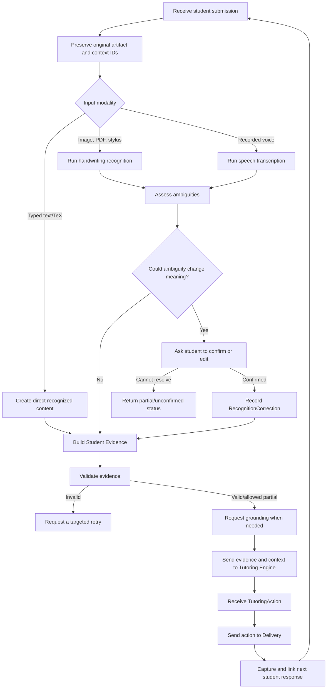

# Student Interaction and Evidence Module

**Status:** Draft V0.1 for review  
**Primary owner:** Jonathan  
**Related specifications:** [Architecture](architecture.md), [Shared Interfaces](interfaces.md)

## 1. Purpose

The Student Interaction and Evidence module is the entry and return point for each tutoring turn. It captures student input, routes it through the appropriate recognition path, confirms meaning-changing ambiguity, and produces validated `StudentEvidence` for the Learner State/Tutoring Engine.

It also coordinates the handoffs around a turn: receiving Course Context / Question Schema, requesting course grounding when required, forwarding evidence, receiving a `TutoringAction`, sending it to Delivery, and linking the student's next response to the action that prompted it.

## 2. Responsibilities

The module owns:

- Accepting supported student input and preserving the original submission.
- Assigning session, question, turn, attempt, and submission identifiers.
- Selecting the recognition path for the input modality.
- Preserving raw recognition separately from corrected or confirmed content.
- Detecting and presenting recognition ambiguity.
- Asking the student to confirm ambiguity that could change mathematical or instructional meaning.
- Building factual `StudentEvidence`.
- Linking initial attempts, revisions, explanations, clarifications, and follow-up responses.
- Validating records before downstream handoff.
- Coordinating the tutoring-turn sequence and recording its status.
- Applying the configured logging and raw-artifact retention choices.

The module does not own:

- Determining whether a student's mathematics is correct.
- Diagnosing misconceptions, prerequisites, or mastery.
- Selecting a hint, explanation, retry, comprehension check, or transfer problem.
- Ranking course passages or inventing citations.
- Changing an approved Tutoring Action's pedagogical purpose.

Those responsibilities belong to the Tutoring Engine, Retrieval, and Delivery components as described in `architecture.md`.

## 3. V1 modality decision

### Recommended scope

| Modality | V1 decision | Simplification |
|---|---|---|
| Typed text and TeX | Include | Accept plain text, Markdown, fenced code, inline TeX, and display TeX. |
| Handwritten image/PDF upload | Include | Process bounded image or PDF submissions through one handwriting-recognition path. |
| Direct stylus/sketchpad | Include | Export the canvas to an image and reuse the handwriting-upload path. |
| Voice | Include recorded speech only | Record a bounded audio clip, transcribe it, and let the student edit/confirm the text. |
| Continuous real-time voice | Defer | Requires streaming recognition, interruption handling, and real-time state synchronization. |
| Live video/avatar Office Hours | Defer | Depends on stable tutoring and delivery contracts plus real-time infrastructure. |

### Rationale

This V1 supports the main ways a student expresses mathematical work while limiting recognition to two asynchronous pipelines: visual handwriting recognition and recorded speech transcription. Typed input provides the lowest-risk baseline. Stylus input reuses the visual path instead of creating a separate evidence format. Continuous conversation, video analysis, and an animated avatar should follow after the complete tutoring loop is reliable.

## 4. Dependencies

### Required

- `CourseContext` and a display-safe `QuestionSchema` subset from Course Context/Ingestion.
- Session/identity service for stable identifiers and authorization.
- Shared schema validation from `interfaces.md`.
- Artifact storage for original input and permitted derived artifacts.
- Learner State/Tutoring Engine endpoint.
- Delivery endpoint.
- Logging configuration and retention policy.

### Required by enabled modality

- Handwriting/image preprocessing and recognition provider.
- PDF page rendering for handwritten PDFs.
- Browser canvas export for direct stylus input.
- Audio capture plus one recorded-speech transcription provider.

### Optional

- Symbolic parser/checker for detecting differences between recognition candidates. It may flag ambiguity but may not correct the student's mathematics.
- Cost calculator when provider usage and rate data are available.
- Human-review queue for unresolved high-impact recognition.

## 5. Inputs

| Input | Producer | Required behavior |
|---|---|---|
| Raw student input | Student/client | Preserve as `StudentSubmission.original_artifact_ref` before recognition. |
| Course Context and Question Schema | Ovunc's component | Validate course/question/version identifiers. Interaction may read only the display-safe fields listed in section 14. |
| Recognition response | Selected recognizer | Store best candidate, alternatives, ambiguity regions, provenance, and status. |
| Student confirmation/edit | Student through Delivery/UI | Create `RecognitionCorrection`; never overwrite the original output. |
| Grounding result | Sean's retrieval component | Preserve passage IDs, page/line references, version, and status. |
| Learner State and Tutoring Action | Tutoring Engine | Route the action without changing its pedagogical meaning. |
| Delivery result | Yining's delivery layer | Record what was presented and which response modalities are available. |
| Logging configuration | Session/system configuration | Apply logging and retention settings before provider calls and persistence. |

## 6. Outputs

| Output | Consumer | Purpose |
|---|---|---|
| `StudentSubmission` | Recognition, evidence builder, operational state | Immutable record of what the student submitted. |
| `RecognitionResult` | Confirmation UI and evidence builder | Raw/best interpretation plus uncertainty. |
| `RecognitionCorrection` | Evidence builder and trace | Auditable raw-to-confirmed change. |
| `StudentEvidence` | Learner State/Tutoring Engine | Validated factual evidence for interpretation. |
| `RetrievalRequest` | Retrieval | Request course support for the current turn if Interaction owns routing. |
| Grounded-turn package/reference set | Tutoring Engine | Evidence plus context and `GroundingBundle` references. |
| `InteractionTraceEvent` | Session state/diagnostics | Operational continuity and optional diagnostic detail. |
| Narrow confirmation or retry prompt | Delivery | Ask only for information needed to continue safely. |

The canonical field definitions are in `interfaces.md`.

## 7. Main functions

These names are conceptual and may become service methods, functions, or endpoints.

| Function | Receives | Returns | Expected behavior |
|---|---|---|---|
| `capture_submission` | Client payload and context refs | `StudentSubmission` | Validate modality/size/type, persist original input, and assign IDs. |
| `establish_question` | Confirmed student question or bank question ID | `QuestionSchema` reference | Use an existing bank schema or request a frozen runtime schema after recognition/confirmation. |
| `select_recognition_path` | `StudentSubmission` | Recognizer request | Use no recognizer for direct text; route visual and audio inputs appropriately. |
| `recognize_submission` | Submission/artifact reference | `RecognitionResult` | Preserve observed work and expose alternatives/uncertainty. |
| `assess_ambiguity` | Recognition result and question context | Confirmation decision | Identify whether uncertainty could change mathematical or instructional meaning. |
| `request_confirmation` | Ambiguous regions/candidates | Confirmation action | Ask a narrow, editable question showing the relevant candidate(s). |
| `apply_recognition_correction` | Recognition result and confirmed edit | `RecognitionCorrection` | Preserve raw and corrected values and record whether meaning changed. |
| `build_student_evidence` | Submission, recognition/corrections, links | `StudentEvidence` | Build factual evidence without diagnosing correctness or mastery. |
| `validate_evidence` | `StudentEvidence` | Validation result | Check required IDs, provenance, link integrity, and unresolved ambiguity. |
| `request_grounding` | Question/evidence/context | `RetrievalRequest` | Request relevant support without exposing unnecessary student history. |
| `route_tutoring_turn` | Valid evidence and context refs | Handoff/result status | Send records in the agreed order and handle structured failures/timeouts. |
| `record_delivery` | `TutoringAction` and `DeliveryResult` | Trace event | Link what was selected to what was actually presented. |
| `link_follow_up` | New submission and prior action/attempt | Updated relationship fields | Preserve the sequence of assistance, response, and revision. |

## 8. Student interaction and evidence workflow



The diagram shows the response path after a question has been established. A student-originated question first follows the same capture, recognition, and confirmation steps with `submission_role = question_intake`. Interaction then requests a runtime `QuestionSchema`, receives its `question_id`, creates an attempt, and begins the response path. Question intake is not itself `StudentEvidence` about the student's understanding.

## 9. Recognition behavior by modality

### 9.1 Typed text and TeX

- Preserve exactly what the student typed.
- Parse Markdown/code/TeX only for display and structure.
- Keep source text separate from rendered output.
- A TeX parse failure should show the source and ask the student to edit it; it must not guess a replacement expression.
- Do not send typed content through handwriting or speech recognition.

### 9.2 Handwritten image or PDF

- Preserve the uploaded file.
- Record page count and which pages were processed.
- Preprocessing may rotate, crop, deskew, or improve contrast, but the original remains unchanged.
- Recognition should preserve line order, crossed-out work when identifiable, and the student's mathematical errors.
- For multi-page input, evidence must retain page/region references for each recognized step.
- If resource limits prevent complete processing, return `partial` and identify unprocessed pages.

### 9.3 Direct stylus input

- Preserve the final canvas export.
- When practical, also preserve stroke data as optional diagnostic or future recognition input.
- Treat the exported image as `handwriting_upload` for recognition while retaining `stylus_canvas` as the original modality.
- Canvas clearing or replacement requires a user action; recognition must not alter the drawing.

### 9.4 Recorded voice

- V1 accepts one bounded recording per submission.
- Transcribe speech into editable text.
- Mathematical phrases should remain literal when uncertain; for example, the system should expose whether “x two” means `x_2` or `x^2`.
- The student may review/edit the transcript before it becomes confirmed evidence.
- Real-time interruption, speaker diarization, continuous listening, and synthesized spoken responses are deferred.

## 10. Ambiguity and confirmation policy

### Confirmation is required when

- Two plausible interpretations produce different mathematical expressions or claims.
- A symbol, sign, exponent, subscript, decimal, inequality, delimiter, or negation is uncertain.
- Speech transcription changes mathematical structure or a key factual statement.
- A missing/extra line could alter the student's reasoning.
- The recognizer reports failure/partial output in a region needed for the current question.
- The student explicitly asks to review or correct the interpretation.

### Confirmation is usually unnecessary when

- The difference is whitespace, harmless TeX bracing, or another defined non-semantic normalization.
- Capitalization/punctuation differs in ordinary prose without changing meaning.
- A display-only transformation leaves the original source available and unchanged.
- An uncertain region is irrelevant to the current evidence and is clearly marked as unused.

### Confirmation interaction

The system should:

1. Show only the relevant region and current interpretation.
2. Offer a small number of candidates when available.
3. Always allow free-form correction.
4. State that it is confirming what was written, not asking the student to solve the problem again.
5. Record the selection/edit as `RecognitionCorrection`.

The system should not ask the student to confirm every recognized character. Confirmation must focus on meaning-changing uncertainty to control correction effort.

## 11. Recognition failure

| Condition | Evidence status | User-facing behavior | Downstream behavior |
|---|---|---|---|
| No usable content recognized | `invalid` / `recognition_failed` | Explain the issue and request a clearer/supported retry. | Do not send diagnostic evidence as if it were student work. |
| Some content recognized, missing region is not essential | `partial` | Show what was captured and disclose the missing region. | May continue if the Tutoring Engine accepts partial evidence for a clarification action. |
| Essential region remains ambiguous | `unconfirmed` | Ask for edit, resubmission, or alternate modality. | Block conclusions that depend on the region. |
| Recognition service unavailable | No new evidence | Preserve submission and offer retry/manual transcription. | Record recoverable provider failure if logging policy allows. |
| Unsupported file/audio | `invalid` | State supported types/limits and retain only according to policy. | Do not invoke Tutoring Engine. |

Failure messages should describe the recoverable problem without blaming the student or claiming their mathematics is wrong.

## 12. Student Evidence construction

### Evidence may contain

- Confirmed transcription or direct typed content.
- Observable ordered steps and final answer.
- Student-provided explanation.
- Student-stated uncertainty.
- References to prior help shown before the response.
- Unresolved recognition ambiguity.
- Links to original artifacts, recognition results, and corrections.

### Evidence must not contain

- Inferred mastery.
- A diagnosed misconception presented as fact.
- A corrected answer substituted for student work.
- Hidden model reasoning.
- A course claim without a source when grounding is required.

### Attempts and revisions

- An `attempt_id` groups work aimed at answering the same question before the team-defined attempt boundary.
- A question-intake submission has no `attempt_id` until the runtime Question Schema has been created.
- A revision creates a new submission and new evidence record.
- `parent_submission_id` and `parent_evidence_id` point to the work being revised or followed up.
- `response_to_action_id` records which hint/question/explanation prompted the new response.
- Earlier evidence is immutable and remains available to the Tutoring Engine.
- A new attempt should be created when the configured tutoring workflow declares a retry/new attempt, not merely because the student sends another message.

## 13. Sample evidence cases

### 13.1 Direct typed response

Student types:

> I used the product rule: `\frac{d}{dx}[x\sin x]=\sin x+x\cos x`. I am not sure whether I needed another term.

Expected behavior:

- Preserve the exact text.
- Create evidence with the equation, explanation, and explicit uncertainty.
- Do not ask for recognition confirmation.
- Do not label the answer correct; send it to the Tutoring Engine.

### 13.2 Ambiguous handwriting

Recognizer returns:

- Candidate A: `x_1 + x_2 = 1`
- Candidate B: `x_l + x_2 = l`

Expected behavior:

- Mark the subscript/right side as meaning-changing ambiguity.
- Show the image crop and candidate interpretation.
- Ask the student to confirm or edit.
- Preserve the raw candidates.
- Create confirmed evidence only after confirmation; otherwise produce `unconfirmed` evidence and restrict downstream interpretation.

### 13.3 Student's incorrect mathematics

The student writes:

```text
d/dx[x^2] = x
```

Expected behavior:

- Transcribe `d/dx[x^2] = x` exactly.
- Do not replace it with `2x`.
- Let the Tutoring Engine assess the work and choose an action.

### 13.4 Voice ambiguity

Transcript contains “x two plus one.”

Expected behavior:

- Present likely interpretations such as `x_2 + 1` and `x^2 + 1`.
- Ask the student which was intended.
- Record the answer as a correction tied to the raw transcript.

## 14. Integration contracts

### From Course Context/Ingestion

Interaction requires:

- A valid `course_id`.
- For an assigned/bank question: `question_id`, `prompt`, `question_type`, `expected_response_modes`, `concept_ids`, `learning_objectives`, and applicable `constraints`.
- For a student-originated question: `build_question_schema(course_id, confirmed_question)`, followed by the same display-safe fields from the frozen runtime schema.
- The Course Context version and Question Schema `built_from` reference needed for traceability.

Interaction must not receive or inspect `correct_approach`, `alternative_approaches`, `reference_answer`, `rubric`, or misconception cues. Those fields are restricted to the Tutoring Engine so recognition and evidence construction cannot be biased toward the expected solution.

For a bank question, these fields are available before the first answer submission. For a student-originated handwritten or spoken question, Interaction first captures and confirms the question with `submission_role = question_intake`; `question_id` may remain null until Ovunc's builder returns the runtime `QuestionSchema`. Answer evidence is not created until that ID exists.

### With Course Knowledge Retrieval

Interaction may send `RetrievalRequest` and receives `GroundingBundle`. The team must decide whether Interaction sends the final request or merely sends Student Evidence to the Tutoring Engine, which then requests retrieval.

Regardless of ownership:

- Retrieval returns passage-level results, not a whole source as the citation.
- Every used passage includes document/content version, page, line range, and `highlight_url`.
- `no_support_found` is a valid result and must remain visible downstream.

Sean should confirm supported filters, query fields, ranking metadata, and line/highlight feasibility.

### With Learner State/Tutoring Engine

Interaction sends:

- Valid or explicitly allowed partial `StudentEvidence`.
- `CourseContext`/`QuestionSchema` references and versions.
- `GroundingBundle` reference if the agreed routing sequence retrieves first.
- Prior action/evidence links needed for the current turn.

Interaction receives:

- Updated `LearnerState` reference/status.
- One structured `TutoringAction` or structured failure.

The Tutoring Engine owns correctness judgments, diagnosis, gap identification, and action selection.

### With Delivery

Interaction sends:

- `TutoringAction` unchanged in pedagogical meaning.
- Session and available-channel information.
- A narrow recognition-confirmation action when required.

Interaction receives:

- `DeliveryResult` describing what was actually presented.
- The student's next response as a new submission.
- A structured failure if the requested presentation is unsupported.

Delivery may adapt layout, speech, avatar behavior, or accessibility presentation within the action's allowed representations.

## 15. Logging and observability

### Configuration

The module reads `LoggingConfiguration` before processing. It must support:

- Diagnostic logging on/off.
- Raw-artifact retention on/off.
- Retention and redaction policy identifiers.
- Cost tracking on/off.

### Required operational records

Even with diagnostic logging off, retain the minimum records needed to continue safely:

- Active session/question/turn identifiers.
- Submission and evidence references.
- Confirmed content needed by the current tutoring loop.
- Parent/attempt/action links.
- Record/schema versions and processing status.

### Optional diagnostic records

When enabled, capture:

- Raw provider output and alternatives.
- Recognition ambiguity and confidence information.
- Every raw-to-corrected value with correction type and actor.
- Preprocessing operations.
- Provider/model version, latency, usage, and estimated cost when possible.
- Routing, retry, timeout, and downstream failure events.

### Correction metrics

The trace should make these later measurements possible:

- Percentage of submissions requiring confirmation.
- Number and type of corrections per submission.
- Whether corrections changed meaning.
- Student time/turns spent correcting recognition.
- Failure rates by modality/provider.

## 16. Expected behavior and invariants

1. Every `StudentEvidence` record links to an immutable original submission.
2. Raw recognition and corrected content are distinguishable.
3. A meaning-changing automated correction cannot become confirmed evidence without student or human confirmation.
4. Student Evidence never contains mastery or misconception labels.
5. Revisions append new evidence rather than overwrite earlier attempts.
6. A downstream action can be traced to the evidence and context versions used.
7. Logging-off behavior is testable and does not silently persist optional diagnostic payloads.
8. Recognition failure never becomes fabricated student evidence.
9. Course citations resolve to page/line locations and a highlightable passage.
10. The module exposes structured failures rather than relying only on user-facing error text.

## 17. V1 acceptance scenarios

| Scenario | Expected result |
|---|---|
| Student submits typed text and TeX | Evidence is created without recognition and retains original source. |
| Student uploads clear one-page handwritten work | Recognition is shown/accepted and evidence preserves page/region order. |
| Handwriting contains an ambiguous exponent/subscript | Student confirms a focused candidate before semantic use. |
| Student handwriting contains a mathematically wrong step | Wrong step is preserved exactly for Tutoring Engine review. |
| Student draws in the sketchpad | Canvas export follows the same evidence path as handwriting upload. |
| Student records one mathematical question | Editable transcript is produced; mathematical ambiguity is confirmed. |
| Student revises after a hint | New evidence links to prior evidence and the hint action. |
| Retrieval finds no support | Turn carries `no_support_found`; no citation is invented. |
| Diagnostic logging is disabled | Tutoring continues, but raw provider payloads and optional telemetry are not retained. |

## 18. Deferred work

- Streaming speech and interruption.
- Live camera/video analysis.
- Animated avatar and real-time Office Hours.
- Collaborative whiteboards.
- Automatic recognition-provider selection.
- Long-term learner modeling across courses.
- Production retention, consent, and institutional policy implementation.

## 19. Open questions for team review

1. Should Interaction or the Tutoring Engine own `RetrievalRequest` generation?
2. Will the runtime Question Schema builder accept confirmed recognized questions, or only directly typed text?
3. What passage and filter fields does Sean require for useful retrieval?
4. Does every handwriting/voice transcript require a review screen, or only meaning-changing ambiguity?
5. Who defines the threshold/policy for allowing partial evidence into the Tutoring Engine?
6. When does a revision become a new `attempt_id` rather than another submission in the same attempt?
7. Should recognition confirmation be represented as a `TutoringAction` or as an Interaction-owned system action?
8. Which original artifacts may be deleted immediately when raw retention is disabled?
9. What is the minimum operational session state and retention period?
10. Which component verifies that Delivery preserved the Tutoring Action's mathematical meaning?

## 20. Requested review

### Ovunc

- Confirm that Interaction receives only the display-safe Question Schema subset in section 14.
- Confirm how `build_question_schema` accepts a recognized-and-confirmed handwritten or spoken question.
- Coordinate source versions and page/line mappings with Retrieval before lecture-note/textbook grounding.

### Sean

- Verify retrieval request fields and grounding outputs.
- Confirm what student evidence summary is useful and privacy-minimal.
- Propose V1 behavior for `highlight_url` and `no_support_found`.

### Team

- Resolve the open ownership questions.
- Check that each input/output has one producer and at least one consumer.
- Walk through the four V1 modalities and one failed recognition.
- Approve or revise the V1 modality scope before implementation.
